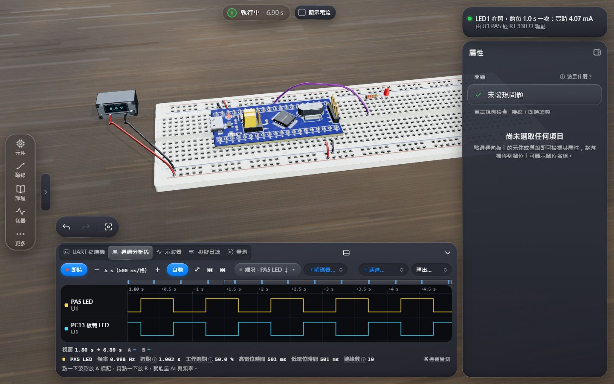

# ohmlet embedded lab

**Hardware, without the hardware.**

[繁體中文](README.md) · [User guide (zh-TW)](docs/user-guide.md) · [Firmware guide (zh-TW)](docs/firmware-guide.md) · [Developer guide (zh-TW)](docs/developer-guide.md) · [Support matrix (zh-TW)](docs/support-matrix.md) · [Architecture](ARCHITECTURE.md) · [Changelog](CHANGELOG.md)

ohmlet is a **3D breadboard circuit simulator** that runs in the browser. This project extends it into an
**embedded-systems learning lab**: an STM32F103C8 "Blue Pill" board executes **real firmware** built with STM32CubeIDE,
instruction by instruction, while its GPIO, timers, UART, I²C, SPI, ADC and DMA run in lockstep with the circuit solver on one
virtual clock. A UART terminal, a logic analyzer with protocol decoders, an oscilloscope, multimeters, an electrical rule checker,
guided lessons that are accepted by the real simulation and a library of ready-to-run examples complete the lab.
The interface is in Traditional Chinese (Taiwan) by default; English is one switch away (More → Settings → Interface language, or `?lang=en`).



## Highlights

- **Real firmware.** A TypeScript ARMv7-M (Cortex-M3) core executes the machine code in ELF / BIN / HEX images; the STM32F103
  peripherals follow RM0008 and are validated with firmware built from ST's HAL v1.1.9. The CPU is differentially tested against
  vectors generated with Unicorn (a development-time oracle, never shipped).
- **Mixed-signal simulation.** The analog MNA solver, a logic-net layer and the MCU advance in deterministic virtual time with
  cycle-exact pin edges; I²C, SPI, UART and 1-Wire travel bit by bit over the wires, so a missing pull-up or swapped SDA/SCL shows
  the same symptoms as on a bench.
- **Instruments.** UART terminal (typed text reaches the MCU as real UART frames on its RX pin, like through a USB-TTL
  adapter, so the logic analyzer sees and decodes it; it never fights a module that already drives that pin), 16-channel logic analyzer (UART / I²C / SPI / 1-Wire decoders, triggers, a decoded-results
  table, VCD / CSV export), 4-channel oscilloscope (auto setup, triggers, cursors, measurements), multimeters and a Readings tab.
- **95 parts**, each labelled with its support level (51 fully simulated, 43 partially, 1 visual only) and an explicit
  "simulated / not modeled" list.
- **One Problems panel** for the electrical rule checker (13 rules), runtime issues and the MCU's state — every row says why, how
  to fix it, and can be shown on the board.
- **A circuit you can see working.** Tick *Show current* and particles flow along the wires with the solver's real currents;
  LED brightness is I ÷ 20 mA with clearly different steps, an overloaded LED burns out, an overheating resistor discolours and smokes,
  a reversed electrolytic vents, and a working circuit gets a success cue and sound (can be turned off). Wires colour themselves
  (supply red, ground black, signals by function), deleting needs no confirmation (Undo instead), and buttons can be kept pressed.
- **23 guided lessons** (7 beginner, 8 intermediate, 8 advanced) and **38 examples** (30 with bundled firmware).
- **Project files** (`.ohmlet.json`) carry the circuit, every board's firmware (embedded, SHA-256 verified), instrument setup
  and panel layout.
- **Honest.** What is not simulated is labelled as such: unsupported peripherals read 0 and log every access, and a reading that
  cannot be trusted shows "—" rather than a number.

## Quick start

Node.js 20 or newer (22 recommended):

```sh
npm install
npm run dev          # http://localhost:5173
npm run build        # production build into dist/
npm run typecheck
npm test
```

Desktop windows ≥ 1100 px with a mouse or trackpad get the workspace (library, inspector, instrument tray); phones and tablets
use the bottom dock.

## First five minutes

1. The first-run tour ends with **Start lesson 1** or **See an example first: Blue Pill blinking LED**; an empty board offers the
   same choices.
2. The run **capsule** at the top centre is the run control. In the workspace (and in the Chinese interface) a circuit on the board
   simulates by itself and re-simulates after every edit — no Run press: click the capsule (or press Space) to pause; editing parts
   or wires, or **Resume running**, carries on; long-press to reset. The English phone layout (the classic chrome) keeps the manual
   run: click the capsule (or press Space) to run, again to pause. While no board can run it says why ("Running · U1 has no power"
   in red, "Running · U1 has no firmware yet" in orange).
3. The **status pill** under it always says what is wrong or what to do next, with a one-click fix (e.g. "U1 has no firmware yet
   → Load firmware…"). When you paused it reads "Simulation paused — editing parts or wires resumes it" next to **Resume running**;
   a circuit that has not run yet (e.g. after a reset while paused) reads "Circuit ready (Space)" next to a Run simulation button.
4. With nothing selected, the inspector shows **Problems**: rule-check findings, runtime issues and MCU states, graded
   error / risk / hint, each with its cause, its fix and "Show on the board".
5. The **instrument tray** has UART Terminal, Logic Analyzer, Oscilloscope, Simulation Log and Readings. Right-click (long-press on
   a phone) any pin, hole or terminal in 3D to add it to the logic analyzer or place a scope probe.

## Loading STM32CubeIDE firmware

1. Create an STM32CubeIDE project for **STM32F103C8Tx**, set `SYS → Debug` to **Serial Wire**, `RCC → HSE` to **Crystal/Ceramic
   Resonator** and the clock tree to 72 MHz (HSE 8 MHz × PLL 9, APB1 ÷2).
2. Build: the image is `<project>/Debug/<project>.elf`.
3. Place a "STM32F103C8T6 Blue Pill" board, power it, then drop the `.elf` onto the 3D view (or the board's firmware card), or use
   the board's Firmware tab → "Choose a file on this computer…". In Edge / Chrome a file chosen that way can be reloaded, and
   "Reload when the file changes" re-reads it once a second after you rebuild.
4. In the workspace the simulation runs by itself once the firmware is loaded; in the classic chrome press ▶ Run simulation.

ELF is preferred (addresses and symbols: the debugger names the functions of PC and LR). A raw `.bin` has no addresses: it loads at
**0x08000000** by default, and any other address is flagged because the vector table must be there — no bootloader is simulated.
Without your own build, **Choose built-in firmware** lists the 76 bundled images (74 firmware projects), with the open lesson's
firmware first. `HAL_Delay(n)` waits n + 1 ticks, as on silicon.

## Support summary and known limits

The generated [support matrix](docs/support-matrix.md) (zh-TW, checked against the code by a test) lists every peripheral, part,
lesson, example and rule-check rule. STM32F103C8: 30 blocks — **verified** GPIO, EXTI, IWDG; **partial** memory map, RCC, FLASH,
AFIO, PWR, DBGMCU, BKP, CRC, WWDG, USART1–3, TIM1–4, I2C1–2, SPI1–2, ADC1–2, DMA1; **unsupported** USB, CAN, RTC and the USB/CAN SRAM.

Known limits: one MCU model (STM32F103C8); no USB, CAN, RTC or system-memory bootloader (BOOT0 = 1); zero-wait-state memory
(flash wait states and bus contention are not modeled, peripheral timing is exact); Stop / Standby approximated by Sleep; no CSS or
MCO; asynchronous USART only; no SMBus; no dual-ADC mode; no semihosting; the debugger halts, steps, resumes, resets and shows
registers and fault causes but has no breakpoint, memory or clock-tree view; switches and encoders have no contact bounce; the far
side of USB / Bluetooth / Wi-Fi / CAN / IR / ultrasound modules is virtual or not modeled (see each part's "not modeled" list); the
upstream behavioural logic ICs update once per 50 µs analog step; the upstream AI circuit assistant builds circuits only and needs
your own Anthropic API key.

## Architecture

React + three.js UI → zustand stores → a `SimHost` (Web Worker) → the simulation coordinator (deterministic virtual time) running
the upstream MNA solver, the STM32F103 SoC on the Cortex-M3 core, the logic-net layer with digital device models, and the
recorders behind the instruments. See [ARCHITECTURE.md](ARCHITECTURE.md).

## Testing

```sh
npm test                 # all vitest suites (CPU, peripherals, coordinator, parts, real firmware, lessons, examples, ERC, UX contracts, i18n, docs)
npm run test:firmware    # every firmware project's machine-checkable 'checks' contract
npm run test:docs        # the support matrix, the quoted figures and UI texts stay in sync with the code
npm run test:visual      # visual regression (Playwright; needs a running server)
npm run audit:i18n       # "fully Chinese" UI audit (Playwright)
npm run test:e2e         # 12-step acceptance walkthrough in a real browser
```

CI: [.github/workflows/ci.yml](.github/workflows/ci.yml) — typecheck, tests and build on Ubuntu and Windows with Node 20 and 22;
optional manual jobs rebuild the firmware with LLVM 21 to check `firmware/dist` is reproducible and run the browser checks.

## Credits and licenses

- **ohmlet** — MIT License © 2026 JENW1N (upstream [JENW1N/ohmlet](https://github.com/JENW1N/ohmlet)); this extension stays MIT, see [LICENSE](LICENSE).
- **ST STM32CubeF1 HAL** v1.1.9 (BSD-3-Clause), **CMSIS Device F1** v4.3.5 and **CMSIS Core** v5.9.0 (Apache-2.0), **FreeRTOS Kernel**
  V11.1.0 (MIT): fetched at pinned tags into `firmware/vendor/` only to build the example firmware (`npm run fw:vendor`), never
  committed; the prebuilt images in `firmware/dist/` contain their object code — see [docs/third-party-notices.md](docs/third-party-notices.md).
- **Unicorn Engine** (GPL-2.0) is a development-time oracle for the CPU tests (`tools/cpu-oracle/`); only the vectors it generated are
  committed; it is never bundled, distributed or linked.
- **Poly Haven** HDRI `studio_small_03` (CC0) lights the Enhanced render mode.
- Runtime npm dependencies (React, three.js, three-gpu-pathtracer, three-mesh-bvh, zustand, Anthropic SDK) are MIT-licensed.
- STM32 and STM32CubeIDE are trademarks of STMicroelectronics; this project is not affiliated with STMicroelectronics or Arm.
