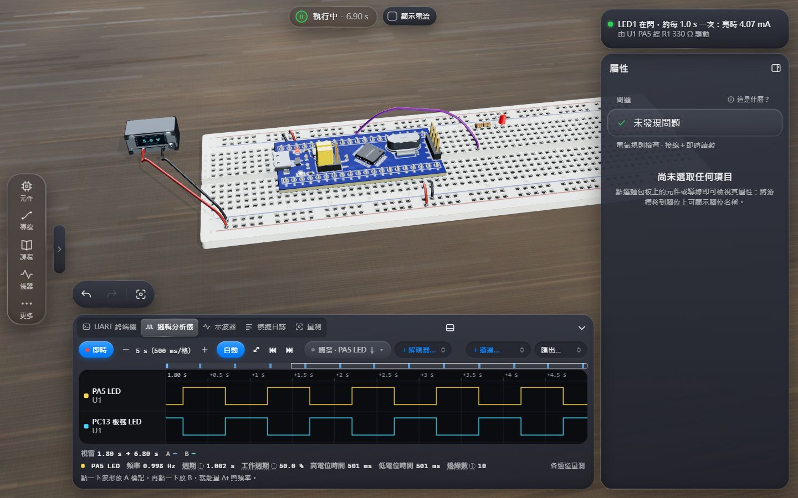
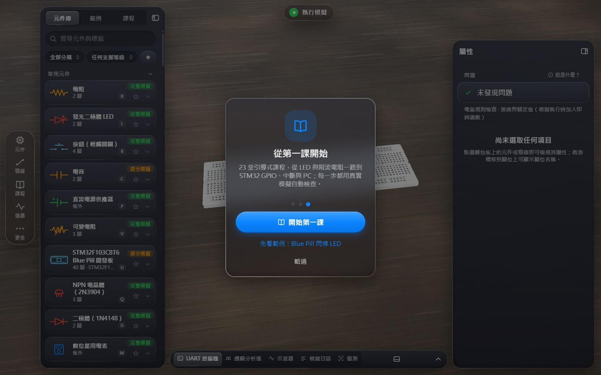
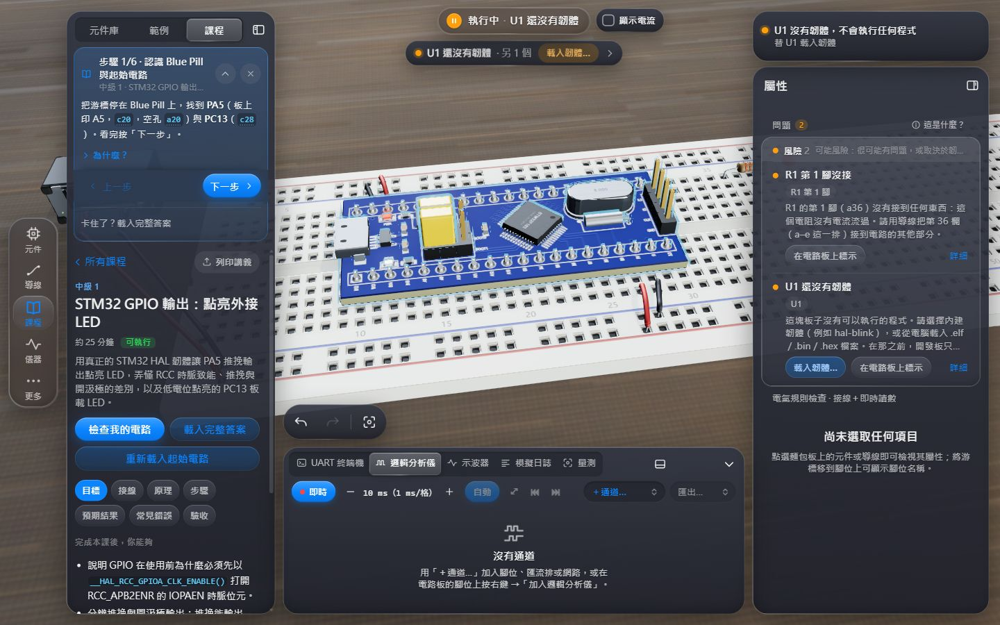
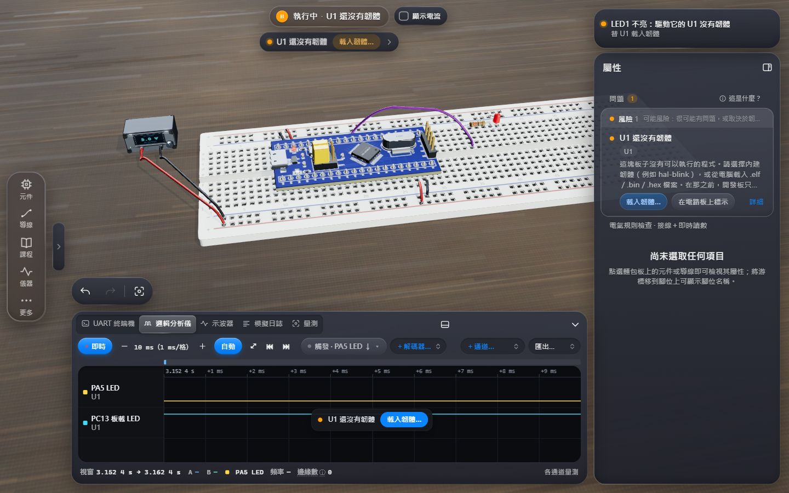
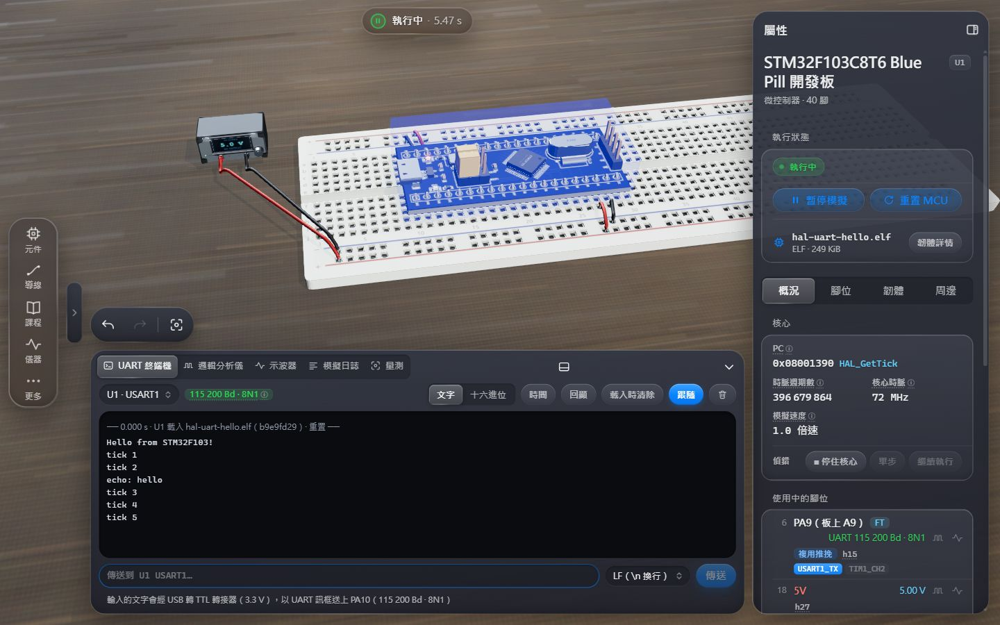
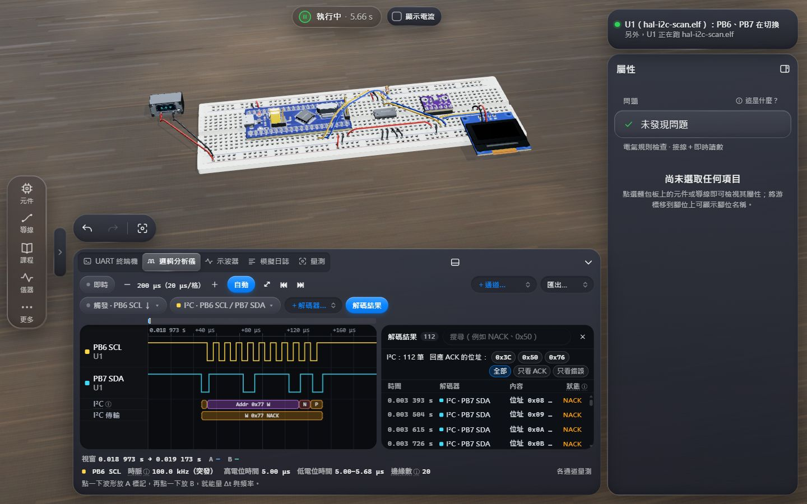
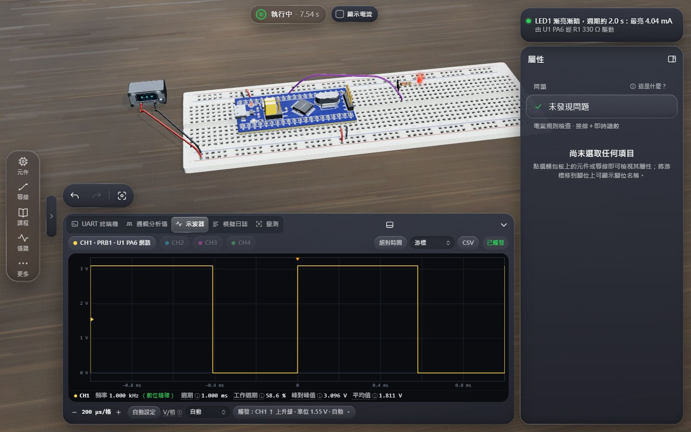
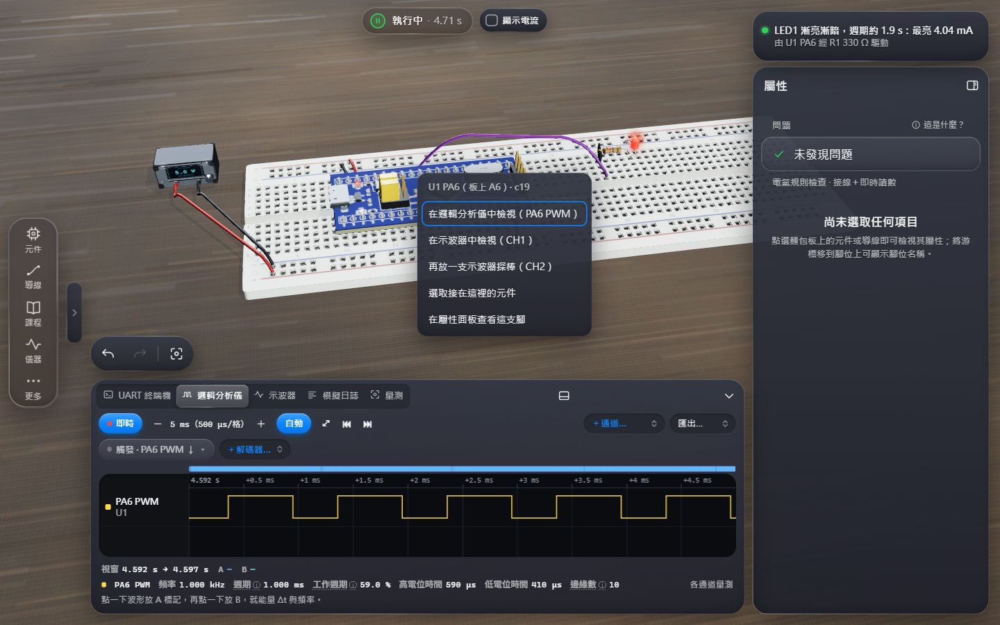
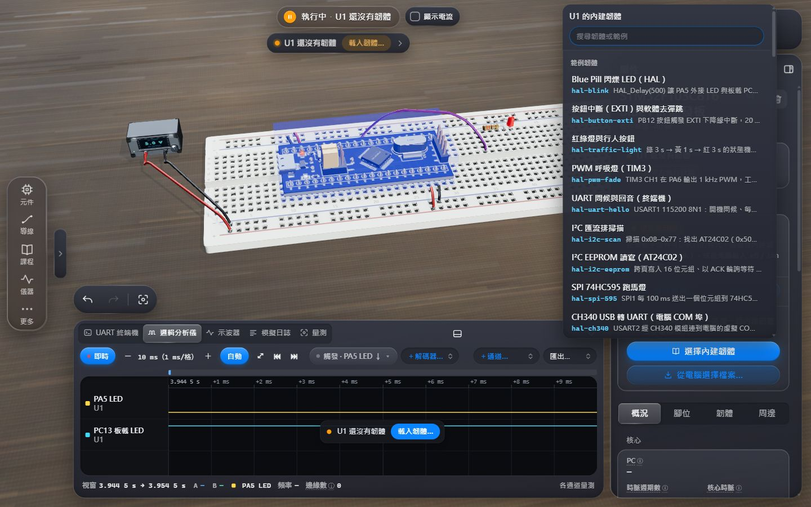

# ohmlet 嵌入式實驗室

**不用硬體，也能做硬體。**

[English](README.en.md) · [使用手冊](docs/user-guide.md) · [韌體指南](docs/firmware-guide.md) · [開發者指南](docs/developer-guide.md) · [模擬支援矩陣](docs/support-matrix.md) · [變更紀錄](CHANGELOG.md)

ohmlet 是在瀏覽器中執行的 **3D 麵包板電路模擬器**。本專案在它的基礎上擴充成**嵌入式系統學習實驗室**：
STM32F103C8「Blue Pill」開發板會逐條指令執行你用 STM32CubeIDE 建置的**真實韌體**，GPIO、計時器、UART、I²C、SPI、ADC、DMA
與電路求解器在同一個虛擬時鐘下同步運作；再搭配 UART 終端機、邏輯分析儀與協定解碼器、示波器、萬用電表、電氣規則檢查，
以及用真實模擬自動驗收的引導式課程與現成範例。整個介面使用台灣繁體中文。



## 特色

- **真實韌體，不是動畫。** 以 TypeScript 寫成的 Cortex-M3（ARMv7-M）核心執行 ELF／BIN／HEX 映像檔中的機器碼，
  STM32F103 的周邊依參考手冊 RM0008 實作；以 ST 官方 HAL v1.1.9 編譯的韌體驗證，CPU 另以 Unicorn 產生的參考向量做差分測試。
- **混合訊號模擬。** 類比求解器（MNA）、邏輯網路層與 MCU 在確定性的虛擬時間中 lockstep：腳位邊緣具週期精度，
  I²C、SPI、UART、1-Wire 以位元層級經過導線傳遞——少了上拉電阻、SDA／SCL 接反，就會看到和實驗桌上一樣的症狀。
- **實驗室儀器。** UART 終端機（收發；輸入的文字以真實的 UART 訊框經 RX 腳送進 MCU）、16 通道邏輯分析儀（UART／I²C／SPI／1-Wire 解碼、觸發、解碼結果表、VCD／CSV 匯出）、
  四通道示波器（自動設定、觸發、游標、自動量測）、數位萬用電表，以及常駐的「量測」分頁。
- **95 種元件。** 被動元件、半導體、邏輯 IC、顯示器（SSD1306、LCD1602、ST7735、MAX7219、WS2812B、TM1637…）、
  感測器（MPU-6050、BME280、DHT22、DS18B20、HC-SR04…）、通訊模組（CH340、HC-05、MAX485、W25Q32…）、馬達與驅動器；
  每個元件都標示**支援等級**（完整模擬 51、部分模擬 43、僅視覺接線 1）與「已模擬／未模擬」清單。
- **一個「問題」面板。** 電氣規則檢查（13 條規則：短路、LED 沒有限流、GPIO 過電壓、浮接輸入、I²C 缺上拉…）、
  模擬中發現的問題與 MCU 狀態集中在一處，每一則都寫出原因、修法與「在電路板上標示」。
- **看得見的電路狀態。** 勾選「顯示電流」，光點會依求解器算出的真實電流沿導線流動。LED 以額定 20 mA 為 100 %，亮度有明顯差別；
  過載的 LED 會燒毀，過熱的電阻會變色冒煙，反接的電解電容會爆開；按〔換新〕或改好電路，就在原位換上新的。右上角的「電路說明」用一兩行白話說明電路現在在做什麼、為什麼。
  電路正常運作時有成功提示；插拔元件、接線、按鈕、開關與繼電器都有機械音效（可關閉）。
  導線依電源（紅）、地（黑）、訊號自動上色；刪除不必再確認，可以〔復原〕；按鈕可以「保持按下」。
- **少按幾下。** 改了就自動模擬，不用按執行；從孔位直接拖曳就能接線，不必切到導線模式；Ctrl+C／Ctrl+V（Mac：⌘C／⌘V）連同參數複製元件；常用元件按一個字母就拿起來（R 電阻、C 電容、L LED、P 電源供應器、B 按鈕……）；
  元件庫依一般電子實驗的使用頻率排列，最上面是「常用元件」。
- **課程與範例。** 23 堂引導式課程（初級 7、中級 8、進階 8），驗收直接執行模擬量測；38 個開啟即可執行的範例（其中 30 個內含韌體）。
- **專案檔。** 電路、每塊開發板的韌體（內嵌並以 SHA-256 驗證）、儀器設定與面板配置存成一個 `.ohmlet.json`。
- **誠實。** 沒有模擬的功能一律明確標示：不支援的周邊讀為 0 並在日誌記錄每次存取，量不準時寧可顯示「—」也不給假數字。

## 快速開始

需求：Node.js 20 以上（建議 22）。

```sh
npm install
npm run dev
```

用瀏覽器開啟 <http://localhost:5173>（建議 Edge 或 Chrome）。介面預設為繁體中文，可在「更多 → 設定 → 介面語言」切換成 English。
視窗寬度 ≥ 1100 px 且使用滑鼠或觸控板時，會出現有元件庫、屬性面板與儀器匣的**桌面工作區**；手機與平板使用底部工具列。

其他指令：

```sh
npm run build        # 正式版建置到 dist/
npm run preview      # 在本機預覽建置結果
npm run typecheck    # tsc --noEmit
npm test             # vitest：全部測試
```

## 五分鐘導覽

以下照第一次打開時實際會走的路徑說明，每一步都是畫面上看得到的按鈕。

**1. 導覽卡。** 第一次打開會出現 3 張導覽卡（這是 STM32 電子實驗室 → 看看四周：怎麼旋轉、縮放、平移與拖曳接線 → 從第一課開始）。
最後一張有兩條路：**開始第一課**，或**先看範例：Blue Pill 閃爍 LED**。之後麵包板是空的時候，畫面中央的「從哪裡開始？」卡片也提供同樣的選擇。



**2. 打開範例或課程。** 「先看範例」會載入接好線的 Blue Pill、LED 與電源，把 hal-blink 韌體燒進開發板並自動開始模擬；
課程則在左側的「課程」分頁打開，並在面板上方顯示**引導卡**：每一步一句說明、一顆動作按鈕（例如「拿一顆電阻」「載入 hal-blink 到 U1」「把 PA5、PC13 加到邏輯分析儀」）。
接線不必先切到導線模式：用滑鼠從一個孔位拖到另一個孔位就接上一條導線（手機與平板：長按孔位約半秒再拖曳）；
選取元件後按 Ctrl+C（Mac：⌘C）、Ctrl+V（Mac：⌘V）就能連同參數複製一份。



**3. 自動模擬。** 電路一放上麵包板就開始模擬，改了就自動重新模擬，不用按執行。畫面上方中央的**膠囊**顯示狀態：
按一下（或空白鍵）暫停，改動接線或元件、或按〔繼續執行〕就繼續；長按可重置。
執行時它顯示「執行中 · 模擬時間」，電腦跑不上即時速度時會誠實加上「0.8 倍速」這類標示；
開發板沒有在動時直接寫出原因，例如「執行中 · U1 沒有供電」（紅）或「執行中 · U1 還沒有韌體」（橘）。

**4. 狀態提示列。** 膠囊下方的提示列永遠回答「現在哪裡不對、下一步做什麼」，並附一顆修正按鈕。
例如開發板還沒有韌體時，它寫「U1 還沒有韌體」並提供「載入韌體…」；元件燒毀時寫出是哪一顆並提供〔換新〕，按一下就在原位換上新的（改好電路或數值時也會自動換新）。
你暫停時寫「模擬已暫停——改動接線或元件就會自動繼續」並附〔繼續執行〕；暫停後重置、還沒執行時則寫「電路已就緒（空白鍵）」，旁邊就是〔執行模擬〕按鈕。
右上角的**電路說明**再用一兩行白話說明電路現在在做什麼、為什麼，例如「LED1 亮著：亮度 49 %（9.70 mA）」「由 5.00 V 經 R1 330 Ω 供電」（手機上寫在提示列）。



**5. 問題面板。** 沒有選取任何東西時，右側「屬性」面板最上方是**問題**：電氣規則檢查、模擬中的問題與 MCU 狀態都在這裡，
依「錯誤／風險／提示」分級，每一則寫出原因與修法，按「在電路板上標示」就會在 3D 中框出相關元件。
下圖是新手最常犯的錯：LED 直接接在 PA5 上，沒有限流電阻。


**6. 儀器。** 下方的儀器匣有 **UART 終端機、邏輯分析儀、示波器、模擬日誌、量測** 五個分頁。範例會自動打開它用到的儀器；
在 3D 畫面的任何腳位、孔位或端子上按右鍵（手機：長按），可以直接「加入邏輯分析儀」或「放示波器探棒」；
選取導線或開發板時，屬性面板的「網路」與腳位列也有同樣的按鈕。
在 UART 終端機輸入的文字會像接了 USB 轉 TTL 轉接器一樣，以真實的 UART 訊框送上 MCU 的 RX 腳（例如 PA10），邏輯分析儀量得到、解碼器解得出；
RX 腳已經接著別的輸出（例如 CH340 模組的 TXD）時，終端機不會和它衝突，而是說明並提供「改用 CH1 的 COM 埠」。

| | |
|---|---|
|  |  |
| **UART 終端機**：hal-uart-hello 的輸出與回音（輸入的 hello 以 UART 訊框送上 PA10）；右側是 MCU 的執行狀態、PC 所在函式、週期數、核心時脈 | **邏輯分析儀**：hal-i2c-scan 在 PB6／PB7 上的 I²C 流量，解碼結果表有摘要（回應 ACK 的位址）、狀態篩選與搜尋（例如 `NACK`、`0x50`） |
|  |  |
| **示波器**：「自動設定」後的 PA6 PWM，頻率標「數位精確」、週期、工作週期、峰對峰值、平均值；觸發寫在一個晶片上 | **探測選單**：在 3D 的腳位上按右鍵，一步加到邏輯分析儀或示波器；已經在量的點改成「在…中檢視」 |

完整操作請看[使用手冊](docs/user-guide.md)。

## 載入 STM32CubeIDE 韌體

1. 在 STM32CubeIDE 建立專案，晶片選 **STM32F103C8Tx**；`SYS → Debug` 設為 **Serial Wire**；`RCC → HSE` 設為 **Crystal/Ceramic Resonator**；
   時脈樹設為 72 MHz（HSE 8 MHz × PLL 9，APB1 ÷2）。
2. `Project → Build Project`，映像檔在 `<專案>/Debug/<專案>.elf`。
3. 在 ohmlet 放置「STM32F103C8T6 Blue Pill 開發板」並接上電源，然後用下列任一方式載入：
   - 把 `.elf` **拖到 3D 畫面上**（放開時會說明要載入到哪一塊開發板），或拖到開發板「屬性」面板的韌體卡片上；
   - 選取開發板 →「韌體」分頁 →「從電腦選擇檔案…」。在 Edge／Chrome 中這樣選的檔案可以按「重新載入」，
     或打開「檔案變更時自動重新載入」——在 CubeIDE 重新建置後，模擬器每秒檢查一次並自動換上新的映像檔。
4. 載入後模擬會自動執行（開發板通電重置、從頭跑你的程式；暫停中也一樣）。

- **建議用 ELF**：檔案內含載入位址與符號表（偵錯器會把 PC 與 LR 對應到函式名稱）。Intel HEX 也帶有位址。
- **原始 `.bin` 沒有位址**，載入時會請你確認燒錄位址，預設 **0x08000000**（主快閃記憶體起點）。
  其他位址會被警告：向量表必須位於 0x08000000，連結在開機載入程式偏移位址（例如 0x08002000）的映像檔無法啟動——沒有模擬任何開機載入程式。
- **內建韌體選擇器**：不必自己建置也能開始。開發板沒有韌體時按「選擇內建韌體」，從隨附的 76 個韌體映像檔（74 個韌體專案，其中一個另有兩種最佳化等級的版本）中搜尋；
  課程正在用的韌體排在最前面（「本課使用」），用來重現常見錯誤的版本標示「錯誤示範」。
- `HAL_Delay(n)` 會等待 n + 1 個 tick（HAL 的行為），所以 `HAL_Delay(500)` 的閃爍半週期是 501 ms。



時脈設定、腳位對照、哪些 HAL 功能可用、偵錯方式、FreeRTOS，以及如何用本專案的 clang 工具鏈建置範例韌體，請看[韌體指南](docs/firmware-guide.md)。

## 模擬支援摘要與已知限制

完整、由程式碼自動產生的清單在 [**模擬支援矩陣**](docs/support-matrix.md)（測試會在它與程式碼不一致時失敗）。摘要：

| 狀態 | STM32F103C8 周邊（共 30 個區塊） |
|---|---|
| **已驗證**（功能完整且有真實韌體整合測試） | GPIO、EXTI、IWDG |
| **部分**（已實作與沒有實作的都寫在說明中） | 記憶體映射、RCC、FLASH、AFIO、PWR、DBGMCU、BKP、CRC、WWDG、USART1–3、TIM1–4、I2C1–2、SPI1–2、ADC1–2、DMA1 |
| **不支援**（讀為 0、忽略寫入、每次存取都記錄） | **USB、CAN、RTC**、USB/CAN 共用 SRAM |

元件的支援等級分為「完整模擬」「部分模擬」「僅視覺接線」「開發中」，顯示在元件庫卡片與屬性面板上；
課程分為「可執行」「部分模擬」「尚不可執行」（目前 20 堂可執行、3 堂部分模擬，說明寫在課程卡片上）。

已知限制（都可以在程式碼與支援矩陣中查到）：

- **只模擬 STM32F103C8（Blue Pill）一種 MCU。**
- **沒有 USB、CAN、RTC**；沒有 ST 系統記憶體開機載入程式（BOOT0 = 1 時 MCU 狀態顯示「系統記憶體開機（未模擬）」）。
- **沒有模擬快閃記憶體等待週期與匯流排競爭**：CPU 週期依 Cortex-M3 TRM 近似，純計算的迴圈會比 72 MHz、2 個等待週期的實機稍快；
  計時器、UART、I²C／SPI 時脈與 SysTick 等周邊時序則依設定的時脈精確計算。
- 停止模式與待機模式以睡眠模式近似；不模擬時脈安全系統（CSS）與 MCO 輸出。
- USART 只有非同步模式（沒有同步、LIN、IrDA、智慧卡、半雙工、硬體流量控制）；I²C 沒有 SMBus；ADC 沒有雙 ADC 模式。
- **不支援半主機（semihosting）**：`printf` 請經由 `_write()` 轉到 UART。
- 偵錯器可以停住、單步、繼續、重置並查看暫存器與錯誤原因，但介面**沒有中斷點、記憶體檢視器與時脈樹檢視**。
- 模擬時間是虛擬時間：電腦跑不動時膠囊會顯示低於 1 的倍速，但韌體看到的時間與波形不受影響。
- 按鈕、開關與旋轉編碼器是理想接點，沒有接點彈跳（相關課程以韌體行為契約的刺激脈衝驗證去彈跳）。
- 無線與 USB 的另一端是虛擬的：CH340 的電腦 COM 埠、HC-05 的手機序列埠、ESP-01 沒有網路、TJA1050 只是收發器（沒有 bxCAN）、
  紅外線光學與超音波傳播不模擬（各元件的「未模擬」清單有完整說明）。
- 上游的行為式邏輯 IC（74xx／CD40xx）每個類比步階（50 µs）計算一次，沒有更短的傳播延遲。
- AI 電路助手（上游功能）只產生電路，不產生韌體；需要自備 Anthropic API 金鑰。

## 架構概觀

```
介面（React + three.js）── store（zustand）── SimHost（Web Worker）── 模擬協調器（確定性虛擬時間）
  ├ 桌面工作區：元件庫／範例／課程、屬性與問題、儀器匣         ├─ 類比求解器（MNA，上游；含稀疏 LU 快速路徑）
  ├ 狀態膠囊、狀態提示列、引導卡                               ├─ STM32F103 SoC ← Cortex-M3 核心
  └ 3D 場景（麵包板、元件、導線路由、標示）                     ├─ 邏輯網路層 + 數位裝置（感測器、顯示器、模組）
                                                               └─ 記錄器（示波器、邏輯分析儀、UART、日誌）
```

- `src/mcu/`：Cortex-M3 核心、STM32F103 SoC 與周邊、ELF／BIN／HEX 載入器。
- `src/sim/coordinator/`：lockstep 協調器、MCU 開發板電氣轉接、記錄器、韌體行為契約執行器；`src/sim/digital/`：邏輯網路與數位裝置；`src/sim/erc/`：電氣規則檢查。
- `src/model/parts/`、`src/sim/models/`、`src/three/meshes/ext/`：元件家族以外掛方式加入目錄、模擬模型與 3D 模型。
- `src/ui/`：殼層（`chrome/`）、桌面工作區（`workspace/`）、屬性與問題（`embedded/`）、儀器（`embedded/instruments/`）、課程（`lessons/`）；`src/instruments/`：解碼、量測與統一的單位格式；`src/i18n/`：介面語言。
- `src/lessons/`：課程與驗收引擎；`examples/embedded/`：範例庫；`firmware/`：韌體專案與建置系統。

細節請看[開發者指南](docs/developer-guide.md)與英文的 [ARCHITECTURE.md](ARCHITECTURE.md)。

## 測試

```sh
npm test                 # 全部 vitest 測試：CPU、周邊、協調器、元件模型、真實韌體、課程、範例、ERC、UX 契約、i18n、文件
npm run test:firmware    # 逐一執行每個韌體專案的 checks 行為契約
npm run test:docs        # 文件：支援矩陣與程式碼一致、連結與錨點有效、用語、數字與引用的介面文字與程式碼一致
npm run typecheck
```

需要瀏覽器的檢查使用 Playwright（預設用 Edge，`VR_CHANNEL=bundled` 改用 Playwright 內附的 Chromium），
請另外啟動一個伺服器（有其他人同時編輯時請用關閉熱重載的伺服器）：

```sh
npm run test:visual      # 視覺回歸：英文經典外觀的舊場景必須 0 差異，各領域另有場景
npm run audit:i18n       # 介面全中文稽核：未翻譯的英文必須為 0
npm run test:e2e         # 端對端驗收：在真實瀏覽器中走完 12 個驗收步驟
```

最近一次端對端驗收的報告在 [`docs/acceptance/`](docs/acceptance/README.md)，使用者體驗審查在 [`docs/ux/`](docs/ux/UX_VERIFY.md)。
CI（[`.github/workflows/ci.yml`](.github/workflows/ci.yml)）在 Ubuntu 與 Windows、Node 20／22 上執行型別檢查、測試與建置；
韌體可重現性與瀏覽器檢查是手動觸發的選用工作，見[開發者指南 §13](docs/developer-guide.md#13-持續整合ci)。

## 文件

| 文件 | 內容 |
|---|---|
| [使用手冊](docs/user-guide.md) | 放置、接線、執行、狀態膠囊與提示列、問題面板、韌體、偵錯器、儀器、探測、ERC、課程、範例、專案、快速鍵 |
| [韌體指南](docs/firmware-guide.md) | STM32CubeIDE → ELF → 模擬器的完整流程、時脈與腳位、HAL 支援、FreeRTOS、clang 建置、`checks` 契約 |
| [開發者指南](docs/developer-guide.md) | 架構、如何新增元件／周邊／裝置模型／課程／範例／字典、共用 UX 輔助函式與用語表、測試策略、CI |
| [模擬支援矩陣](docs/support-matrix.md) | 每個周邊、元件、課程、範例與 ERC 規則的模擬程度（由程式碼產生） |
| [CHANGELOG.md](CHANGELOG.md) | 各階段、兩輪 UX 改版、發布前 QA 與收尾的變更摘要 |
| [ARCHITECTURE.md](ARCHITECTURE.md)、[DESIGN.md](DESIGN.md) | 架構（英文）、Liquid Glass 視覺設計規格（英文） |
| [ARCHITECTURE_REVIEW.md](ARCHITECTURE_REVIEW.md) | Phase 0 架構審查與 MCU 引擎評估 |
| [firmware/README.md](firmware/README.md) | 韌體專案、工具鏈與行為契約的完整定義（英文） |
| [第三方授權聲明](docs/third-party-notices.md) | 隨附韌體映像檔中的 ST HAL、CMSIS、FreeRTOS 授權條款 |

## 致謝與授權

- **ohmlet** — MIT License © 2026 JENW1N（上游專案 [JENW1N/ohmlet](https://github.com/JENW1N/ohmlet)）。本專案的擴充沿用 MIT，見 [LICENSE](LICENSE)。
- **ST STM32CubeF1 HAL**（`stm32f1xx_hal_driver` v1.1.9，BSD-3-Clause）、**CMSIS Device F1**（v4.3.5，Apache-2.0）、**CMSIS Core**（v5.9.0，Apache-2.0）、
  **FreeRTOS Kernel**（V11.1.0，MIT）：只在建置範例韌體時由 `npm run fw:vendor` 依固定版本下載到 `firmware/vendor/`，**原始碼不入庫**；
  `firmware/dist/` 中建置好的映像檔包含這些程式庫的目的碼，授權條款全文見 [docs/third-party-notices.md](docs/third-party-notices.md)。
- **Unicorn Engine**（GPL-2.0）只在開發期當作 CPU 差分測試的參考答案（`tools/cpu-oracle/`），入庫的只有它產生的測試向量資料；**從不打包、散佈或連結**。
- **Poly Haven** 的 HDRI `studio_small_03`（CC0）用於「增強」算繪模式的環境光。
- 執行期的 npm 相依套件（React、three.js、three-gpu-pathtracer、three-mesh-bvh、zustand、Anthropic SDK）皆為 MIT 授權。
- STM32、STM32CubeIDE 為 STMicroelectronics 的商標；本專案與 STMicroelectronics、Arm 沒有任何關係。
