# 首次發佈驗收報告（端對端）

> 本報告由 `node scripts/acceptance-e2e.mjs --runs 3` 自動產生：在真正的瀏覽器（Playwright + msedge，1440 × 900，滑鼠）中，以繁體中文介面與桌面工作區，透過使用者實際使用的介面完成使用者訂定的十二個驗收步驟。每一步都以模擬的實際狀態判定（應用程式與實驗室狀態、韌體 SHA-256、MCU 狀態 / PC / 週期數、求解器的 LED 亮度遙測、UART 緩衝、邏輯分析儀記錄器的邊緣時間），截圖只是佐證。

- 產生時間：2026-10-19T18:46:05.615Z
- 受測網址：http://localhost:5330/（專案自帶的 Vite 開發伺服器，關閉熱更新；自動化掛鉤 `?e2e` 只讀取狀態，不改變任何行為；`?shotrig` 只用來把滑鼠點擊對準 3D 孔位）
- 韌體：`firmware/dist/lab-acceptance.elf`（SHA-256 `63d2defbc788a0456ec7d28d22fab35c6e5e0dc10e75aca0fb9b0ca515c43072`），以 clang + ST HAL v1.1.9 建置，原始碼在 `firmware/projects/lab-acceptance/`
- 總結：**全部通過（3 次連續執行皆通過）**

## 結果摘要

| 步驟 | 驗收項目 | 第 1 次 | 第 2 次 | 第 3 次 |
| --- | --- | --- | --- | --- |
| 1 | 建立新專案 | 通過（2.4 s） | 通過（2.4 s） | 通過（2.4 s） |
| 2 | 放入 STM32F103C8T6 Blue Pill | 通過（2.1 s） | 通過（2.1 s） | 通過（2.1 s） |
| 3 | 放入麵包板元件：電阻、LED、按鈕與電源 | 通過（7.4 s） | 通過（7.6 s） | 通過（7.5 s） |
| 4 | 透過視覺化介面接線 | 通過（14.7 s） | 通過（14.7 s） | 通過（14.7 s） |
| 5 | 載入真正的 STM32F103 ELF 韌體 | 通過（1.2 s） | 通過（1.2 s） | 通過（1.3 s） |
| 6 | 按下執行 | 通過（0.2 s） | 通過（0.2 s） | 通過（0.3 s） |
| 7 | MCU 模擬引擎開始執行韌體 | 通過（2.7 s） | 通過（2.5 s） | 通過（2.7 s） |
| 8 | LED 根據韌體與接線狀態亮滅 | 通過（5.3 s） | 通過（5.1 s） | 通過（5.3 s） |
| 9 | 按鈕能改變 GPIO 輸入 | 通過（9.7 s） | 通過（10.3 s） | 通過（10 s） |
| 10 | 使用虛擬儀器觀察訊號 | 通過（7.8 s） | 通過（7.1 s） | 通過（7.7 s） |
| 11 | 可以暫停、重置與重新執行 | 通過（10.2 s） | 通過（9.5 s） | 通過（11 s） |
| 12 | 儲存專案後能重新載入 | 通過（11.6 s） | 通過（11.6 s） | 通過（11.5 s） |
| — | 頁面錯誤（pageerror / console.error） | 無 | 無 | 無 |
| — | 模擬即時比（中位數） | 70 % | 73 % | 72 % |

## 執行環境與速度

模擬器以這台電腦當下能給的速度執行韌體：「即時比」是模擬時間 ÷ 實際時間（狀態膠囊與屬性面板「模擬速度」顯示的就是它）。因此每個需要模擬計算的等待都以**模擬時間**設定期限（例如按下按鈕後 1 s 模擬時間內必須輸出模式訊息、LED 每個相位 0.25 s），而不是實際時間；只有模擬時鐘真的停住（30 s 實際時間內完全沒有前進）才算失敗。電腦忙碌時驗收會跑得比較久，但判定標準不變。

| 項目 | 第 1 次 | 第 2 次 | 第 3 次 |
| --- | --- | --- | --- |
| 模擬即時比：中位數（最低 – 最高） | 70 %（36 – 104 %） | 73 %（44 – 103 %） | 72 %（39 – 104 %） |
| CPU 校準：單執行緒整數迴圈（百萬次 / s，越大表示電腦越空閒） | 開始 115 · 模擬中 119 · 結束 118 | 開始 122 · 模擬中 121 · 結束 109 | 開始 124 · 模擬中 123 · 結束 115 |
| 頁面載入（含重新整理） | 5.5 s / 1.3 s | 2 s / 1.3 s | 1.9 s / 1.3 s |
| 按下執行到第一個執行中畫格 | 0.3 s | 0.2 s | 0.2 s |

即時比若隨 CPU 校準一起下降，是這台電腦當時忙碌（例如同時有其他瀏覽器在跑 3D 場景），不是模擬器在上一次執行後留下了東西：每一次執行都是全新的瀏覽器環境，關閉後不留下任何程序。

## 測試電路

| 元件 | 位置 | 說明 |
| --- | --- | --- |
| STM32F103C8T6 Blue Pill（U1） | 第 1 腳 PB12 在 h10 | PA5 = c20、5V = h27、GND = h28、PB12 = h10 |
| 電阻 R1，330 Ω | b33 – b37 | PA5 的限流電阻 |
| LED LED1（紅色） | 陽極 e37、陰極 f37 | 跨越中央溝槽 |
| 按鈕 SW1 | A1 在 f45 | A 側接 PB12，B 側接地；不需外接電阻（內部上拉） |
| 工作台電源 PS1 | 板外 | 5 V，接下方電源軌 |

| 導線 | 顏色 | 用途 |
| --- | --- | --- |
| PS1:+ → bot+0 | 紅色 | 電源 + → 下方紅色電源軌 |
| PS1:- → bot-0 | 黑色 | 電源 − → 下方藍色接地軌 |
| j27 → bot+21 | 紅色 | Blue Pill 5V（h27）→ +5 V 電源軌 |
| j28 → bot-22 | 黑色 | Blue Pill GND（h28）→ 接地軌 |
| a20 → a33 | 黃色 | PA5（c20）→ 電阻 R1 |
| j37 → bot-29 | 黑色 | LED 陰極 → 接地軌 |
| j10 → j45 | 藍色 | PB12（h10）→ 按鈕 A 側 |
| j47 → bot-37 | 黑色 | 按鈕 B 側 → 接地軌 |

韌體行為（`lab-acceptance`）：72 MHz；開機輸出 `boot ok` 與 `mode=0 blink 2 Hz`；PA5 依模式 0 → 1 → 2 → 3 為 2 Hz 閃爍 / 5 Hz 閃爍 / 恆亮 / 熄滅，按鈕（PB12，EXTI 下降緣，30 ms 去彈跳）切換模式並由 USART1 115200 8N1 回報；PC13 板載 LED 每秒亮 50 ms 作為心跳。所有時序都在 SysTick 中斷內完成，與 UART 輸出無關。

## 逐步紀錄（第 3 次執行）

### 1. 建立新專案 — 通過

- 啟動時麵包板上有前一次工作階段留下的電路：8 個元件、6 條導線（examples/blinky-555.json）。
- 透過「更多 → 清空麵包板 → 確認」建立新專案：元件 0、導線 0、韌體綁定 0，模擬停止、時間 0 s。

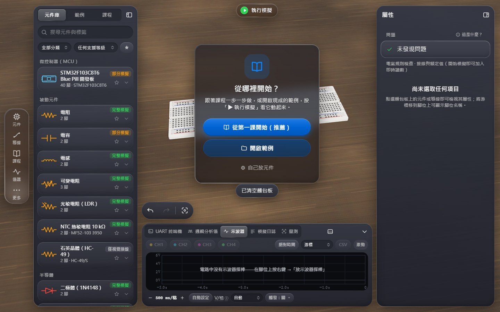

*新專案：空白麵包板（桌面工作區，繁體中文介面）*

### 2. 放入 STM32F103C8T6 Blue Pill — 通過

- 在元件庫搜尋並點選「STM32F103C8T6 Blue Pill 開發板」卡片 → 進入放置模式（stm32_bluepill）。
- 點擊麵包板孔位 h10（3D 場景中的實際孔位）→ 新元件 U1（stm32_bluepill），第 1 腳 PB12 位於 h10；放置後自動選取，屬性面板顯示該開發板。

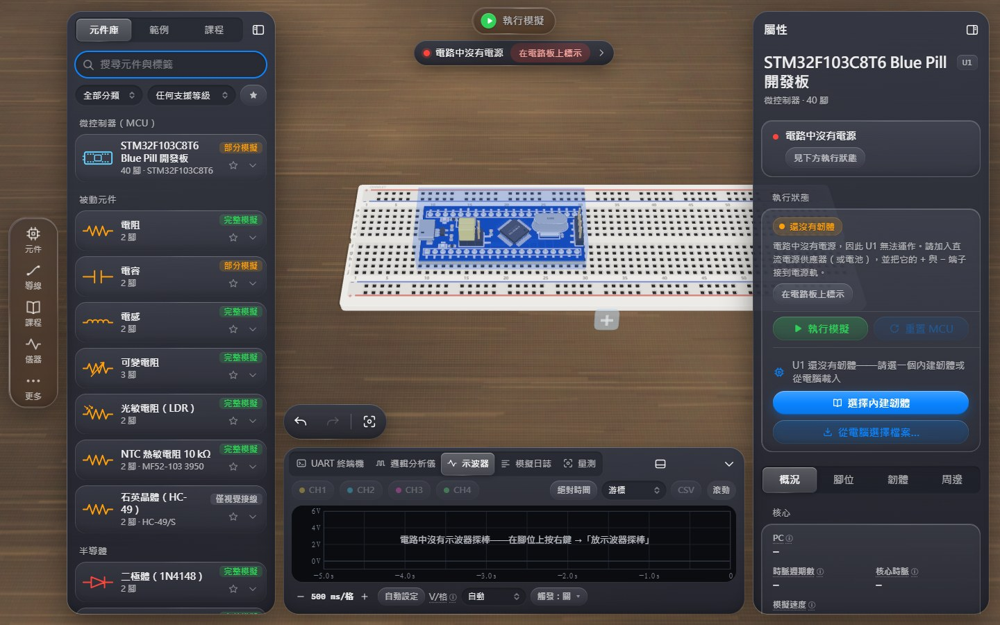

*Blue Pill 放在麵包板上（右側屬性面板顯示韌體與執行區塊）*

### 3. 放入麵包板元件：電阻、LED、按鈕與電源 — 通過

- 「電阻」R1：b33 – b37；「發光二極體 LED」LED1：陽極 e37、陰極 f37（跨越中央溝槽）；「按鈕（輕觸開關）」SW1：A1 位於 f45；「直流電源供應器」PS1：工作台電源（板外，預設 5 V）。
- 在 3D 場景點選 R1，於屬性面板的 E12 快速選值點「330 Ω」→ resistance = 330 Ω。

*五個元件就位：Blue Pill、電阻 330 Ω、LED、按鈕與工作台電源*

### 4. 透過視覺化介面接線 — 通過

- PS1:+ → bot+0（紅色）：電源 + → 下方紅色電源軌
- PS1:- → bot-0（黑色）：電源 − → 下方藍色接地軌
- j27 → bot+21（紅色）：Blue Pill 5V（h27）→ +5 V 電源軌
- j28 → bot-22（黑色）：Blue Pill GND（h28）→ 接地軌
- a20 → a33（黃色）：PA5（c20）→ 電阻 R1
- j37 → bot-29（黑色）：LED 陰極 → 接地軌
- j10 → j45（藍色）：PB12（h10）→ 按鈕 A 側
- j47 → bot-37（黑色）：按鈕 B 側 → 接地軌
- 共 8 條導線，全部以「導線」工具在 3D 麵包板上逐孔點擊完成，並以色票選擇導線顏色。

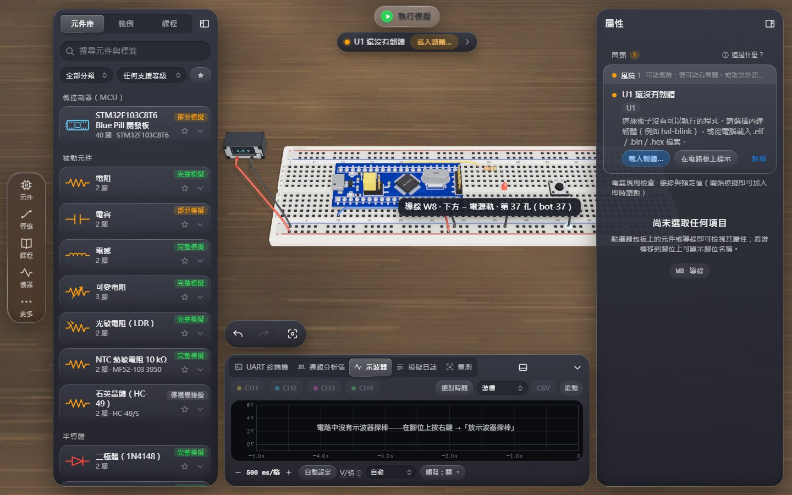

*接線完成：電源、5V/GND、PA5 → 330 Ω → LED → GND、PB12 → 按鈕 → GND*

### 5. 載入真正的 STM32F103 ELF 韌體 — 通過

- 在 3D 場景點選 U1，於屬性面板「韌體」區塊按「選擇檔案…」，經瀏覽器檔案選擇器選取 firmware/dist/lab-acceptance.elf。
- 綁定記錄：lab-acceptance.elf，格式 ELF，254436 位元組，SHA-256 63d2defbc788a0456ec7d28d22fab35c6e5e0dc10e75aca0fb9b0ca515c43072（與磁碟上的檔案一致）。
- 載入器描述：ELF32 ARM, EABI5, soft-float, Thumb entry 0x08001f55

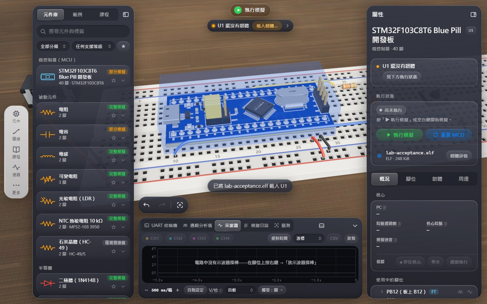

*屬性面板：韌體 lab-acceptance.elf 已載入（含 SHA-256）*

### 6. 按下執行 — 通過

- 按屬性面板「執行」區塊的「執行」按鈕 → 應用程式狀態 running = true，狀態膠囊顯示「執行中」，按鈕變為「暫停」。

### 7. MCU 模擬引擎開始執行韌體 — 通過

- 狀態徽章顯示「執行中」；模擬畫格中 U1 的 state = running、韌體 = lab-acceptance.elf。
- 模擬時間前進 1.856 s 期間，週期計數 9,633,697 → 143,265,696（+133,631,999），≈ 72 M 週期 / 模擬秒。
- PC 在 8 個不同位址間移動（例：0x080002A8、0x080002A0、0x080002A4、0x0800029E），全部位於快閃記憶體。
- 核心時脈 72 MHz（韌體 SystemClock_Config：HSE 8 MHz × PLL9）；即時比 81 %（模擬速度 / 實際時間；這 1 s 模擬時間用了實際 1.4 s，按下執行後 0.2 s 出現第一個執行中的畫格）。

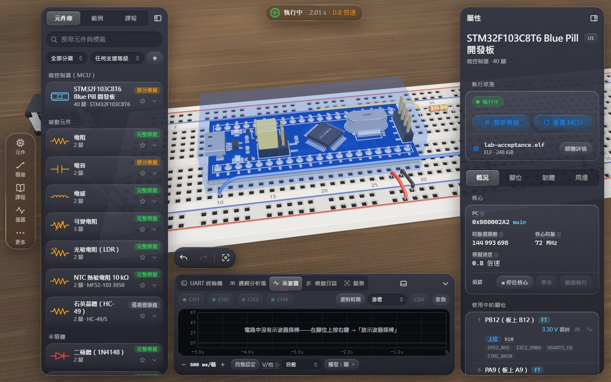

*執行中：狀態徽章、PC、週期數、核心時脈與即時比*

### 8. LED 根據韌體與接線狀態亮滅 — 通過

- 模擬 2.6 s 內 LED（LED1）亮度由求解器遙測逐畫格取樣：峰值 0.41（≈ 4.1 mA，滿亮度 = 10 mA），共 11 次亮滅轉換，半週期中位數 0.249 s → 2 Hz 閃爍（韌體 mode 0：250 ms 亮 / 250 ms 滅）。
- 目前 LED 電流 0 mA。
- 亮 / 滅截圖：在相位開始時以狀態膠囊暫停（閃爍半週期短於一次截圖所需時間），確認暫停畫格的 LED 遙測確實為亮 / 滅後才截圖，再繼續執行。

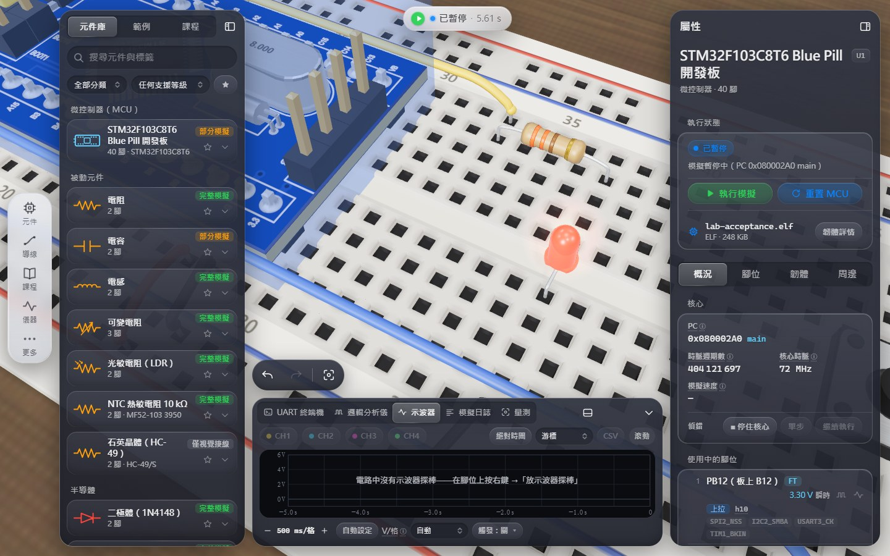

*LED 亮（2 Hz 閃爍的亮相位，暫停後截圖）*

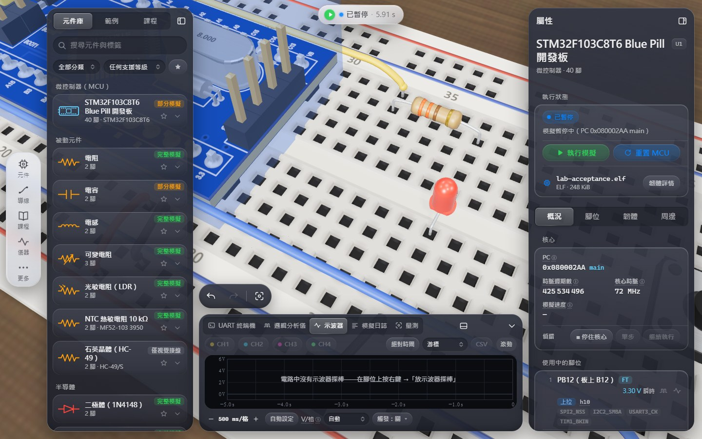

*LED 滅（2 Hz 閃爍的滅相位，暫停後截圖）*

### 9. 按鈕能改變 GPIO 輸入 — 通過

- 放開時 PB12 = 3.3 V（韌體設定的內部上拉）。
- 第 1 次直接在 3D 場景按住按鈕 SW1（模擬執行中，在按鈕上按住滑鼠就是按下、放開就是放開，同時會選取它）；之後改用屬性面板的「按住」大按鈕。
- 第 1 次按下：PB12 最低 0 V → 韌體經 EXTI12 去彈跳後輸出「mode=1 blink 5 Hz」，LED 半週期中位數 0.1 s（5 Hz，16 次轉換 / 1.6 s）。
- 第 2 次按下 →「mode=2 solid on」，31 個畫格中 LED 全部恆亮（亮度 0.41）。
- 第 3 次按下 →「mode=3 off」，46 個畫格中 LED 全部熄滅。
- 第 4 次按下 →「mode=0 blink 2 Hz」，LED 半週期中位數 0.248 s，回到 2 Hz。

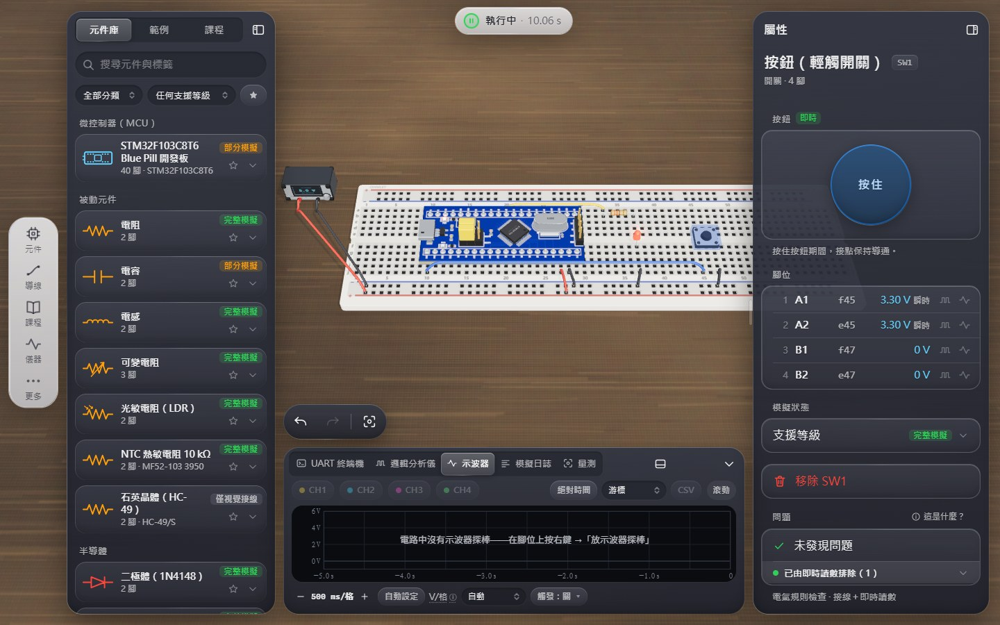

*mode 2：LED 恆亮（UART 終端機顯示模式切換訊息）*

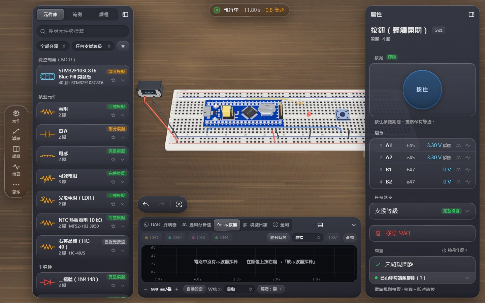

*mode 3：LED 熄滅*

### 10. 使用虛擬儀器觀察訊號 — 通過

- 邏輯分析儀（底部儀器列）以「新增通道」加入 U1 的 PA5、PC13、PB12、PA9，並縮放到每畫面 2 s。
- 記錄器在最近 2 s 內擷取 PA5 共 8 個邊緣，每個半週期 250 ms，最大偏差 0.03 µs（精確邊緣時間，非取樣）。
- PC13（板載 LED 心跳）低電位脈衝寬 50 ms（韌體：每秒亮 50 ms）。
- UART 終端機（U1 · USART1）顯示「boot ok」與四行模式訊息；線路設定標籤「115 200 Bd · 8N1」與模擬畫格中韌體寫入 USART_BRR / CR1 / CR2 的設定（115200 Bd、8 位元、無同位、1 停止位元）一致，並可點開「鮑率」名詞解釋。

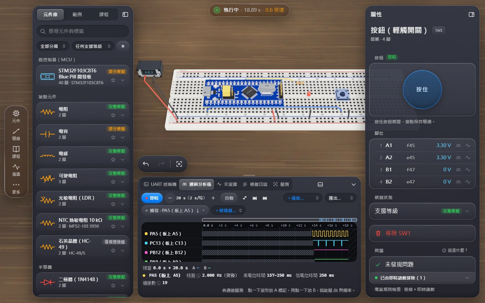

*邏輯分析儀：PA5 方波（2 Hz）、PC13 心跳、PB12、PA9（USART1 TX）*

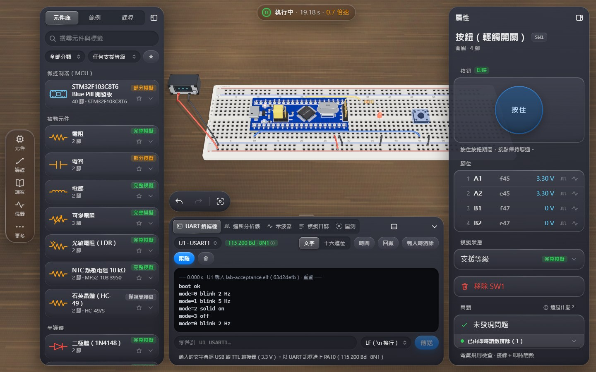

*UART 終端機：boot ok 與模式切換訊息，線路設定 115 200 Bd · 8N1*

### 11. 可以暫停、重置與重新執行 — 通過

- 點狀態膠囊暫停：running = false，0.8 s 內模擬時間停在 19.372 s、週期數停在 1,394,726,496，膠囊顯示「已暫停」。
- 「更多 → 重置模擬」：模擬時間歸零、UART 終端機緩衝清空（電源循環）。
- 再點狀態膠囊執行：韌體從頭開始，終端機重新出現「boot ok」「mode=0 blink 2 Hz」，LED 半週期 0.249 s（mode 0）。
- 先按一次按鈕進入 mode 1（終端機「mode=1 blink 5 Hz」），再按屬性面板「重置 MCU」（NRST 腳位重置：只重置核心，電路持續模擬）：日誌在 3.103 s 記錄「U1: reset」（模擬時間未歸零），韌體從重置向量重新開機，終端機再次出現「boot ok」「mode=0 blink 2 Hz」，LED 半週期 0.245 s——RAM 中的模式狀態已清除。

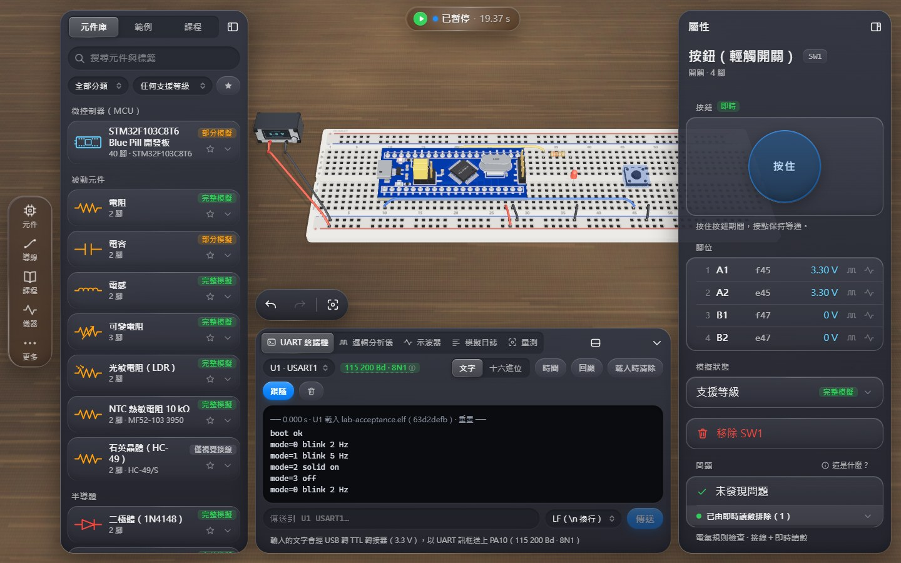

*已暫停：時間與週期數凍結*

### 12. 儲存專案後能重新載入 — 通過

- 「更多 → 儲存專案」觸發瀏覽器下載：circuit.ohmlet.json（342,161 位元組，format = ohmlet-project，formatVersion 1），內含電路（5 個元件、8 條導線）、1 個韌體（U1：lab-acceptance.elf，SHA-256 一致）與儀器設定。
- 清除這個瀏覽器的 localStorage（自動儲存的電路與韌體綁定）後重新整理頁面 → 空白麵包板、沒有韌體。
- 「更多 → 開啟專案…」經檔案選擇器選取剛下載的檔案 → 5 個元件、8 條導線與儲存前完全相同；U1 的韌體 lab-acceptance.elf 已重新綁定（SHA-256 一致）。
- 執行開啟的專案：MCU 執行中，終端機輸出「boot ok」「mode=0 blink 2 Hz」，LED 半週期 0.252 s（2 Hz）。

*重新整理後：瀏覽器儲存已清除，麵包板空白*

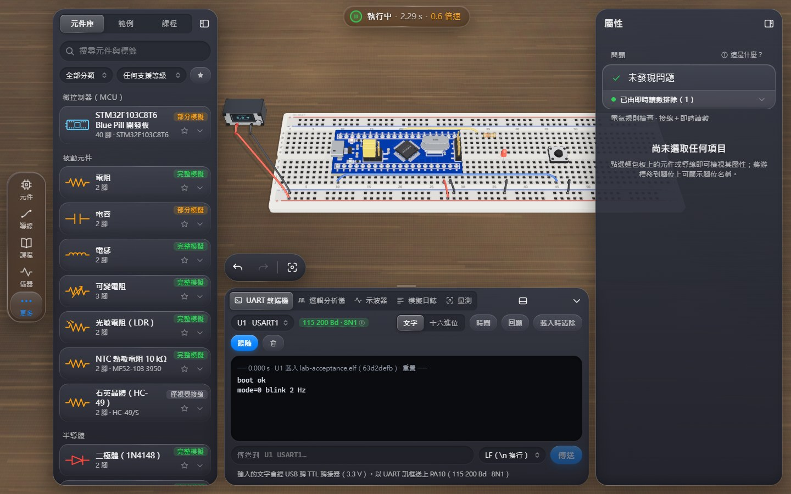

*開啟儲存的專案後再次執行：韌體仍綁定、LED 閃爍、終端機輸出*

## 驗收過程中發現與修正的問題

- **模組序列埠的字長**（已修正，`src/sim/models/comm.model.ts`）：CH340 的 COM 埠以 9600 8E1 開啟時，UART 終端機顯示成「9600 7E1」。原因是模組回報的傳輸參數把「資料位元數」當成 `UartLineConfig.dataBits`，而這個欄位與 STM32 的 USART_CR1.M 一樣是「含同位位元的字長」。現在 8 個資料位元 + 同位位元回報為 9 位元字長，終端機正確顯示 8E1（測試：`tests/uart-module-ports.test.ts`）。
- **UART 終端機在模組傳出任何位元組前看不到模組的序列埠**（已新增功能）：CH340 的「COM 埠（USB 轉 TTL）」與 HC-05 的「藍牙（已配對手機）」現在一進入模擬（第一個模擬畫格）就列在序列埠選單中，並顯示模組在腳位上使用的傳輸參數；之前要等到第一個位元組抵達才會出現。
- 十二個步驟本身沒有發現產品錯誤。觀察：屬性面板的「週期」是自上電起累計的核心週期數，「重置 MCU」（NRST）不會將它歸零；重置是否發生以韌體重新開機（UART「boot ok」）、日誌「U1: reset」與 RAM 中的模式狀態被清除來驗證。
- **發佈前分析（2026-10-19）：第 10 步「線路設定應為 115200 8N1」**——不是產品錯誤：UART 終端機的線路設定標籤改用全產品統一的鮑率格式「115 200 Bd · 8N1」（與邏輯分析儀通道、量測分頁相同），並可點開「鮑率」名詞解釋（ⓘ）。驗收仍檢查同一件事：標籤內容與模擬畫格中韌體寫入 USART1 的設定（115200 Bd、8 位元、無同位、1 停止位元）一致。
- **發佈前分析（2026-10-19）：第 2、3 次執行在第 8 步「逾時（20000 ms）：模擬時間前進 2.6 s」**——不是產品洩漏：狀態膠囊當時誠實顯示「0.06 倍速」。量測顯示模擬速度跟著整台電腦的忙碌程度走（同一段時間內單執行緒校準在 2–122 百萬次 / s 之間變動）：全新的瀏覽器第一次執行一樣慢；同一頁重新整理、同一頁連續開啟多個專案都只有一個模擬背景執行緒；每次執行關閉後瀏覽器不留下任何轉譯程序或 CPU 用量；不經瀏覽器、直接在 node 執行同一電路與韌體，同一段時間也一樣忽快忽慢（每 0.1 s 模擬時間花 0.17–40 s 實際時間）；慢的時候模擬背景執行緒處於「就緒」狀態（要執行卻分不到 CPU，只得到約 2 % 的 CPU 時間），而系統的處理器佇列同時有 100 個以上等著執行的執行緒。原因是驗收以實際時間設定期限，電腦忙碌時正確的產品也會逾時；現在改以模擬時間設定期限並偵測真正的停滯（見「執行環境與速度」）。

## 範圍與誠實聲明

- 「拖入」在本應用程式中的操作是：點選元件庫卡片進入放置模式，再點擊麵包板孔位放下（與手機版相同的放置流程）；本測試使用的就是這個流程。
- 3D 孔位與端子的點擊位置由 `window.__shotRig.project()` 依場景實際的相機投影計算，再以真實滑鼠事件點擊；點擊前確認該像素沒有被任何介面面板遮住。相機在點擊前會移到目標上方（如同使用者縮放視角）。
- 示波器為選用項目，本次驗收未納入（需要另外放置示波器探棒）；訊號以邏輯分析儀（精確邊緣時間）與 UART 終端機觀察。
- 截圖使用「效能」繪圖模式（無隨機後製特效），讓每次執行的畫面可以比較。
- 原始量測資料（每次執行的每一步證據與耗時）在 `results.json`。
