# 使用手冊

ohmlet 是在瀏覽器中執行的 3D 麵包板實驗室：把元件放到麵包板上、接好導線，電路就自動由真正的電路求解器即時模擬（改了就自動重新模擬，不用按執行）；
STM32F103「Blue Pill」開發板會逐條指令執行你載入的**真實韌體**，再用 UART 終端機、邏輯分析儀、示波器與萬用電表觀察結果。

本手冊依操作順序說明每個功能，畫面上的名稱一律照實際介面的文字標示（例如「屬性」面板、「更多」面板、「在電路板上標示」）。
每個元件、周邊與課程模擬到什麼程度，請看[模擬支援矩陣](support-matrix.md)；韌體的建置與載入細節請看[韌體指南](firmware-guide.md)。

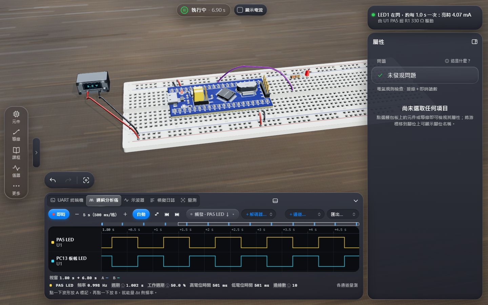

## 目錄

1. [介面總覽](#1-介面總覽)
2. [第一次使用](#2-第一次使用)
3. [放置元件](#3-放置元件)
4. [接線](#4-接線)
5. [執行模擬：狀態膠囊](#5-執行模擬狀態膠囊)
6. [狀態提示列](#6-狀態提示列)（[6.1 電路說明](#61-電路說明)）
7. [問題面板](#7-問題面板)
8. [屬性面板](#8-屬性面板)
9. [開發板（MCU）的四個分頁](#9-開發板mcu的四個分頁)
10. [載入韌體](#10-載入韌體)
11. [偵錯器](#11-偵錯器)
12. [UART 終端機](#12-uart-終端機)
13. [邏輯分析儀與協定解碼](#13-邏輯分析儀與協定解碼)
14. [示波器](#14-示波器)
15. [萬用電表與「量測」分頁](#15-萬用電表與量測分頁)
16. [從腳位、孔位、導線直接量測](#16-從腳位孔位導線直接量測)
17. [模擬日誌](#17-模擬日誌)
18. [電氣規則檢查（ERC）](#18-電氣規則檢查erc)
19. [課程](#19-課程)
20. [範例](#20-範例)
21. [專案：儲存與開啟](#21-專案儲存與開啟)
22. [設定與「更多」面板](#22-設定與更多面板)
23. [鍵盤快速鍵](#23-鍵盤快速鍵)
24. [手機與平板](#24-手機與平板)

---

## 1. 介面總覽

視窗寬度 ≥ 1100 px 並使用滑鼠或觸控板時，ohmlet 顯示**桌面工作區**：所有面板漂浮在 3D 畫面上，可以調整大小與收合。

| 位置 | 名稱 | 內容 |
|---|---|---|
| 最左側直欄 | 工具列 | **元件**（元件庫）、**導線**（導線模式）、**課程**、**儀器**、**更多** |
| 左側面板 | 元件庫／範例／課程 | 三個分頁；面板右上角的按鈕可以收合，收合後左側把手可以再展開 |
| 上方中央 | **狀態膠囊** | 模擬狀態兼暫停鍵（模擬平常會自己執行）：「執行中 · 3.11 s」「已暫停 · 3.11 s」「核心已停住 · 繼續執行」（[§5](#5-執行模擬狀態膠囊)） |
| 膠囊下方 | **狀態提示列** | 最重要的問題或下一步，附一顆修正按鈕（[§6](#6-狀態提示列)） |
| 右側面板 | **屬性** | 選取元件或導線時顯示它的屬性；沒有選取時顯示**問題**面板（[§7](#7-問題面板)） |
| 右上角 | **電路說明** | 一兩行白話說明電路現在在做什麼、為什麼，例如「LED1 亮著：亮度 49 %（9.70 mA）」「由 5.00 V 經 R1 330 Ω 供電」；屬性面板排在它下方（[§6.1](#61-電路說明)） |
| 下方 | **儀器匣** | **UART 終端機、邏輯分析儀、示波器、模擬日誌、量測** 五個分頁 |
| 左下角 | 復原膠囊 | 復原、重做、**對準電路**（讓鏡頭重新框住整個電路，快速鍵 F） |

儀器匣會跟著電路自動開合：麵包板是空的時候收合，有邏輯分析儀通道、探棒、萬用電表或韌體啟用的 USART 時自動打開；
你自己開關一次之後，這次使用期間就不再自動改變。**分析版面**（Shift+A，或儀器匣右上角的按鈕）會收合兩側面板、把儀器匣放大到約 55 % 的視窗高度，再按一次還原。

手機與平板使用底部工具列（**元件 · 導線 · 課程 · 儀器 · 更多**），各功能以底部面板呈現，模擬與電路完全相同（見 [§24](#24-手機與平板)）。

> 介面語言設為 English、而且沒有顯示桌面工作區時（關閉了工作區，或在手機上），會顯示上游 ohmlet 的**經典外觀**（逐像素保留）。本手冊說明的是預設的繁體中文介面。

---

## 2. 第一次使用

第一次打開時會出現 3 張**導覽卡**：

1. **這是 STM32 電子實驗室**——在 3D 麵包板上接電路、燒入真正的 STM32 韌體，再用邏輯分析儀、示波器和萬用電表觀察訊號。
2. **看看四周**——在孔位以外的地方按左鍵拖曳旋轉，按住 Alt（Mac：Option）拖曳則哪裡都能旋轉；滾輪縮放、右鍵拖曳平移；從一個孔位拖到另一個孔位就能接線。在空白處點兩下可重新取景
   （觸控：單指拖曳旋轉、雙指捏合縮放、雙指拖移平移；長按孔位再拖到另一個孔位就能接線）。
3. **從第一課開始**——按 **開始第一課**，或 **先看範例：Blue Pill 閃爍 LED**；也可以按「略過」。

之後只要麵包板是空的，畫面中央就會出現「**從哪裡開始？**」卡片：**從第一課開始（推薦）**、**開啟範例**、**自己放元件**
（設定了 Anthropic API 金鑰時另有「問 AI 幫你接」）。

最快看到東西動起來的路徑是：「先看範例」。範例會載入電路、把 hal-blink 韌體燒進開發板、打開邏輯分析儀，並**自動開始模擬**（不用按執行）：
PA5 的紅色 LED 與板載 PC13 綠色 LED 每 501 ms 交替亮滅，邏輯分析儀自動縮放到看得見方波並量出 0.998 Hz。

---

## 3. 放置元件

**元件庫**（左側面板「元件庫」分頁；手機：工具列「元件」）：

- **搜尋**：中文、英文、零件編號或標籤都可以，例如「電阻」、`stm32`、`i2c`、`oled`。
  搜尋結果先依**符合程度**排列：名稱就是搜尋字或以它開頭的排最前面，其次是名稱裡含有它的，只有標籤符合的排最後；符合程度一樣時，再依下面的使用順序。
  例如搜尋「電阻」，電阻排在可變電阻、光敏電阻前面；搜尋 `LED`，LED 本身排第一，名稱只是含有這幾個字母的 OLED 排在後面。
- **排列**：最上面是「常用元件」——電阻、LED、按鈕、電容、直流電源供應器、可變電阻、Blue Pill、NPN 電晶體、二極體、數位萬用電表
  （桌面上這一區可以收合，下次打開仍會記得）；接著依一般電子實驗的使用頻率排列分類，每個分類裡最常用的排最前面。有收藏（★）時，收藏排在最上面。
  手機的「全部」也先列這些常用元件，接著依分類列出，每一段都標出分類名稱。
- **篩選**：分類（被動元件、半導體、開關、電源、顯示、IC、微控制器、感測器、模組、馬達、儀器）、**模擬支援等級**，或只看收藏（★）。
- **支援等級徽章**：每張卡片都標示「完整模擬」「部分模擬」「僅視覺接線」或「開發中」。按卡片右側的 ⌄ 展開**詳細資訊**：說明、**規格**、**已模擬**、**未模擬**。

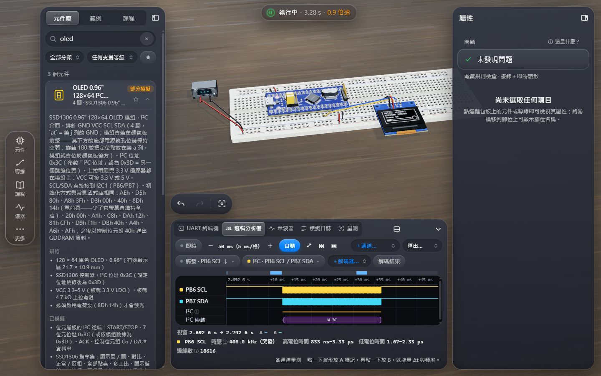

**點一下卡片**即進入放置模式（卡片顯示「放置中」，再點一次卡片或按 Esc 結束）。同一個元件同時出現在「常用元件」和它的分類裡時，只有你點的那一張卡片會顯示「放置中」。畫面上方的提示會告訴你下一步，而且一定寫出離開的方法：

| 元件類型 | 放置方式（提示的原文） |
|---|---|
| 兩腳、三腳元件（電阻、LED、電晶體…） | 「第 1/2 腳：點『…』的孔位」——依腳位順序點孔位，選了第一個孔後會預覽整個元件 |
| DIP 晶片 | 「點 f 列中第 1 腳的孔位（DIP-n 跨在中央溝槽上）」 |
| 模組與開發板 | 「點 h 列的孔位放下（PB12 對齊那個孔）· Shift+R 旋轉」——可以放的那一列會以藍色標示 |
| 板外儀器（電源、函數產生器、萬用電表） | 直接放在麵包板旁邊，再為它的端子接線；之後可以拖曳到桌面其他位置 |
| 探棒（示波器、邏輯分析儀） | 「點要量測的網路上的孔位」 |

放置預覽是元件的半透明全像投影：**青色**表示可以放，**紅色**表示不行。放不下時，提示會寫出真正的原因與解法，例如
「這裡放不下 STM32F103C8T6 Blue Pill 開發板：它要跨在中央溝槽上——請點 h 列（藍色標示）的孔位」，或「右邊超出麵包板——請往左移，或在『更多 → 麵包板尺寸』改用實驗室 XL」。
兩腳元件與探棒點到不能用的孔位時，提示同樣寫出原因，例如「這裡不能放：j27 已經被導線 W3 佔用」。
放好之後可以繼續點孔位再放一顆，按 Esc 結束。

**用鍵盤拿元件**（桌面）：常用元件都有一個字母快速鍵，卡片上的小鍵帽就是它——R 電阻、L LED、B 按鈕、C 電容、P 直流電源供應器、V 可變電阻、U Blue Pill、Q NPN 電晶體、D 二極體、M 數位萬用電表（多半取自元件編號 R1、LED1、PS1、RV1、U1、Q1、D1、DMM1；按鈕用 B）。滑鼠停在麵包板上按字母，預覽立刻出現在滑鼠下面；同一個字母再按一次（或按 Esc）就停止放置，按別的字母就換成那個元件。電源供應器與萬用電表按下就直接放在麵包板旁邊。在輸入框（例如元件庫的搜尋框）裡打字時字母照常輸入，Ctrl／⌘ 加字母仍是原本的功能；拖曳中按字母不會有動作。英文的經典外觀沒有這些快速鍵。

其他編輯操作：

- **選取**：點元件本體或導線（游標移到元件上會顯示「U1 · STM32F103C8T6 Blue Pill 開發板 · 點一下選取」）。
- **多選**：Shift／Cmd + 點選，或在空白麵包板上 Shift + 拖曳框選；選取膠囊會顯示「已選取 n 項」與「複製」「刪除」按鈕。
- **移動**：拖曳已選取的元件（多選時一起移動），或用方向鍵微移；導線端點留在原來的孔位。
- **旋轉**：放置中或選取 DIP／模組後按 **Shift+R**（R 是電阻的快速鍵；英文的經典外觀仍按 R）。
- **刪除**：Delete 鍵、屬性面板標題列的垃圾桶（或最下方的「移除」）、選取膠囊的「刪除」或長按選單的「刪除」。**不會再問一次**：元件立刻刪除，
  提示「已刪除 PS1——Ctrl+Z 可復原」（觸控裝置：「已刪除 PS1——點 ↶ 可復原」），右邊附〔復原〕按鈕，按一下就回來（連同接在它上面的導線；開發板的韌體也一起回來）。
  一次刪除好幾項也一樣，〔復原〕把整批帶回來。
- **複製／貼上**：選取元件後按 Ctrl+C（Mac：⌘C）複製，再按 Ctrl+V（Mac：⌘V）貼上。複本**連同參數**（電阻值、LED 顏色、開關位置……）一起過去，
  Blue Pill 的複本也載入同一份韌體（提示會寫出韌體檔名；復原、重做時韌體也跟著）。一起複製的導線有：選取的元件之間的導線、從元件接到電源軌的導線，
  以及萬用電表 COM 端、函數產生器 GND 端接到電源軌的導線。接到沒有選取的元件或儀器的導線不會跟過去；直流電源供應器的 +、函數產生器的 OUT 接到電源軌的導線也不會
  （同一條電源軌不能有兩個電源）。一起帶過來的導線會寫在提示裡，例如「已貼上 R2（連同導線 W5）」；選取了卻沒有一起複製的導線，提示也會寫出來。
  - **放在哪裡**：滑鼠指著空的孔位時，複本的左上角就放在那個孔；那裡放不下時，提示會說明並改放到原件旁邊。滑鼠沒有指著孔位時，放在原件旁邊最近的空位，
    這一半放滿了就放到麵包板另一半，再到其他排麵包板。複本**不會和現有電路共用同一排孔**，不會偷偷接進原本的電路；接電源軌的導線會接回同一條電源軌
    （或已經和它接通的另一條）。貼上後複本是選取狀態，提示附〔復原〕，一次就拿掉整批。
  - **在旁邊複製一份**：Ctrl+D（Mac：⌘D）、選取膠囊的「複製」與長按選單的「複製」會立刻在旁邊放一份複本；按住按鍵不放也只複製一份。
  - **剪下**：Ctrl+X（Mac：⌘X）剪下選取的元件；之後貼上（滑鼠還停在原處也一樣）會放回原處，名稱與導線都不變。先複製、再按 Delete 刪除後貼上，也會放回原處，接回留下的導線。
  - 麵包板上沒有空位時，提示附〔加一塊麵包板〕，按一下就加一塊再貼上。在輸入框裡打字或選取了文字時，這些按鍵照常複製、貼上文字。
- **復原／重做**：左下角的復原膠囊，或 Ctrl+Z／Ctrl+Y（Mac：⌘Z／⌘Y）。每一次編輯都是一個可以復原的步驟，提示會寫出復原或重做了什麼，
  例如「已復原：刪除 PS1」「已重做：刪除 PS1」。
- **擴充麵包板**：游標靠近麵包板邊緣時會出現「+」（加接一塊麵包板）；長按「+」可以移除那一側的麵包板。尺寸也可以在「更多 → 麵包板」設定。
- **音效**：元件插進麵包板時，聽得到接腳一根根卡進孔裡（腳越多的元件聲音越厚重）；拔出、移動、旋轉元件（放置前按 Shift+R 轉動預覽也一樣），接上或拔出導線也各有一聲短短的機械聲；
  貼上或複製一份是一聲插入，新加的麵包板落定時「喀」一聲。放不下元件、貼上時沒有空位、拖曳的導線接不上時，是一聲低沉的「咚咚」；取消（Esc）不出聲。
  復原／重做則是一聲輕輕的「咻」。第一次點畫面之前不會出聲；不需要時在「更多 → 設定 → 音效」關閉（只有這一個開關）。英文的經典外觀沒有這些音效。

---

## 4. 接線

**直接拖曳接線（不必先切到導線模式）**：用滑鼠在孔位、元件腳位或板外端子上按住左鍵，拖到另一個孔位或端子再放開，就接上一條導線；可以這樣拉線的地方，游標會變成十字。元件腳位那一排已經沒有空孔時，那裡不會出現十字游標，按住拖曳是旋轉視角，跟按在元件本體上一樣。
視角拉得太遠、孔位小到點不準時，從孔位拖曳是旋轉視角；這時會提示一次「放大一點（滾輪，或按 F 對準電路）就能從孔位拉線」。
手機與平板上是**長按孔位約半秒**，孔位上出現圓圈後再拖曳（拖曳時對準圈浮在手指上方）。
拖曳時懸停晶片寫出對準的孔位，預覽的路徑就是實際的路徑，接不上的地方預覽變成紅色（放開後提示寫出原因）；還沒對準任何孔位或端子時，預覽是半透明的淡黃色（這時放開什麼都不會發生）。從元件腳位開始時，導線改從同一排的空孔拉出，例如按在 c21（U1 PA4）上，導線從 a21 開始；
拖曳時還沒對準孔位，懸停晶片會寫「c21 被 U1 PA4 佔用，已改從同一排的 a21 拉線」，放開後的提示也會寫出來，例如「已接上 a21（c21 被 U1 PA4 佔用，改從同一排接出）→ e40」。
放在元件腳位上也一樣：導線改接到那一排離腳位最近的空孔，預覽與懸停晶片會先標出那個孔，放開後的提示也寫出改接到哪裡；那一排已經沒有空孔時才接不上。
例如放在 R1 的腳 c26 上，懸停晶片寫「c26 被 R1 第 2 腳佔用 → 接到同一排的 b26」，放開後寫「已接上 a19 → b26（c26 被 R1 第 2 腳佔用，改接同一排）」。
放在起點同一排的孔位上（空孔或元件腳位都一樣）就接不上：這兩點在麵包板裡本來就是通的。懸停晶片先寫「d40 跟起點在同一排，本來就是通的」，放開後提示「這裡不能接：d40 跟起點在同一排，本來就是通的」；同一條電源軌也一樣（「…跟起點在同一條電源軌上，本來就是通的」）。
放開後寫「已接上 起點 → 終點」並附〔復原〕，按一次就拿掉；新導線不會被選取，顏色照它接到的電路自動決定。接不上時提示寫出原因（「這裡不能接：…」），並有一聲低沉的提示音；
放在孔位或端子以外的地方，或放回起點，就什麼都不會發生（也沒有聲音）。
用滑鼠按住腳位或孔位不動不會跳出動作選單（長按選單是觸控的手勢；滑鼠用點一下選取、按右鍵打開探測選單），停一下再拖曳照樣拉線；只有那一排已經沒有空孔的腳位例外：那裡按住就跟按住元件本體一樣，打開元件的動作選單。用觸控筆時，按住約半秒不動會出現「放開：探測選單／拖曳：拉線」的小標籤，這時放開就打開探測選單，拖曳照樣拉線。
從板外端子拉線時要按在端子上（或儀器本體上靠近端子的地方）；按在端子旁的桌面上拖曳是旋轉視角。就算那台儀器正被選取（例如剛放上的電源供應器）也一樣：按在端子上拖曳是拉線，按在儀器本體其他地方拖曳才是移動它。
按在孔位以外的地方拖曳仍是旋轉視角，按住 Alt（Mac：Option）拖曳則一律旋轉；已選取的元件照樣可以拖曳移動，Shift + 拖曳照樣框選；
模擬進行中按在按鈕上是按下按鈕，不會拉線。第一次把滑鼠停在可以拉線的空孔上時，會提示一次「小提示：按住孔位拖到另一個孔位，就能拉線」（每個瀏覽器只提示一次）。
長按孔位後不拖曳直接放開，仍會打開探測選單（[§16](#16-從腳位孔位導線直接量測)）；長按時孔位旁的小標籤會寫出接下來的兩種做法，例如「a24 · 放開：探測選單／拖曳：拉線」。
長按元件本體（例如電阻的色環、LED 的燈罩）則打開那個元件的動作選單，即使本體下面剛好是空的孔位；長按在元件自己的腳位、導線端點或元件旁邊的孔位上，才打開探測選單。

要一條接一條連續接線時，也可以用導線模式：

1. 按工具列的「**導線**」進入導線模式。提示寫「導線模式：依序點兩個孔位或端子 · Esc 結束」
   （觸控裝置寫「導線模式：依序點兩個孔位或端子 · 點「完成」結束」），下方出現導線顏色的說明列「紅＝電源正　黑＝地　其他顏色＝訊號」與「完成」按鈕
   （手機上精簡成一列「● 電源正　● 地　●●● 訊號 │ 完成」，圓點就是導線的顏色；訊號的三個圓點是一般訊號的紫色、青綠色、粉紅色）。
2. 點第一個孔位或端子，提示會寫出起點是什麼，例如「從 a20（U1 PA5 這一排）拉線：點第二個孔位 · Esc 取消這條」。
   點到已經插著元件腳的孔位時，會自動改從同一排（或同一條電源軌）的空孔拉線並告訴你，例如「c21 被 U1 PA4 佔用，已改從同一排的 a21 拉線」；
   那一排已經沒有空孔時會寫「這裡不能接：…——這一排已經沒有空孔」。
3. 點第二個孔位。接好時會出現「已接上 起點 → 終點」的確認；導線會自動繞過元件本體與其他導線，預覽的路徑就是實際的路徑。
4. 不能接的時候會直接說原因，例如「這裡不能接：c25 已經被 U1 PA0 佔用」「e20 被 U1 的本體蓋住了」「這兩點之間已經有導線 W3」。
   點在第一個端點同一排（或同一條電源軌）的孔位上也不會接：提示寫「這裡不能接：d40 跟起點在同一排，本來就是通的」，起點保留，可以改點別的孔位。

**懸停晶片**：游標停在孔位上時，旁邊的小標籤會寫出這個孔是什麼、接到誰，模擬執行時還會加上即時數值：

| 位置 | 例子 |
|---|---|
| MCU 腳位 | 「PA5（板上 A5）· 推挽輸出 · 3.30 V · c20」 |
| 其他元件的腳 | 「LED1 陽極（長腳）· b40」 |
| 空孔 | 「a20（U1 PA5 這一排）」 |
| 電源軌 | 「上方 + 電源軌 · 第 10 孔（top+10）」 |
| 板外端子 | 「PS1 正端 · 5.00 V」 |
| PWM 網路 | 「PWM 1.000 kHz · 34.0 %」 |
| 函數產生器的輸出網路 | 「導線 W2 · 方波 100 Hz · 0–5.00 V · a10（R1 第 1 腳這一排）」——寫的是產生器的設定，不是隨波形跳動的瞬時電壓 |

數值只在可信時出現：沒有錄到邊緣的網路寫「3.10 V（瞬時）」，求解器沒有可信的值時就不寫數字。可以在 3D 中按住的元件（按鈕）最後會寫「按住即可按下」。
電路一改變（例如刪除了元件），懸停晶片就跟著更新，不會留在已經不存在的元件或端子上。

**導線顏色自動決定，不必挑**：每條導線的顏色由它接到的電路決定（用的是模擬器求解的同一份網路），接好就是對的顏色：

| 顏色 | 意義 |
|---|---|
| 紅色 | 電源正：電源供應器或電池的正端、5V／3V3／VCC 等電源腳、+ 電源軌 |
| 黑色 | 地：負端、GND 腳、− 電源軌 |
| 藍色／黃色 | I²C 資料線 SDA／時脈線 SCL |
| 綠色／白色 | UART 傳送線（MCU 送出）／UART 接收線（MCU 接收） |
| 橘色 | PWM 控制訊號（伺服馬達、馬達驅動器等標明 PWM 的輸入） |
| 紫色、青綠色、粉紅色、棕色、灰色 | 一般訊號（例如接 LED 或按鈕的 GPIO 線）；依導線建立的順序輪流使用，新接的線不會改變舊線的顏色 |

**一個顏色只有一個意思**，在每個電路都一樣：上面五種功能的顏色只用在那個功能上，一般訊號只用最後一列的五個顏色。
所以範例「Blue Pill 閃爍 LED（HAL）」裡 PA5 接 LED 的線是紫色（「紫色：訊號（U1 PA5）」），黃色的線一定是 I²C 時脈線。
一般訊號超過五條時顏色會重複，懸停晶片與屬性面板仍會寫出每一條線是什麼。

訊號的功能先看模組的腳位（SDA、SCL、TXD、RXD、PWM…）；線上沒有模組時，看 MCU 腳位**唯一**的複用功能（例如 PA9 只有 USART1_TX，所以是綠色）。
同一支腳有兩種可能（PB10 是 I2C2_SCL 也是 USART3_TX），或同一條線上還接著 LED、電阻等其他元件時，就當一般訊號，不猜；計時器通道也不會被當成 PWM。
經過準位轉換器的同一條線，兩側是同一個顏色，例如兩段都寫「白色：UART 接收線（BT1 TXD → U1 PA3，經 LS1 準位轉換）」。萬用電表的導線就是表筆：IN 端紅色、COM 端黑色。

電路一改，顏色就跟著改：把一排接到地，這排上的導線全部變黑。選取導線時屬性面板寫出顏色的原因，例如「紅色：電源正極（5 V 網路）」；
游標停在導線上時懸停晶片也寫同一句，例如「導線 W1 · 紅色：電源正極（5 V 網路）· 點一下選取」。

**改接導線**：用滑鼠按住任何一條導線插在孔位裡的那一端（不必先選取），拖到另一個孔位就會改接（一個可以復原的步驟，提示附〔復原〕），沒有放在孔位上則維持原樣。
觸控裝置上長按導線的一端約半秒（不必先選取），小標籤寫「放開：探測選單／拖曳：改接這一端」，再拖到另一個孔位；不拖曳直接放開則打開探測選單。

**選取導線**時，屬性面板顯示它的顏色與原因、**網路**（接在這裡的所有元件腳位，以及模擬中的即時摘要，例如「PWM 1.000 kHz · 39.4 %（平均 1.22 V）」）、
「加入邏輯分析儀」「放示波器探棒」兩個按鈕，以及兩個**端點**（例如「起點 a19（U1 PA6 這一排）」）。

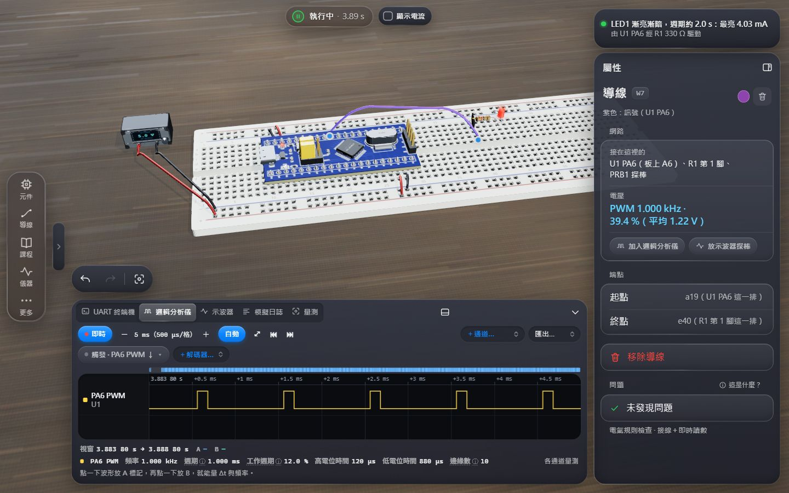

麵包板規則：同一欄的 a–e 五個孔相通、f–j 五個孔相通，中央溝槽兩側不相通；上下各有兩條電源軌（`top+`、`top−`、`bot−`、`bot+`），每條整排相通。
Blue Pill 跨在中央溝槽上時蓋住 b–i 列，**每支排針只剩 a 列或 j 列一個空孔**可以接線。

---

## 5. 執行模擬：狀態膠囊

**改了就自動模擬**：麵包板上有元件時，模擬會自己執行——開啟範例、課程電路或專案，放上元件、接線、改元件數值、復原／重做、載入韌體，
電路都會立刻開始（或繼續）模擬，不用按執行。打開 App 時會等前一次的韌體重新載入開發板後才開始（最多等 5 秒）。
麵包板是空的（只有導線也算空的）時不會模擬，也不會在背景跑模擬；刪掉最後一個元件，這次模擬就結束並歸零。

**暫停**：點膠囊（或按空白鍵）暫停。暫停會一直保持，直到你**改動接線或元件**（新增、移動、刪除元件、接線、改元件數值例如電阻值、復原／重做）、
載入韌體（同一個檔案再載入一次也算），或按狀態提示列的〔繼續執行〕；只是操作電路（按按鈕、撥開關、轉可變電阻、改電源電壓、移動儀器）不會讓它繼續。
暫停後「重置模擬」會停在 0 s，執行中重置則從 0 s 重新開始（課程步驟上的「重置模擬」也一樣）。
偵錯器停住的核心不會自動繼續；但「重置模擬」等於重新上電，之後會自動重新執行。

> 英文的**經典外觀**（[§1](#1-介面總覽)）維持原本的手動執行。離開經典外觀時（改回繁體中文，或打開桌面工作區），麵包板上的電路會自動開始模擬（之前暫停的除外）。

上方中央的膠囊顯示模擬狀態，也是暫停鍵：

| 狀態 | 膠囊顯示 | 點一下 |
|---|---|---|
| 尚未執行（空白麵包板、暫停後重置） | ▶（綠）「執行模擬」 | 開始 |
| 執行中（平常的狀態） | ❚❚（綠，開始後脈動約 3 秒）「執行中 · 3.11 s」 | 暫停 |
| 執行中，但開發板沒有在動 | ❚❚（紅）「執行中 · U1 沒有供電」或（橘）「執行中 · U1 還沒有韌體」 | 暫停 |
| 已暫停 | ▶「已暫停 · 3.11 s」 | 繼續 |
| 偵錯器停住核心 | ▶（橘）「核心已停住 · 繼續執行」 | 讓核心與模擬一起繼續 |
| 核心鎖死 | ⚠（紅）「U1 故障 · 5.20 s」 | 暫停；原因寫在狀態提示列 |

- **執行中但開發板沒有在動**：電路中每一塊開發板都沒有供電或還沒有韌體時，膠囊不會只寫「執行中」，而是用那個狀態的顏色寫出第一塊開發板的原因
  （與狀態提示列、問題面板同一句話）；類比電路照常模擬。
- **鎖死的那一刻**，膠囊下方會展開一行「U1 故障（鎖死）——查看原因 ›」（約 6 秒）。這一行顯示時點膠囊，會打開開發板的「概況」分頁並捲到「執行狀態」卡片
  （和狀態提示列的「查看原因」相同），而不是暫停；這一行收起後，點膠囊又是暫停／繼續。
- **空白鍵**等同點膠囊（在輸入框裡打字時除外）。麵包板是空的時候不會開始，而是提示「麵包板是空的——先開啟範例或放元件」。
- **長按膠囊**重置模擬：第一次長按會提示「再長按一次即可重置模擬」，3 秒內再長按一次才真的重置（等於整個電路斷電再上電，記錄全部清空）。
  也可以用「更多 → 模擬 → 重置模擬」。
- **速度**：「更多 → 模擬 → 模擬速度（倍速）」可選 0.1 倍、0.5 倍、1 倍、5 倍、10 倍。電腦跑不上設定的速度超過 2 秒時，膠囊會誠實加上「0.8 倍速」這類標示；
  **波形與時序本身完全正確**，只是比真實時間慢——模擬時間是虛擬時間，韌體看到的時間不受電腦速度影響。
- 模擬在背景執行緒（Web Worker）中執行，介面不會被卡住。
- 執行中可以直接調整標示「即時」的參數：按鈕、開關、可變電阻位置、光線、電源電壓、感測器的溫度與距離等。
  **按鈕可以直接在 3D 中按住**（按住的同時也會選取它），或用屬性面板的大型「按住」按鈕。
- **保持按下**：要讓按鈕一直按著（例如邊按邊量電壓），打開屬性面板「按住」旁邊的「**保持按下**」開關，或在 3D 中**雙擊**按鈕（觸控：點兩下）；
  沒有模擬在進行時（例如暫停後重置），長按按鈕打開的動作選單也有「保持按下」；模擬進行中（暫停時也一樣）長按就是用手指按住它。KY-040 旋轉編碼器與搖桿模組的「按鈕（SW）」列也是同一個「保持按下」開關。
  游標停在按鈕上時，懸停晶片會寫「按住即可按下 · 雙擊保持按下」，保持中寫「已保持按下 · 按一下放開」；按鈕上方會出現鎖頭標記，
  狀態提示列寫「SW1 保持按下中」，旁邊的〔放開〕一按就放開。
  再按一下按鈕（3D 中點一下或按一次「按住」）、關掉開關、按〔放開〕，或「重置模擬」，就會放開；保持按下只在這次模擬中有效，**不會存進專案檔**。
  課程的驗收在放開所有按鈕的情況下檢查（要按按鈕的條件會自己按）；只看目前電路的步驟則照你保持按下的樣子檢查——這時若量測、UART 或 ERC 的結果
  可能是按著的按鈕造成的，會提示「SW1 保持按下中——這一步檢查的是目前的電路」並附〔放開〕；接線或元件的錯誤不會出現這個提示。
- **顯示電流**：模擬執行或暫停時，膠囊右邊有「顯示電流」勾選鈕（也在「更多 → 模擬 → 顯示電流」，快速鍵 **Shift+C**）。勾選後，導線與元件上會有光點沿著電流方向流動：
  「光點越快越密＝電流越大，方向＝由正到負」。光點全部來自模擬算出的真實電流：暫停時光點停住，沒有電流的地方沒有光點，還沒執行時不會畫出假的電流；
  暫停時勾選，提示會說明模擬繼續後就會看到電流流動；
  電流無法完整追回電源的區域（例如經過電阻才供電的晶片）寧可不畫光點，也不畫出流到一半就消失的電流，
  並在每次執行時提示一次，例如「U1 的電流迴路無法完整追蹤，暫不顯示它的光點」。系統設定為減少動態效果時，改成不動的光點。
  光點刻意走得慢、排得疏，方便看清方向（一般 LED 的 10 mA 約每秒走 3.5 個孔距）；速度以螢幕時間計，不隨「模擬速度（倍速）」改變。
- **成功**：電路真的開始運作（LED 亮了、馬達轉了、MCU 腳位開始切換…），而且連續 1.2 秒（模擬時間）沒有錯誤、也沒有和運作中元件有關的風險時，
  會出現「電路正常運作 ✓」提示與一點光芒，提示後面寫出看到了什麼，例如「電路正常運作 ✓ · LED1 亮了」。
  提示寫出的每一件事在那一刻都還成立：按一下按鈕亮起、放開就熄滅的 LED 不會被慶祝。
  手指按住按鈕的期間（不論按多久）不會出現提示，放開後只寫出還在運作的東西；改成「保持按下」才會在 LED 亮著時慶祝。
  提示裡的腳位只切換一次時寫「U1 的 PA5 切換了」，持續切換才寫「U1 的 PA5 在切換」；閃爍的 LED 會等它亮著時才提示。
  每次改動電路最多一次，同一個電路不會重複慶祝；在那 1.2 秒內編輯或刪除元件，原本已經在運作的部分不會再補慶祝。
  開啟 App、範例、課程電路或專案時自動開始的模擬，電路自己做到的事不會出現這個提示（那不是你接出來的）；你改動電路，
  或操作它（撥開關、保持按下按鈕、轉旋鈕、調電源）之後新運作起來的東西，才會慶祝。
  課程驗收全部通過時顯示「完成！」與彩帶；用「載入完整答案」通過時不會出現「完成！」，只寫「驗收 6 項全部通過，但用的是載入的解答——自己接一次，才算完成本課。」
  判定跟著電路板走：載入答案後按〔復原〕（或 ↶）回到自己的電路、或清空麵包板後從頭自己接，通過時算自己完成；反過來復原回到答案時，仍算用解答。
- **損壞**：元件被模擬弄壞時一看就知道，問題面板與屬性面板同時寫出原因與修法。按〔換新〕（屬性面板的損壞說明、問題面板或狀態提示列的那一則、
  選取燒毀元件時的選取膠囊，或長按元件的選單）就在原位換上一顆新的，參數照舊，不必刪掉重放；多選時，選取膠囊的〔換新〕一次換掉選取中所有燒毀的元件。
  改好電路（接線、新增或移動元件、改電阻值）或按「重置模擬」時會換上新的；
  改好會變動的數值（例如調低電源電壓、轉動可變電阻）時，也會在停手後自動換新。按按鈕、撥開關、DIP 開關、跳線帽、電表檔位這類機械操作不會換新；
  把同一個數值往同一個方向繼續調（例如電源電壓越調越高）也不會，往回調就會。原因還在的話，新的元件會再燒毀一次：電路還沒改好就按〔換新〕時，新的元件會馬上又燒掉，提示會寫「新的 LED1 又燒掉了：」加上電路說明給的改法（例如「改用至少 180 Ω 的限流電阻；改好就會自動換上新的 LED1」）；
  改了電路的其他地方（或其他元件的數值）之後，同一顆元件（同一個位置、同樣的參數）又為同一個原因燒毀時，只顯示燒毀的樣子，不再重播火花、煙霧與爆裂聲；
  按〔換新〕後再燒毀、或修好運作過一陣子又改壞時，則照常播放。
  模擬暫停時換上的新元件要等繼續執行後才會通電，提示上就有〔繼續執行〕。開發板上燒毀的板載 LED 也能換新。
  - **LED**：亮度＝電流 ÷ 額定 20 mA（[§8](#8-屬性面板)）。超過 100 % 會刺眼閃爍，問題面板提醒電流超過額定；5 V 串 100 Ω（約 31 mA）只會過亮，不會燒毀。
    電流長時間遠超額定（紅色約 110 mA、藍色約 70 mA 以上）時接面超過 100 °C，開始過熱冒煙，到約 150 °C 就燒毀；電流超過 150 mA 達 1 ms
    （例如沒有限流電阻、直接接在電源上）會立刻燒毀。燒毀的 LED 焦黑裂開、不再導電也不會亮，問題面板寫「LED1 已燒毀」。
  - **電阻**：消耗的功率超過額定（¼ W）就發熱，顏色由褐轉橘、再到白熱並冒煙；持續嚴重過載（例如 10 Ω 接 12 V，約 2 秒）會燒黑斷開，寫「R2 燒斷了」。
  - **電解電容**：+ 腳比 − 腳低超過 1 V 會發熱，直到頂部的洩壓閥爆開冒煙（反接 5 V 約 1 秒），寫「C1 反接爆開」。
    電容反接在兩條電源軌之間時，不必等模擬算出結果（就算暫停後重置、**還沒按執行**），問題面板就會寫「C1 電解電容接反了」，按「對調兩腳」一鍵把兩支腳對調。
- **音效**：成功的提示音、元件燒毀的爆裂聲，以及按鈕按下／放開、保持按下、撥動開關、DIP 開關、跳線帽（含 PCF8574 的 A2–A0 位址跳線）、轉動可變電阻與旋轉編碼器的機械聲，
  都可以在「更多 → 設定 → 音效」關閉，畫面上的回饋不變。繼電器只有在模擬執行中、模擬裡的觸點真的切換時才會發出「喀」的一聲（分頁在背景時不響）；
  蜂鳴器與馬達不發出聲音。
- 編輯電路（新增、移動、接線）會重建模擬；元件編號與韌體沒有變的 MCU 會繼續執行，電容電荷等類比狀態則重新開始。

---

## 6. 狀態提示列

膠囊下方的**狀態提示列**永遠回答「現在哪裡不對、下一步做什麼」，依序顯示：

1. 最嚴重的**錯誤**（紅點）；
2. 最重要的**風險**（橘點）——開發板層級的狀況（還沒有韌體、偵錯器停住、系統記憶體開機、沒有供電）排在電路的風險前面，因為沒有程式其他都不重要；
3. 有按鈕保持按下中：「SW1 保持按下中」與〔放開〕（[§5](#5-執行模擬狀態膠囊)）；
4. 你暫停了模擬：「模擬已暫停——改動接線或元件就會自動繼續」，右邊是〔繼續執行〕按鈕；
5. 麵包板上有東西但還沒執行（例如暫停後重置）：「電路已就緒（空白鍵）」，右邊就是〔執行模擬〕按鈕（觸控裝置寫「電路已就緒」）；
   還有需要執行後才能確認的項目時，後面加上「· n 項執行後確認」；模擬馬上就要自動開始時（剛打開 App、正在載入課程或專案）不顯示這一行；
6. 手機上，沒有上面這些話要說時，寫出[電路說明](#61-電路說明)的第一行；
7. 其他情況隱藏。課程引導卡正在引導時，下一步由引導卡負責，提示列不另外說。

右邊的按鈕就是那則問題自己的修法：例如「U1 還沒有韌體」→「**載入韌體…**」（直接選取開發板並打開[內建韌體選擇器](#10-載入韌體)）、
「U1 核心已停住（偵錯器）」→「**繼續執行**」、「U1 故障（鎖死）」→「**查看原因**」（打開「概況」分頁的執行狀態卡片）、「LED1 已燒毀」→「**換新**」、
指向元件的問題 →「**在電路板上標示**」。還有其他問題時會寫「· 另 n 個」；
點提示列本身（或 ›）會打開完整的[問題面板](#7-問題面板)。

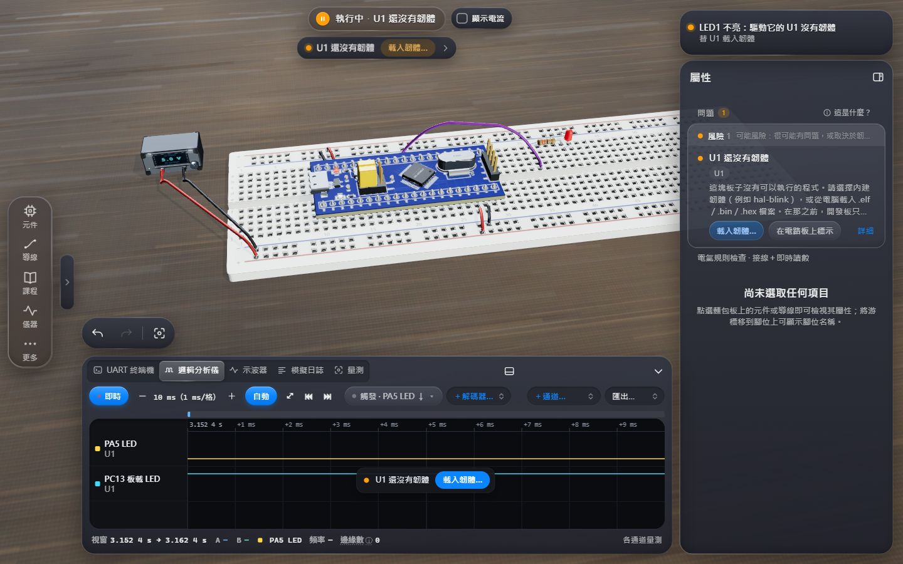

同一個原因在各處用同一句話：上圖的邏輯分析儀、UART 終端機與示波器沒有訊號時，也會先說明開發板為什麼不動（「U1 沒有供電，所以這些通道沒有訊號」「U1 還沒有韌體」），並附同樣的按鈕。

### 6.1 電路說明

右上角的**電路說明**用一兩行白話說明電路現在在做什麼、為什麼：狀態提示列說「哪裡不對、按哪個鍵」，電路說明說「結果是什麼、原因在哪」。例如：

| 情況 | 電路說明 |
|---|---|
| LED 正常發亮 | 「LED1 亮著：亮度 49 %（9.70 mA）」「由 5.00 V 經 R1 330 Ω 供電」 |
| 電阻太大，LED 很暗 | 「LED1 很暗：亮度 3.5 %（710 µA）」 |
| 陰極沒接地 | 「LED1 不亮：陰極（c20）沒有接地」「用導線把 LED1 陰極（c20）接到上方 − 電源軌 第 15 孔」 |
| 沒有限流電阻而燒毀 | 「LED1 燒毀：量到 302 mA，超過額定 20 mA」（模擬器在燒毀那一刻量到的電流；問題面板寫的是規則檢查估計的「最多約 320 mA」），第二行寫出要串多大的限流電阻，並說明改好就會自動換上新的 LED1 |
| 按鈕沒按 | 「LED1 沒亮：SW1 沒按下，電路斷開」「按住 SW1，電路就會接通」 |
| 開發板沒有韌體 | 「LED1 不亮：驅動它的 U1 沒有韌體」「替 U1 載入韌體」 |
| LED 閃爍（blink 範例） | 「LED1 在閃，約每 1.0 s 一次：亮時 4.07 mA」「由 U1 PA5 經 R1 330 Ω 驅動」 |
| PWM 呼吸燈（pwm-fade 範例） | 「LED1 漸亮漸暗，週期約 2.0 s：最亮 4.05 mA」「由 U1 PA6 經 R1 330 Ω 驅動」 |

所有數字都來自模擬讀數、元件參數或規則檢查本身算出的值，和屬性面板寫的一樣；建議的電阻值只在規則檢查已經算出時才出現。
LED 要自己亮暗交替好幾次才算數，週期也要看到幾次變化才會寫出；你按一下按鈕、轉一下旋鈕造成的亮滅不算。只在亮、暗兩種亮度之間切換的寫「在閃」；平順地經過許多亮度（例如 PWM 呼吸燈）寫「漸亮漸暗」，看不出是哪一種時寫「一明一暗」。PWM 快到眼睛看不出閃爍時，寫「亮著（PWM）：亮度 15 %（平均 2.98 mA）」。蜂鳴器自己一響一停時寫「嗶嗶響」，沒響時寫「不響」並說明原因。週期由模擬讀數的亮滅估出，是大約值：0.5 秒以上寫到 0.1 s（10 秒以上寫整數秒），更短的寫成約幾 ms。
按下按鈕或轉動旋鈕後，電路說明會等到新的讀數（不到半秒）再更新，不會先說錯再改口。暫停時保留暫停前的內容並加上「（已暫停）」；
還沒開始模擬時只寫規則檢查已經知道的事（自動模擬馬上就要開始時寫「模擬即將自動開始」）。剛開始模擬或剛改完電路的一瞬間，舊的說明會先變淡，等模擬解出新電路的讀數再更新，不會短暫寫出「沒有電流流過」或「輸出 0 V」這類還沒算好的結果。
課程引導卡的步驟要你自己量某個數值（電流、亮度、電壓、頻率或工作週期）時，電路說明不會寫出那個數字，例如只寫「LED1 亮著」；要量頻率或工作週期時，也不會寫出呼吸燈的週期與最亮電流。

點一下電路說明，會選取它說的那個元件並打開它的屬性（鏡頭不會移動）；滑鼠停在上面時，畫面會標出它說的元件。
桌面工作區裡，它固定在右欄最上方、屬性面板的上面；字太多時卡片會長高一行，修正方法不會被截斷（之後要穩定一陣子才縮回，屬性面板不會跟著一直跳動）。收合屬性面板或沒有使用工作區時，它浮在右上角，避開狀態膠囊、「顯示電流」與狀態提示列。
手機上沒有這張卡片，改由狀態提示列寫出第一行（[§24](#24-手機與平板)）。英文的經典外觀沒有電路說明。

---

## 7. 問題面板

沒有選取任何東西時，右側屬性面板最上方是「**問題**」。電氣規則檢查（ERC）、模擬中發現的問題與 MCU 的狀態都集中在這裡，一件事只列一次：

| 等級 | 意義 |
|---|---|
| **錯誤** | 由接線與元件額定值即可確定 |
| **風險** | 很可能有問題，或取決於韌體、開關位置或元件數值 |
| **提示** | 允許，但值得留意 |

每一則問題寫出：標題（例如「LED1 沒有限流電阻」，或腳接到沒有電源的電源軌時的「LED1 陰極的電源軌沒接電」）、相關的元件與腳位（「LED1」「U1 PA5」）、白話的原因與修法，以及動作按鈕：
「**在電路板上標示**」（鏡頭對準相關的元件與孔位，以紅色、橘色或藍色外框依等級標出，並選取元件、打開它的屬性——MCU 的問題會直接捲到那支腳）、
問題自己的修正動作（「載入韌體…」「繼續執行」「查看原因」、LED 或電解電容接反時的「對調兩腳」、元件燒毀時的「換新」…）、
「詳細」（規則名稱與參考資料）。標題列的「ⓘ 這是什麼？」說明三個等級的意義。

面板會誠實處理「現在還不知道」與「已經排除」的情況：

- **執行後確認（n）**：要看韌體怎麼設定腳位才能判斷的項目（例如按鈕輸入是否浮接），以「提示」列出，模擬執行後自動確認或撤回。
- **已由即時讀數排除（n）**：靜態檢查懷疑、但即時讀數顯示目前沒有問題的項目，收在下方。
- **1 個原因 · 影響 n 處**：同一個原因造成的多處症狀合併成一則。
- **連帶影響（先解決：…）**：因為某個根本原因而不可信的讀數（例如 GND 沒接時的腳位電壓）會收進這一則，寫成「已隱藏 n 則腳位讀數」，**不會顯示假數字**。
- 暫時性的狀況（例如開機時 MCU 腳位在重置期間短暫浮接）在之後有訊號時會自動撤回並說明。

兩個以上元件燒毀時，標題列多一個〔全部換新〕：按一下就一次換上全部新的元件，提示例如「已換上新的 LED1、LED2」。

手機與平板上，問題列在「更多」面板的最上方（〔全部換新〕在「問題」標題旁）。

---

## 8. 屬性面板

點選元件或導線即會打開「**屬性**」面板（桌面在右側；手機為底部面板）。內容依元件而定：

| 區塊 | 內容 |
|---|---|
| 標題 | 元件名稱、編號（例如 R1、SW1）、種類與腳數（例如「微控制器 · 40 腳」）；右邊的垃圾桶一按就刪除（不再確認，提示附〔復原〕） |
| 讀數 | 萬用電表、電源供應器的大字讀數（例如「2.499 V　直流電壓（IN − COM）」；課程有預期範圍時顯示在下方）。電表的探棒還沒接線時顯示「—」，並寫出缺哪一支與下一步，例如「探棒未接（DMM1 兩支探棒都還沒接線）——把 COM 接到 GND、IN 接到要量的點」；暫停時接好線，卡片也會立刻更新 |
| 參數 | 元件參數。標示「**即時**」的可以在執行中調整；**常用值一鍵設定**：電阻 220 Ω、330 Ω、1 kΩ、4.7 kΩ、10 kΩ，電容 100 nF、1 µF、10 µF、100 µF，電源 3.3 V、5 V、9 V、12 V；LED 的顏色是一排色塊，點一下就換；按鈕有大型「按住」按鈕與「保持按下」開關；指撥開關可逐一切換 |
| 腳位 | 每支腳所在的孔位與即時電壓；有 ⎍（加入邏輯分析儀）與 ∿（放示波器探棒）按鈕。函數產生器的輸出寫它的設定，例如「方波 100 Hz · 0–5.00 V」（游標移上去說明這是設定值、不是量測結果） |
| 即時讀數 | 電流、功率、亮度等。LED 的**亮度＝電流 ÷ 額定 20 mA**，一律和電流一起寫，例如「49 %（9.70 mA）」；超過額定時另外註明「超過額定 20 mA」。3D 中 LED 旁的標籤、問題面板與課程驗收寫的都是同一個數字。LED 燒毀時顯示「0 %（已燒毀）」與原因；元件燒毀或洩壓爆開時，損壞說明下方有〔換新〕按鈕。LED 的電流與亮度是最近 20 ms（模擬時間）的平均，和眼睛看到的一樣：用 PWM 調光的 LED 會平順地變亮變暗，這時讀數寫「平均」，例如「15 %（平均 3.05 mA）」，屬性面板另外寫導通時的「峰值 4.07 mA」。函數產生器的電流與功率隨波形跳動，所以寫「交流（瞬時值會跳動）——請用示波器看」，下方一鍵就能看波形：示波器已在量它的輸出時是「在示波器中檢視（CH1）」，否則是「放示波器探棒（CH1）」 |
| 板載元件 | 模組上的穩壓器、LED、上拉電阻等的即時數值 |
| 模擬狀態 | 支援等級、已模擬與未模擬的項目 |
| 對調兩腳 | 兩腳元件（LED、二極體、電解電容…）可以一鍵把兩支腳的孔位互換（一個可以復原的步驟） |
| 移除 | 刪除元件（不再確認；提示附〔復原〕） |

腳位名稱的寫法全介面一致：完整寫法是「U1 PA5（板上 A5）」，表格裡的簡寫是「U1 PA5」（游標移上去顯示完整寫法）；
板外端子寫成「PS1 正端」「DMM1 COM 端」。名詞旁的 ⓘ 可以打開說明（PC、週期、核心時脈、推挽輸出、開汲極、複用功能、FT、浮接、工作週期…）；
儀器上的名詞也一樣（邊緣數、Δt、突發、鮑率、8N1、峰對峰值、平均值、均方根、上升時間（10–90 %）、觸發、觸發抑制時間、V/格、ACK、I²C 解碼字母…）。

---

## 9. 開發板（MCU）的四個分頁

選取 Blue Pill 開發板時，屬性面板最上方是這塊板子的問題（例如「U1 還沒有韌體」），接著是「**執行狀態**」卡片：

- **狀態徽章**與一行原因：尚未執行、執行中、睡眠（WFI／WFE，省電韌體的正常行為）、已暫停、核心已停住、重置中、故障（鎖死）、
  沒有供電、還沒有韌體、系統記憶體開機（未模擬）。沒有供電或還沒執行時，所有讀數一律顯示「—」並寫出原因，而不是顯示過期的數字。
  鎖死時，載入的檔案說明得了原因就直接點名，例如「bare-blink.bin 載入在 0x08001000，所以 0x08000000 沒有向量表，核心一開機就出錯。」，
  並附一鍵「**改用 0x08000000 重新載入**」（[§11](#11-偵錯器)）。
- **▶ 執行／❚❚ 暫停**與**重置 MCU**（只重置這顆 MCU，等於按下開發板的 RESET 鍵，電路其餘部分繼續運作）。
- 目前的韌體檔名、格式與大小，按「韌體詳情」切到韌體分頁。

下面有四個分頁：

| 分頁 | 內容 |
|---|---|
| **概況** | 「核心」：PC（ELF 有符號時附函式名稱，例如 `HAL_Delay`）、週期、核心時脈、模擬速度；「偵錯」列（[§11](#11-偵錯器)）；「使用中的腳位」；參數（BOOT0 跳線） |
| **腳位** | 全部 40 支腳：絲印、韌體設定的模式（推挽、開汲極、上拉、類比、複用推挽…）、可耐受 5 V（FT）標記、孔位、即時電壓、可能的複用功能（例如 `USART1_TX`）；可搜尋（「PA5」「USART1」），也可以只看有接線的腳；最後是板載元件（3.3 V 穩壓器、電源 LED、PC13 LED、PA12 上拉） |
| **韌體** | 韌體卡片（[§10](#10-載入韌體)） |
| **周邊** | 「韌體目前的設定」、這塊板子的支援等級，以及 MCU 模型自己回報的周邊支援表（[§9.1](#91-周邊分頁)） |

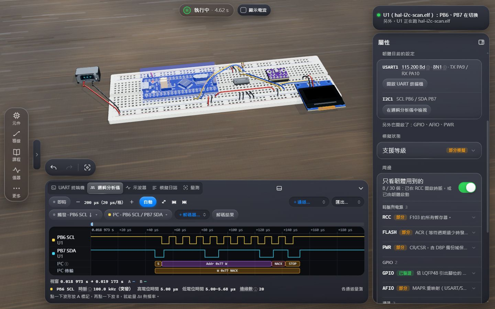

### 9.1 周邊分頁

最上方的「**韌體目前的設定**」列出執行中的韌體實際設定了什麼：每個 USART 的傳輸參數與 TX／RX 腳（例如「USART1 115 200 Bd · 8N1 · TX PA9 / RX PA10」）、
I²C 與 SPI 的腳位、計時器的 PWM 通道、ADC 的類比輸入，每一列都附看它的儀器：「開啟 UART 終端機」（直接打開這塊板子的這個 USART）、
匯流排的「加入邏輯分析儀（含解碼器）」、PWM 的「加入邏輯分析儀」，已經在邏輯分析儀上時改成「在邏輯分析儀中檢視」。沒有自己腳位的周邊寫在下方，例如「另外也開啟了：GPIO、AFIO、PWR」。
還沒有韌體或還沒執行時，這裡寫出下一步。

下面是支援表：依時脈與電源、GPIO、計時器、通訊、類比、其他分組，每個周邊標示「**已驗證**」（功能完整且有真實韌體整合測試）、「**部分**」或「**不支援**」，
點一下展開說明：做了什麼、**沒做什麼**、用哪些韌體驗證過。不支援的周邊（USB、CAN、RTC）讀取一律為 0、忽略寫入，並在模擬日誌記錄每一次存取。

韌體一旦開啟了周邊時脈，「**只看韌體用到的**」開關會預設打開，只列出已在 RCC 開啟時脈或已由韌體啟動的周邊（例如「8／30 個」）；關掉就顯示全部。
完整表格也在[模擬支援矩陣](support-matrix.md#微控制器周邊stm32f103c8)。

---

## 10. 載入韌體

有四種方式，全部走同一個載入器：

1. **內建韌體**：開發板沒有韌體時，韌體卡片最大的按鈕是「**選擇內建韌體**」（有韌體時是「改用內建韌體…」）。
   選擇器可搜尋（「搜尋韌體或範例」），分成「**本課使用**」（目前課程用到的韌體排最前面）、「**範例韌體**」（附範例的標題與說明）與「**其他**」；
   用來重現常見錯誤的韌體標示「**錯誤示範**」。↑／↓ 移動、Enter 載入、Esc 關閉。
2. **從電腦選檔**：「從電腦選擇檔案…」，接受 `.elf`、`.bin`、`.hex`。
3. **拖到韌體卡片上**。
4. **拖到 3D 畫面上**：拖曳檔案經過視窗時，畫面中央會出現「放開以載入到 U1」（瀏覽器允許讀取時附上檔名）；電路中有多塊開發板時，會為每一塊列出一個放置目標。
   不是韌體檔時會說「只接受 .elf、.bin 或 .hex 韌體檔」，電路中沒有開發板時會說「電路中沒有微控制器——先放一塊 Blue Pill 開發板」。

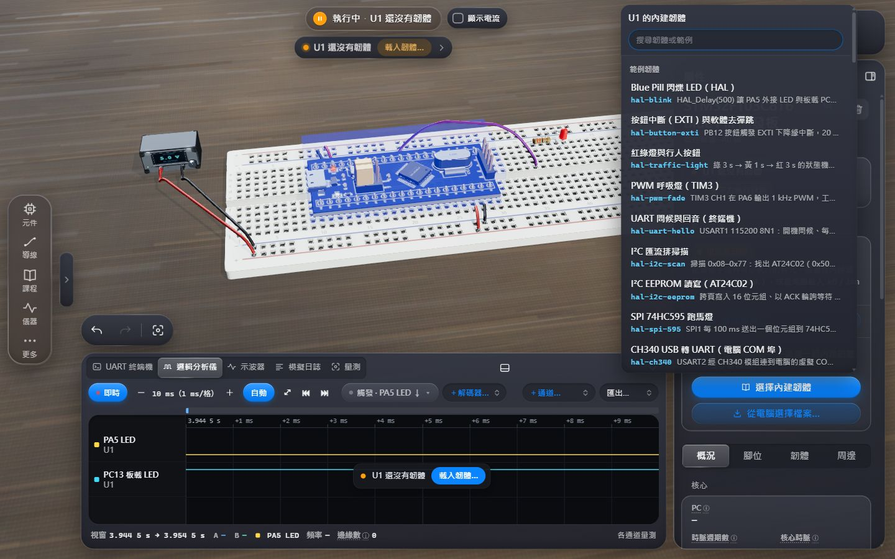

- **原始 `.bin` 沒有位址**：載入前卡片會請你確認燒錄位址（「原始二進位檔：請選擇要燒到快閃記憶體的哪個位址」），預設 `0x08000000`；
  其他位址會被警告「非預設位址：向量表必須位於 0x08000000」。ELF 與 HEX 檔內含自己的位址。
- 載入後 MCU 會重新上電重置，模擬自動執行、從頭跑新的程式（暫停中載入也會繼續執行，同一個檔案再載入一次也一樣）；UART 終端機插入一條分隔線「── 0.000 s · U1 載入 hal-uart-hello.elf（b9e9fd29）· 重置 ──」。
- **重新載入**：在 Edge／Chrome 中用「從電腦選擇檔案…」選的檔案，卡片上會有「重新載入」按鈕與「**檔案變更時自動重新載入**」開關——
  打開後，視窗顯示時每秒檢查一次檔案，在 STM32CubeIDE 重新建置後自動換上新的映像檔（`.bin` 會沿用原本的燒錄位址）。
- 卡片顯示檔名、格式（例如「ELF32 ARM（EABI5、軟體浮點），Thumb 進入點 0x08002099」）、大小、SHA-256 與載入器警告；「更換韌體…」「移除韌體」隨時可用。
- 韌體會保存在這個瀏覽器中（IndexedDB），也會隨「儲存專案」寫進專案檔；重新整理頁面後會重新解析並驗證雜湊後才綁定。

如何用 STM32CubeIDE 產生 ELF、時脈與腳位設定、哪些 HAL 功能可用，請看[韌體指南](firmware-guide.md)。

---

## 11. 偵錯器

在「概況」分頁的「偵錯」列，或用鍵盤（在任何地方都能用，在輸入框打字時也可以）：

| 動作 | 按鈕 | 快速鍵 |
|---|---|---|
| 停住核心（整個模擬一起等待） | ■ 停住核心 | F5（執行中） |
| 繼續 | 繼續／▶ 繼續執行 | F5（停住時）、空白鍵、點膠囊 |
| 單步執行一道指令 | 單步 | F10（暫停中按 F10 會先停住再單步） |
| 重置 MCU | 重置 MCU | Shift+F5 |

電路中有多塊開發板時，快速鍵作用在選取的那一塊。停住時：

- 顯示核心暫存器 `r0`–`r12`、`sp`、`lr`、`pc`、`xpsr`、`ipsr` 與條件旗標 N／Z／C／V；
- **PC 與 LR 都會對應到函式名稱**（ELF 有符號時），LR 為 EXC_RETURN 值時標示「例外返回」；
- 發生錯誤時列出 CFSR／HFSR 解讀出的**錯誤原因**（例如「除以零」「未定義指令」「精確資料匯流排錯誤」）。

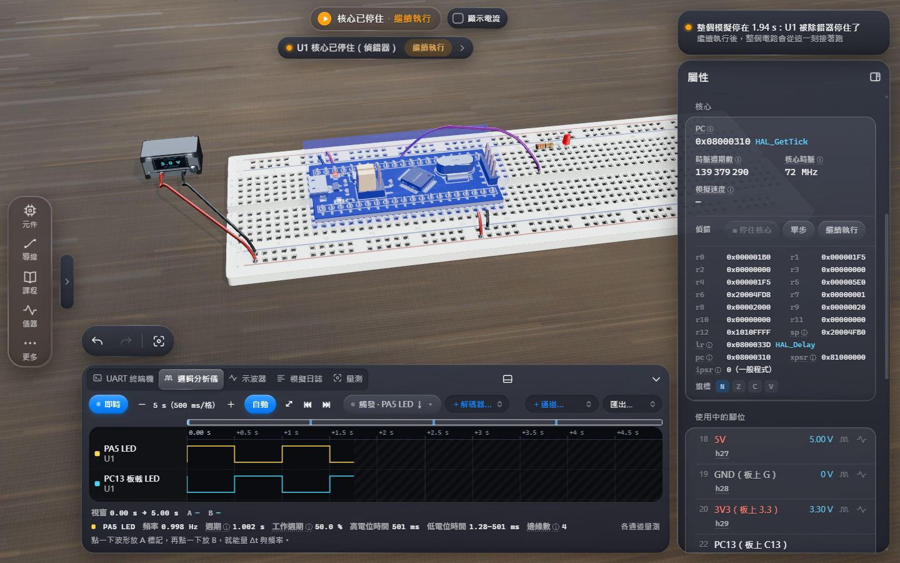

狀態提示列與膠囊會同步顯示「U1 核心已停住（偵錯器）」與「核心已停住 · 繼續執行」。

核心鎖死（處理錯誤時又發生錯誤）時，狀態為「故障（鎖死）」，提示列寫「U1 故障（鎖死）」並附「查看原因」。執行狀態卡片寫出原因：
載入的映像檔說明得了時直接點名，例如原始 `.bin` 燒在別的位址——「bare-blink.bin 載入在 0x08001000，所以 0x08000000 沒有向量表，核心一開機就出錯。」——
並附一鍵「**改用 0x08000000 重新載入**」（用同一份檔案重新燒到 0x08000000，核心隨即回到執行中）；初始堆疊指標不在 SRAM、重置向量的 Thumb 位元是 0 或沒有指向快閃記憶體時也會直接寫出來。
其他情況列出常見原因（0x08000000 沒有向量表，或堆疊指標錯誤），細節記在[模擬日誌](#17-模擬日誌)（「在模擬日誌中檢視」）。

目前**沒有中斷點、記憶體檢視器與時脈樹檢視**的操作介面。

---

## 12. UART 終端機

位置：儀器匣的「**UART 終端機**」分頁（手機：「儀器」→ UART）。

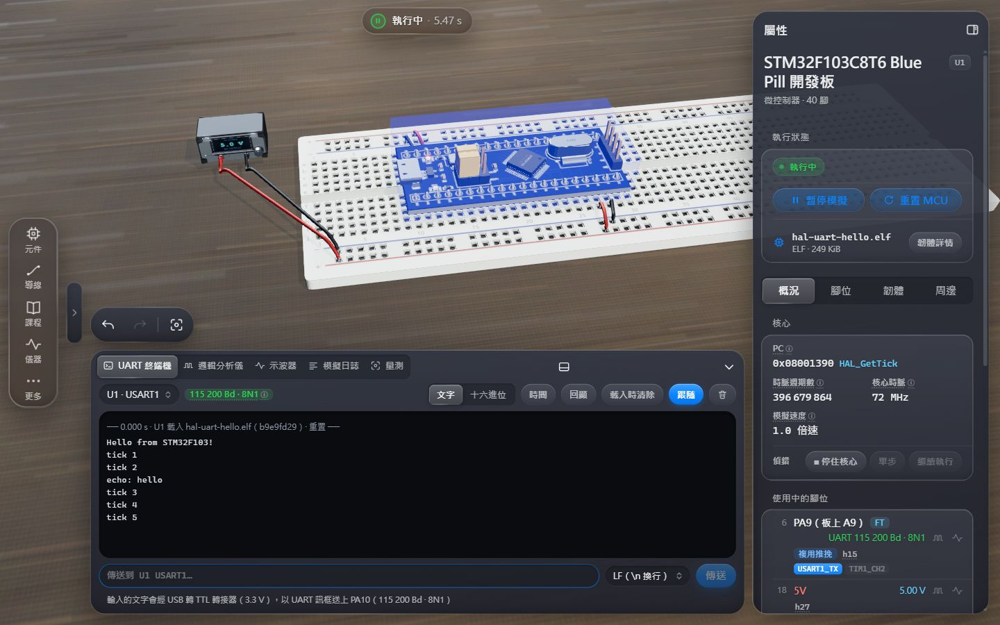

- **序列埠**選單列出每塊開發板的 USART（例如「U1 · USART1」），以及有虛擬序列埠的模組（CH340 的電腦端 `COM`、HC-05 的手機端 `BT`）。
  旁邊的綠色標籤是**韌體實際設定的傳輸參數**（例如「115 200 Bd · 8N1」，ⓘ 說明鮑率與 8N1）；韌體還沒啟用這個埠時會說明。
- 顯示方式：「文字」或「十六進位」；「時間」以收到的模擬時間標記每一行；「回顯」顯示你送出的內容；「載入時清除」在載入新韌體時清空（否則插入分隔線）；
  「跟隨」自動捲到最新輸出；垃圾桶清除緩衝區。
- **傳送**：在下方輸入框輸入文字、選擇行尾字元（無、LF、CR、CR LF），按「傳送」或 Enter。
- **點一行輸出**可以「在邏輯分析儀中檢視」：邏輯分析儀會對準這一行在 TX 線上的波形，並把 A 標記放在第一個起始位元。
  TX 腳還不在邏輯分析儀上時，會自動加入，之後收到的行就能回看。
  打開「回顯」後，你**送出的那一行**也有「在邏輯分析儀中檢視」：邏輯分析儀會對準它在 RX 腳（PA10，或重新對應後的腳位）上的訊框，A 標記放在第一個起始位元。
- 開發板「周邊」分頁的「開啟 UART 終端機」（[§9.1](#91-周邊分頁)）會直接選好那塊板子的那個 USART，例如韌體用的是 USART2 時就是「U1 · USART2」。

**送出的文字真的走在導線上。** 開發板的序列埠就像接了一個 3.3 V 的 USB 轉 TTL 轉接器：轉接器的 TXD 接在這個 USART 的 RX 腳
（USART1 → PA10、USART2 → PA3、USART3 → PB11；韌體重映射時跟著換腳），GND 接開發板的 GND。你輸入的文字以韌體設定的鮑率與格式，
一個位元一個位元地變成真正的 UART 訊框送上 RX 腳（鮑率與格式在按下「傳送」時取自韌體當時的設定），MCU 的 USART 再從腳位取樣接收——
RXNE、IDLE、DMA 與框架錯誤都和實機一樣。輸入框下方的一行字寫出這條路徑：

| 情況 | 輸入框下方的說明 | 「傳送」 |
|---|---|---|
| RX 腳空著（一般情況） | 「輸入的文字會經 USB 轉 TTL 轉接器（3.3 V），以 UART 訊框送上 PA10（115 200 Bd · 8N1）」 | 可以 |
| 正在送出 | 「正在送上 PA10……還有 12 個位元組（115 200 Bd · 8N1）」 | 可以 |
| RX 網路已經由電路中的其他輸出驅動（例如 CH340 模組的 TXD 接在 PA3） | 「PA3 已由 CH1 的 TXD 驅動，終端機不另外送出」，旁邊的「**改用 CH1 的 COM 埠**」直接切到模組自己的序列埠 | 變灰 |
| RX 腳直接接在電源或 GND | 「PA10 直接接在電源或 GND 上，終端機不另外送出」 | 變灰 |
| 韌體把 RX 腳當成一般輸出 | 「PA10 目前是 U1 的輸出腳（韌體沒有把它當成 USART1 的 RX），終端機不另外送出」 | 變灰 |
| 韌體還沒設定這個 USART | 「U1 還沒有設定 USART1 的鮑率，終端機不知道要用多快的速度送出」 | 變灰 |

終端機從不和電路互相衝突：只要有別的輸出在驅動 RX 網路，它就不送（已經接上時會放開那支腳，並在模擬日誌記錄原因）。
CH340 與 HC-05 這類模組有自己的序列埠（電腦端 `COM`、手機端 `BT`）：從那裡輸入的文字由模組自己的 TXD 送出，經過你接的導線到 MCU。

因為訊框真的在導線上，用邏輯分析儀量 RX 腳（例如 PA10）就看得到你送出的每個位元組，UART 解碼器也照常解碼；
RX 通道還沒有任何訊框時，波形上寫「PA10 上還沒有訊框——在 UART 終端機送出文字，USB 轉 TTL 轉接器就會把它以 UART 訊框送上這條導線」。
另一個方向，終端機直接讀取 USART 送出的位元組（不需要另外接線）；要看實際的 TX 波形，請用邏輯分析儀量 TX 腳（例如 PA9）。

---

## 13. 邏輯分析儀與協定解碼

位置：儀器匣的「**邏輯分析儀**」分頁（手機：「儀器」→ 邏輯）。最多 16 個通道。

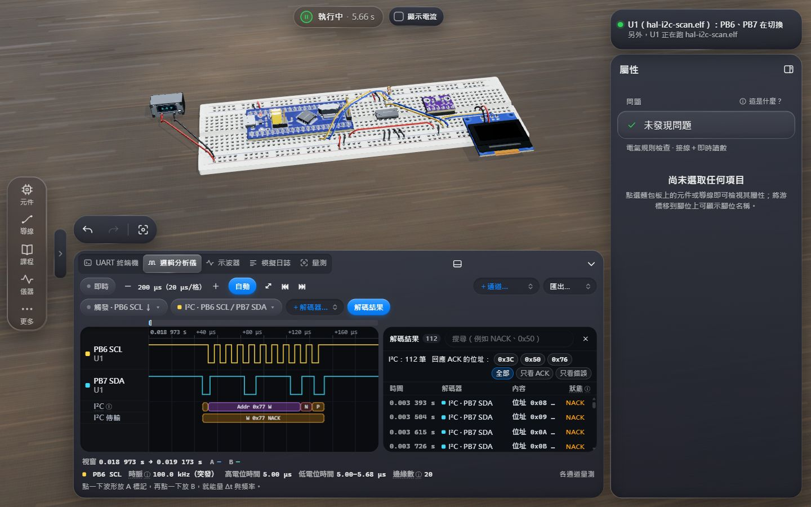

**加入通道**：

- 「**＋通道…**」選單分成「匯流排（通道＋解碼器）」（例如一次加入 I²C1 的 PB6／PB7 與 I²C 解碼器）、「使用中的腳位」（韌體正在使用的腳，
  標出目前的功能，例如 `USART1_TX`）、「網路」與「全部腳位」；
- 在 3D 的腳位或孔位上按右鍵 →「加入邏輯分析儀」，或屬性面板腳位列的 ⎍；
- 放置「邏輯分析儀探棒」元件後按「＋探棒」。

MCU 腳位與只由數位元件、上下拉電阻組成的網路，邊緣時間是**精確**的（週期等級）；其他類比網路以 0.8／2.0 V 門檻轉成邏輯準位（通道名稱旁會說明），
訊號始終達不到門檻時會提示「改用示波器」。

**檢視**：

- 「**即時**」跟隨模擬時鐘；「−／＋」縮放（顯示「5 s（500 ms/格）」）；「**自動**」讓每個通道的訊號都看得到（最慢的通道至少 2 個週期，或最新一筆解碼結果）；
  ⤢ 顯示全部記錄；⏮／⏭ 跳到上一個／下一個解碼訊框或邊緣。上方的活動條顯示整段記錄的訊號活動，點一下放大到那裡；還沒錄到的區段畫斜線。
- **時間軸**：第一個刻度是模擬時間（例如「1.91 s」），其餘刻度是相對它的時間差（「+0.5 s」「+1 s」…），任何縮放與手機上都讀得清楚。
- **標記**：點一下波形放 A 標記，再點一下放 B（會吸附到最近的邊緣；按住 Alt（Mac：Option）點一下則放在點的位置），下方讀出 Δt 與頻率。
- 讀數列顯示第一個通道的頻率、週期、工作週期、高電位時間、低電位時間與邊緣數（時間不固定時寫成「最短–最長」，例如「低電位時間 1.28–501 ms」）；
  「**各通道量測**」列出每個通道（A–B 之間或整個視窗）。視窗裡不到一個完整週期時，數字取自最近一段記錄，並在名稱後標出「（最近 …）」的範圍。
  頻率只對週期訊號給出：UART 這類序列資料寫「—（非週期訊號：序列資料）」並改顯示鮑率，突發的時脈寫「100.0 kHz（突發）」；
  訊號規律重複之後停了，會寫「—（已停在低電位，最後一個邊緣 …）」，不再給頻率。
- 記錄緩衝區只保留最新的 65 536 個邊緣；看的是已被覆寫的時段時會說明，並請你按「自動」回到最新的訊號。
- 點通道名稱會在電路板上標示它的來源；右鍵可以重新命名、在屬性面板查看這支腳、移除通道。

**觸發**：觸發晶片（例如「觸發 · PA5 LED ↓」）打開觸發設定——邊緣觸發（上升緣、下降緣、任一邊緣）或樣式觸發（每個通道 X／0／1）、觸發前比例，按「準備觸發」等待條件。

**協定解碼**：「＋解碼器…」加入 **UART**、**I²C**、**SPI**、**1-Wire**，指定各角色的通道（例如 I²C 的 SCL 與 SDA）與參數（UART 鮑率可設「自動」、SPI 模式 0–3、位元順序、字組長度…）。
解碼結果畫在通道下方（I²C 的字母 S＝開始、Sr＝重複開始、P＝停止、A＝ACK、N＝NACK，旁邊的 ⓘ 有說明）；
「**解碼結果**」打開表格：最上方是摘要（例如「I²C：112 筆」與「回應 ACK 的位址：」0x3C、0x50、0x76，點一個位址只看它的資料），
可以依狀態篩選（全部、只看 ACK、只看錯誤）或搜尋（例如 `NACK`、`0x50`），點一列就在波形中顯示那個訊框。
解碼器**只看記錄下來的邊緣**，就像實驗室的邏輯分析儀：接錯線就解出錯誤，不會假裝成功；MCU 開機時腳位還沒穩定的雜訊會標示「開機雜訊」。

**匯出**：「匯出…」可匯出 VCD（邏輯準位，可用 PulseView／GTKWave 開啟）、CSV 邊緣清單、CSV 解碼結果；範圍可選「可見視窗」或「全部記錄」。

通道、解碼器與觸發設定保存在這個瀏覽器中，也會隨「儲存專案」寫進專案檔。

---

## 14. 示波器

位置：儀器匣的「**示波器**」分頁（手機：「儀器」→ 示波器）。最多 4 個通道（CH1–CH4）。

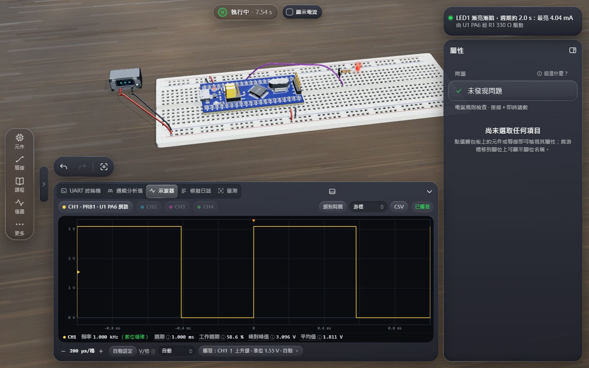

1. 在要量測的網路上放「示波器探棒」——最快的方法是在 3D 的腳位或孔位上按右鍵 →「放示波器探棒」，探棒會自動放在同一個網路的空孔並分配通道。
2. 模擬執行時按「**自動設定**」：畫面顯示 2–3 個週期、自動 V/格、在 50 % 準位的上升緣觸發（完成時提示「已自動設定：200 µs/格、觸發 CH1 ↑」）。

| 控制 | 功能 |
|---|---|
| CH1–CH4 晶片 | 顯示／隱藏通道；晶片寫出探棒與網路（「CH1 · PRB1 · U1 PA6 網路」），點一下在電路板上標示，按右鍵看更多 |
| 時基（−／＋） | 每格時間（「200 µs/格」） |
| V/格（自動或固定值） | 垂直刻度；選了固定值時另有把波形上移／下移一格的按鈕 |
| 觸發晶片 | 一個晶片寫出目前的觸發，例如「觸發：CH1 ↑ 上升緣 · 準位 1.55 V · 自動」；點一下設定來源、邊緣、準位、模式（自動／一般／單次）與觸發抑制時間。「單次」擷取下一次觸發後停止 |
| 游標（時間／電壓） | 拖曳線條，或按 A／B 選一條再用方向鍵移動 |
| 絕對時間 | 時間軸改用模擬時鐘標示（與邏輯分析儀相同） |
| CSV | 匯出顯示中的取樣 |

量測列依訊號調整：只有高低兩個準位的數位訊號（例如 PWM）顯示頻率、週期、工作週期、峰對峰值與平均值；
類比波形（例如 RC 電路的電容電壓）顯示最大、最小、峰對峰值、平均值、均方根與上升時間（10–90 %）。名稱旁的 ⓘ 說明每一項。示波器**量不準時不給數字**：
時基太慢、視窗內不到一個完整週期或取樣不足時，會寫出原因並建議按「自動設定」。同一個網路也在邏輯分析儀上時，頻率改用精確邊緣計算並標示「（數位精確）」；
時間範圍很大時以最小／最大值抽取顯示（尖峰保留，平均值為近似值，畫面會註明）。

---

## 15. 萬用電表與「量測」分頁

在元件庫「儀器」分類放置「**數位萬用電表**」，它是板外儀器，端子為 **COM** 與 **IN**。檔位在屬性面板的「檔位」切換（執行中也可以切換）：

| 檔位 | 接法 | 模型 |
|---|---|---|
| V | IN、COM 並聯在待測兩點 | 10 MΩ 輸入阻抗 |
| A | **串聯**在電路中 | 0.1 Ω 分流電阻 |
| Ω | 接在**未通電**的待測元件兩端 | 1 V／10 kΩ 歐姆計電源 |

只量直流；與實際電表一樣，通電電路中的 Ω 讀值無效；A 檔沒有保險絲模型，直接跨接在電源上就是短路。
顯示值是約 100 ms（模擬時間）內的平均，與積分式電表相同：量 PWM 腳讀到的是平均值（工作週期 × 高電位）。

儀器匣的「**量測**」分頁常駐顯示電路中**所有**萬用電表與電源供應器的讀數（不必先選取它們），以及邏輯分析儀上各網路的即時摘要；
點一列可以在電路板上標示該儀器。讀數也會顯示在電表 3D 模型的螢幕與屬性面板的大字讀數上。
探棒還沒接好的電表不顯示數字，而是寫出缺哪一支與下一步（依檔位而定），例如「探棒未接（DMM1 兩支探棒都還沒接線）——把 COM 接到 GND、IN 接到要量的點」；
「量測」分頁與屬性面板的讀數卡片寫的是同一句話。

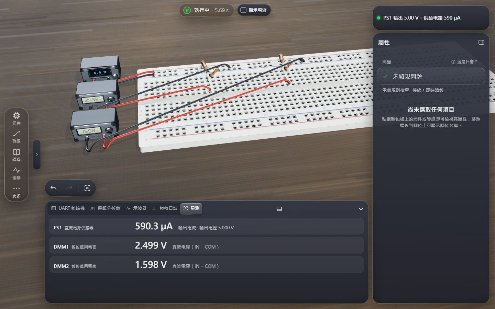

電流讀數只計入有電氣模型的部分：**晶片本身的耗電（72 MHz 時約 20–36 mA）未模擬**，所以電源供應器讀到的電流不含晶片本身；
顯示模組的面板等元件本身也不消耗電源電流。555、74xx、CD40xx、LM358 這些行為模型晶片的輸出電流，求解器讓它經電路接地返回、不經過電源，
所以電源供應器讀到的電流也不含它；「顯示電流」則把它算回晶片的電源腳，光點走的是真正的迴路。每個元件沒有模擬的部分列在屬性面板的「未模擬」清單與[模擬支援矩陣](support-matrix.md#各元件的模擬範圍)。

---

## 16. 從腳位、孔位、導線直接量測

不必先找儀器，可以從你正在看的地方直接量：

| 從哪裡 | 怎麼做 | 可以做什麼 |
|---|---|---|
| 3D 的腳位、孔位、板外端子 | 桌面：**按右鍵**；手機：**長按** | 探測選單：「加入邏輯分析儀」「放示波器探棒（CH n）」「選取接在這裡的元件」，MCU 腳位另有「在屬性面板查看這支腳」 |
| 屬性面板的腳位列 | ⎍ ／ ∿ 按鈕 | 加入邏輯分析儀／放示波器探棒 |
| 選取導線 | 屬性面板的「網路」 | 「加入邏輯分析儀」「放示波器探棒」 |
| 課程步驟 | 引導卡的動作按鈕 | 例如「把 PA5、PC13 加到邏輯分析儀」 |

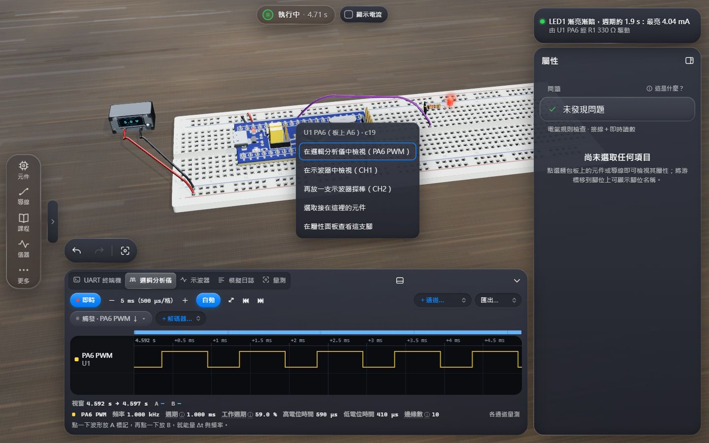

已經在量的點不會重複加入：選單改成「在邏輯分析儀中檢視（PA6 PWM）」「在示波器中檢視（CH1）」，按下後打開該儀器並閃示那個通道；
真的需要第二支探棒時，另有「再放一支示波器探棒（CH2）」。四個示波器通道都在使用中、或那個網路已經沒有空孔時，選項會變灰並寫出原因。
反過來，點邏輯分析儀的通道名稱或示波器的 CH 晶片，可以回到 3D 中標示它的來源。

---

## 17. 模擬日誌

位置：儀器匣的「**模擬日誌**」分頁。記錄韌體通知、不支援周邊的存取、載入器訊息、時脈與燒錄的警告、電氣警告，
以及 UART 終端機的轉接器沒有送出或放開 RX 腳的原因（例如「U1 USART2：終端機的 USB 轉 TTL 轉接器已放開 PA3——PA3 已由 CH1 的 TXD 驅動」）；
可以依等級（全部、警告、錯誤）與來源（模擬器、實驗室、核心、載入器）篩選，「跟隨」自動捲到最新項目。
問題面板中有詳細記錄的問題，可以按「在模擬日誌中檢視」直接跳到這裡。

---

## 18. 電氣規則檢查（ERC）

ERC 依接線、元件資料手冊的額定值，以及（模擬執行時）最新的模擬讀數進行規則式檢查，結果顯示在[問題面板](#7-問題面板)。
面板下方的一行字說明目前的依據：「接線與額定值（模擬執行時加入即時讀數）」或「接線＋即時讀數」。
函數產生器也算電源：只用它驅動 LED 的電路不會被說成「電路中沒有電源」；開發板、IC 這類需要供電的元件仍要接直流電源或電池。

規則共 13 條：電源短路、LED 限流（含 LED 接反）、GPIO 過電壓（區分可耐受 5 V 的 FT 腳）、浮接輸入、I²C 上拉電阻、電源電壓範圍、邏輯準位、
超出額定、共地參考、腳沒接、電源軌沒有接電源、未供電、腳位沒有被驅動（即時）。每條規則在各等級的判斷標準見
[模擬支援矩陣](support-matrix.md#電氣規則檢查erc的規則)。

ERC 會考慮韌體的實際狀態：例如韌體啟用了內部上拉，按鈕輸入的「浮接」就會解除；MCU 還在重置、BOOT0 = 1 或周邊沒有開時脈時，不會怪罪韌體的腳位設定。
ERC **不能證明電路一定正確或安全**；它只在有資料（額定值、讀數）時才下判斷，不會臆測。

---

## 19. 課程

位置：左側面板的「**課程**」分頁（工具列「課程」；手機：工具列「課程」）。23 堂課依**初級**、**中級**、**進階**分組，
卡片顯示課程編號（例如「中級 1」）、預估時間、模擬狀態（可執行、部分模擬、尚不可執行）與你的進度（已完成、以解答完成、目前步驟、上次檢查結果）。

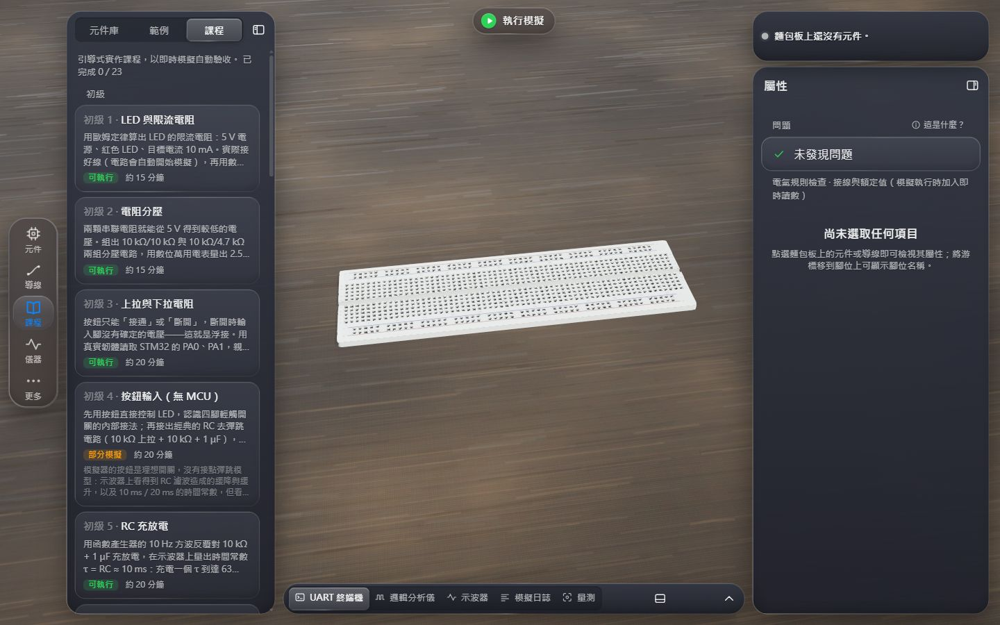

一課分成七個章節：**目標、接線、原理、步驟、預期結果、常見錯誤、驗收**。課程頁上方的按鈕：

| 按鈕 | 作用 |
|---|---|
| **載入起始電路** | 以這一課的起始電路取代麵包板上的電路，並開始引導 |
| **載入完整答案** | 載入這一課完成的電路（和韌體）；一直顯示在課程頁上方，不必到選單裡找 |
| **開始引導** | 這一課的電路不在麵包板上時，先換上它的起始電路，再從第 1 步開始引導 |
| **檢查我的電路** | 對**你現在的電路**（含已載入的韌體）執行所有驗收條件；起始電路載入後成為主要按鈕 |
| 重新載入起始電路 | 重來一次 |
| 列印講義 | 可列印的講義：步驟、接線表、常見錯誤與驗收清單；可選學生版（不含解答）或教師版（含解答） |

這些載入（還有驗收通過後的「**下一課**」）都**直接換上**電路，不再問一次：提示會寫出載入了什麼並附〔復原〕，按一下就回到原本的電路。
只有一種情況會先詢問：換上的電路會蓋掉開發板上已載入的韌體——韌體不在復原紀錄裡。這時對話框會寫出是哪一塊板子和哪個韌體，例如
「要取代電路和 U1 的韌體嗎？」「……也會取代已載入的韌體：U1 的 hal-blink.elf（韌體無法復原）。」

### 引導卡

課程開始後，**引導卡**固定在左側面板上方（不會遮住 3D 畫面）：「步驟 1/6 · 標題」、這一步的說明、「為什麼？」（展開原理）、上一步／下一步，
並在 3D 中標示要用到的孔位與元件（孔位代號可以點，點了會在電路板上標示）。卡住時，引導卡下方的「**卡住了？載入完整答案**」一鍵換上完成的電路（一樣可以復原）。每一步都有一鍵動作，例如：

- 「拿一顆電阻」（直接進入放置模式；放好後自動選取並打開屬性面板）、「把 R1 設為 330 Ω」；
- 「開始接線（a16 → top-13）」（進入導線模式並標出起點與終點）；
- 「載入 hal-blink 到 U1」（內建韌體，一鍵載入；之後顯示「U1 已載入 hal-blink」）；
- 「把 PA5、PC13 加到邏輯分析儀」；模擬平常會自己執行，只有模擬沒在執行時（例如你暫停了），需要模擬的步驟上才會出現「▶ 執行模擬」；
- 「重現這個錯誤：載入 lesson-i1-noclk」／「換回 hal-blink」（錯誤示範）。

只看接線的步驟在你每次編輯後自動檢查，接對了就打勾（接線步驟完成時，導線模式也會自動結束）；需要模擬的步驟按「檢查此步驟」。
模擬執行時（開啟課程電路就會自動執行），需要量測的步驟也會自己檢查。浮在畫面上的引導卡（收合左側面板或在手機上時）在模擬自動執行（包括步驟上的「重置模擬」之後）時不會收合，只有你自己按下執行時才收成一行標題。
「下一步」按鈕一直留在看得到的地方，最後一步會帶你到「前往驗收 · 檢查我的電路」。
換成別的電路或清空麵包板時，引導會自動結束並說明，不會在別的電路上繼續引導；重新整理頁面後會回到原本的步驟。

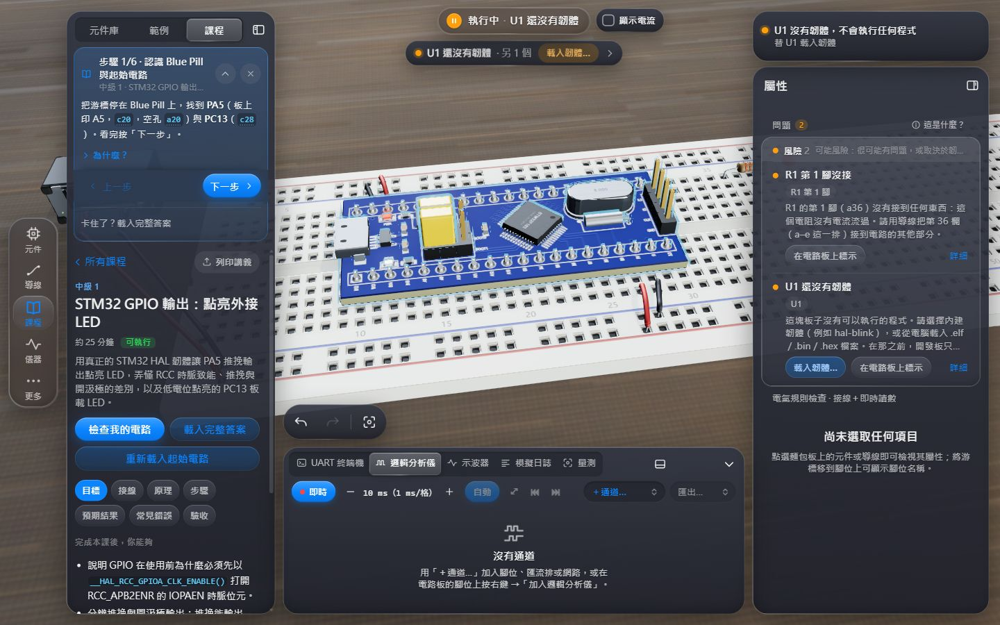

### 驗收

**驗收是真的模擬，不是動畫。** 每一項條件都用真實模擬評估：網路連接（「PA5 經 150 Ω～1 kΩ 的限流電阻接到 LED1 陽極」）、
執行模擬後量測電壓、頻率、工作週期、電流或 LED 亮度、韌體的 UART 輸出、韌體的 `checks` 行為契約、ERC。
檢查在背景執行緒中進行並顯示進度；結果逐項列出**量測值與預期值**（例如「量測值 0.998 Hz（預期 0.95 Hz – 1.05 Hz）」）。

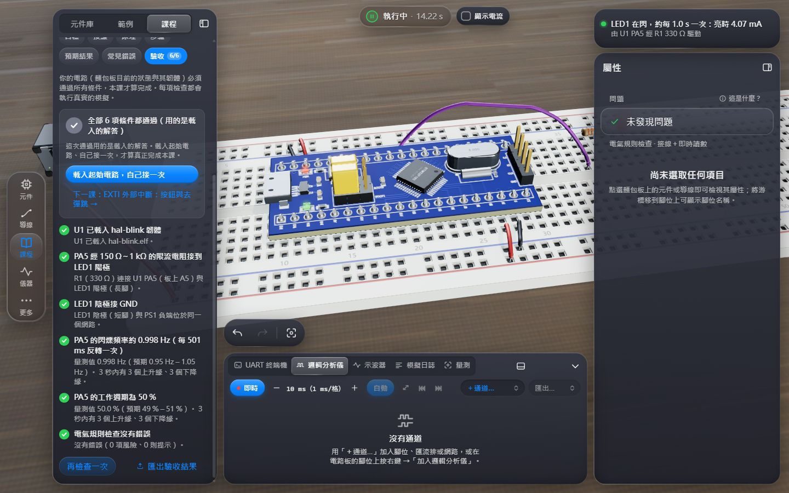

- 沒有全部通過時，第一行是「**最可能的原因**」——比對課程列出的常見錯誤，附「解法」與「在電路板上標示」；因同一原因而失敗的項目會合併說明。
- 全部通過時，這一課標為「已完成」，並出現「**下一課**」與跳到下一級的按鈕。若是載入解答後通過，會標為「以解答完成」，並提醒自己接一次才算完成。
- 「**匯出驗收結果**」下載結果（JSON）並打開可列印的**驗收收據**（檢查時間、每項條件的預期與實測、電路 SHA-256、署名）；
  收據上的姓名／座號可以在匯出時設定。
- 學習進度（目前步驟、完成日期、上次檢查結果）存在這個瀏覽器中，不會寫進專案檔。

課程若需要尚未模擬的功能，會標示「部分模擬」或「尚不可執行」並寫出缺少什麼：「部分模擬」的課程可以執行與驗收（說明列出沒有模擬的部分，
例如按鈕沒有接點彈跳），「尚不可執行」的課程只能閱讀。各課程的狀態見[模擬支援矩陣](support-matrix.md#課程的模擬狀態)。

---

## 20. 範例

位置：左側面板的「**範例**」分頁（手機：「元件 → 範例」）；「更多 → 範例 ›」與空白麵包板上的「開啟範例」打開的都是同一份清單。38 個範例分成六類：**GPIO、計時器與 PWM**、**序列匯流排與通訊**、**顯示器**、
**感測器與輸入**、**馬達與致動器**、**經典類比與邏輯電路**；可以用關鍵字（標題、晶片、標籤，例如 `I2C`、`DMA`、`OLED`）搜尋，並依分類與難度（初級、中級、進階）篩選。

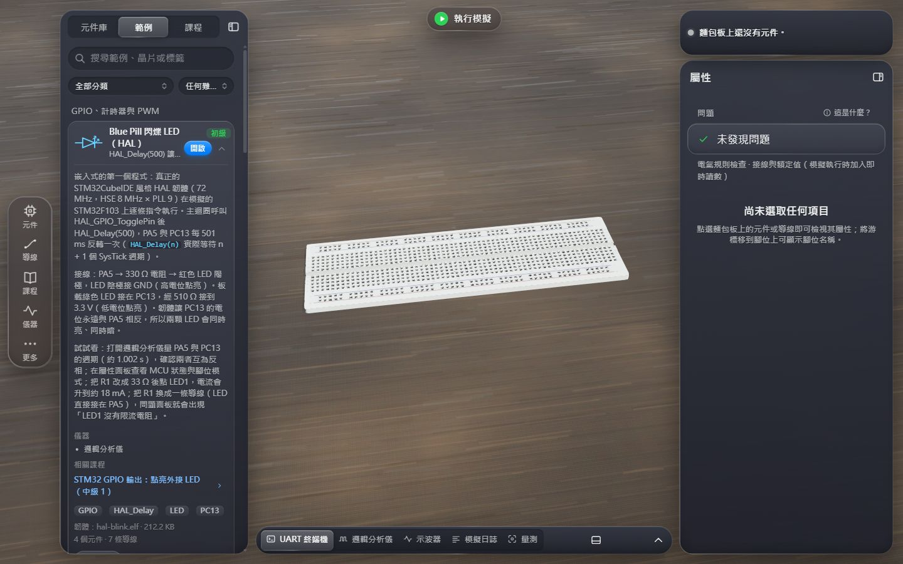

- 卡片上的「**開啟**」直接載入；展開後可以看到說明（原理、接線、「試試看」）、會用到的儀器、**相關課程**（點一下打開那一課）、標籤、內嵌的韌體與元件數量，
  部分模擬的範例另有**未模擬的部分**（例如 CH340 與 HC-05 的電腦／手機端是虛擬序列埠，不是真的 USB 或藍牙）。
- 開啟範例會**直接取代目前的電路**，提示「已開啟「…」」附〔復原〕，按一下就回到原本的電路；並自動打開它用到的儀器分頁、設定好邏輯分析儀的通道與解碼器；韌體載入開發板後就自動開始模擬，不用按執行。
  只有麵包板上的開發板已經載入韌體時才會先問：範例會取代那份韌體，而韌體無法復原，所以對話框會寫出是哪一塊板子的哪個韌體。
- 每個範例都在真實模擬中執行：測試會實際執行每個範例，確認韌體的 UART 輸出與預期行為真的出現。
- 「經典類比與邏輯電路」包含上游 ohmlet 的四個電路（555 LED 閃爍電路、日期顯示器、0–9 計數器、小夜燈）與不需要韌體的類比範例。

範例檔案在 [`examples/`](../examples)：經典電路是純電路 JSON；嵌入式範例是內含韌體的 `examples/embedded/*.ohmlet.json` 專案檔，也可以用「更多 → 開啟專案…」直接開啟。

---

## 21. 專案：儲存與開啟

在「**更多 → 電路**」：

| 動作 | 說明 |
|---|---|
| **儲存專案**（Ctrl+S） | 下載 `.ohmlet.json` 專案檔：電路、每塊開發板的韌體（內嵌並附 SHA-256 與大小）、邏輯分析儀的通道／解碼器／觸發設定、面板配置 |
| **開啟專案…** | 開啟 `.ohmlet.json` 或一般電路 `.json`。較新版本的 ohmlet 建立的檔案會被拒絕並說明，不會只讀一半；韌體的大小或雜湊不符時整個專案會被拒絕 |
| **匯入電路 JSON** | 從 `.json` 檔案或貼上的 JSON 匯入純電路配置（與 AI 輸出相同的格式），匯入前會完整驗證並列出問題 |
| **匯出電路 JSON** | 下載並複製純電路配置（不含韌體） |
| **清空麵包板** | 立刻移除所有元件與導線（不再確認）；提示「已清空麵包板」附〔復原〕，整塊麵包板連同韌體設定一起回來 |

目前的電路也會自動儲存在瀏覽器中，韌體存在瀏覽器的 IndexedDB；重新整理頁面後會還原。
舊檔案中的按鈕代號 `PB1` 會在載入時改成 `SW1`（避免與 STM32 的 PB1 腳位同名）。

---

## 22. 設定與「更多」面板

「**更多**」面板（工具列最下方）：

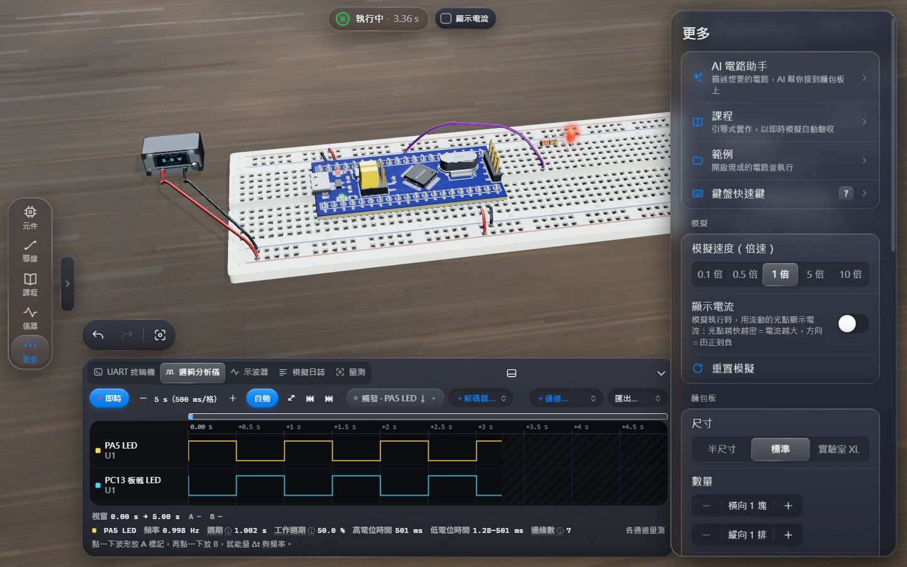

- **AI 電路助手**：用一句話描述電路，Claude 會產生電路配置，先在模擬器中測試，再由你決定是否放到麵包板上。需要自備 Anthropic API 金鑰
  （「設定 → Anthropic API 金鑰」；只存在這個瀏覽器，只傳送到 api.anthropic.com）。AI 只產生電路，不產生韌體。
- **課程**、**範例**（打開範例清單）、**鍵盤快速鍵**。
- **模擬**：「模擬速度（倍速）」——0.1 倍、0.5 倍、1 倍、5 倍、10 倍；**顯示電流**開關（同膠囊旁的勾選鈕與 Shift+C，見 [§5](#5-執行模擬狀態膠囊)）；重置模擬。
- **麵包板**：尺寸（半尺寸、標準、實驗室 XL）、數量（橫向最多 6 塊、縱向最多 4 排）。
- **圖形 → 算繪模式**：效能（最快、最省電，手機預設）、增強（HDRI 打光、環境光遮蔽、反鋸齒，桌面預設）、攝影棚（漸進式光線追蹤，適合截圖）。
- **電路**：見 [§21](#21-專案儲存與開啟)。
- **設定**：**介面語言**（繁體中文／English；也可以在網址加上 `?lang=en`）、**音效**開關（「課程通過或電路正常運作時的提示音、元件燒毀的爆裂聲，以及插拔元件、接線、按鈕、開關與繼電器的機械聲」；
  預設打開，打開時會先播一聲按鈕聲和提示音讓你聽聽看，選擇記在這個瀏覽器）、**嵌入式工作區**開關、**效能診斷**（在 3D 畫面角落顯示畫面更新率、
  模擬速度、類比求解步數、模擬執行緒負載與每塊開發板的 MIPS，關閉後不增加任何負擔）、Anthropic API 金鑰、**關於 ohmlet**。

---

## 23. 鍵盤快速鍵

按 **?** 或「更多 → 鍵盤快速鍵」可以隨時打開這份清單。

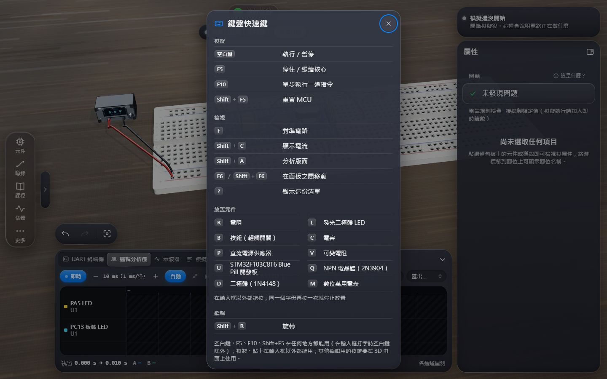

| 按鍵 | 功能 |
|---|---|
| 空白鍵 | 執行／暫停 |
| F5 | 停住／繼續核心 |
| F10 | 單步執行一道指令 |
| Shift+F5 | 重置 MCU |
| F | 對準電路 |
| Shift+C | 顯示電流（開／關） |
| Shift+A | 分析版面（桌面工作區） |
| F6／Shift+F6 | 在面板之間移動焦點（工具列、左側面板、3D 畫面、屬性面板、儀器匣） |
| ? | 顯示快速鍵清單 |
| Shift+R | 旋轉 |
| Delete | 刪除 |
| Ctrl+C（Mac：⌘C） | 複製選取的元件（連同參數） |
| Ctrl+X（Mac：⌘X） | 剪下選取的元件 |
| Ctrl+V（Mac：⌘V） | 貼上（滑鼠所指處或原件旁） |
| Ctrl+D（Mac：⌘D） | 在旁邊複製一份 |
| 方向鍵 | 微移選取的元件 |
| Esc | 取消目前動作／取消選取 |
| Ctrl+Z／Ctrl+Y（Mac：⌘Z／⌘Y） | 復原／重做（Ctrl+Shift+Z 也是重做） |
| Ctrl+S（Mac：⌘S） | 儲存專案 |

**放置元件**（在輸入框以外都能按；同一個字母再按一次就停止放置）：

| 按鍵 | 元件 |
|---|---|
| R | 電阻 |
| L | 發光二極體 LED |
| B | 按鈕（輕觸開關） |
| C | 電容 |
| P | 直流電源供應器 |
| V | 可變電阻 |
| U | STM32F103C8T6 Blue Pill 開發板 |
| Q | NPN 電晶體（2N3904） |
| D | 二極體（1N4148） |
| M | 數位萬用電表 |

空白鍵、F5、F10、Shift+F5 在任何地方都能用（點過面板按鈕之後也一樣；在輸入框打字時空白鍵除外）；複製、貼上在輸入框以外都能用；其他編輯用的按鍵要在 3D 畫面上使用。
點過選項組（例如 UART 的「文字／十六進位」）、分頁或滑桿之後，方向鍵會操作那個控制項（焦點跟著移到新選的選項），不會微移元件，Delete 也不會刪掉元件；點一下 3D 畫面，方向鍵和 Delete 就回到電路板上。手機版的面板（儀器、屬性、更多）裡也一樣：點過裡面的選項之後，空白鍵、F5、F10 照樣能執行、暫停、除錯。
空白鍵在模擬執行時是暫停，暫停時是繼續（模擬平常會自己執行，見 [§5](#5-執行模擬狀態膠囊)）。
按鈕的提示文字會寫出它的快速鍵，例如「單步執行一道指令（F10）」。

| 滑鼠 | 功能 |
|---|---|
| 左鍵拖曳孔位以外的地方 | 旋轉視角 |
| Alt（Mac：Option）+ 左鍵拖曳 | 旋轉視角（從孔位開始也一樣） |
| 從孔位、腳位或端子拖到另一個孔位或端子 | 接一條導線（可以拉線的地方游標是十字） |
| 拖曳導線插在孔位裡的一端 | 把那一端改接到別處 |
| 按住腳位或孔位不動 | 不會跳出選單；接著拖曳就是拉線（觸控才有長按選單） |
| 拖曳已選取的元件 | 移動 |
| 右鍵拖曳 | 平移 |
| 滾輪 | 縮放 |
| 在空白處點兩下 | 重新取景 |
| Shift + 拖曳空白麵包板 | 框選 |
| 右鍵點腳位／孔位／端子 | 探測選單 |

---

## 24. 手機與平板

手機與平板使用同一套模擬與電路，介面改為底部工具列與底部面板：

| 工具列 | 內容 |
|---|---|
| 元件 | 「元件庫」與「範例」兩個分段：元件庫同桌面的搜尋、篩選與詳細資訊（放置中標題下方會寫「放置中：… · 再點一次卡片即可結束」）；範例同[§20](#20-範例) |
| 導線 | 導線模式（點「完成」結束，點空白處取消這一條；不進導線模式也能長按孔位再拖曳接線）；下方一列寫出顏色的意思「● 電源正　● 地　●●● 訊號」 |
| 課程 | 課程清單與課程頁；引導卡以精簡版顯示 |
| 儀器 | UART、邏輯、示波器、日誌、量測五個分段 |
| 更多 | 問題（有問題時排在最上方）、AI 電路助手、課程、範例、模擬、麵包板、圖形、電路、設定 |

| | |
|---|---|
| 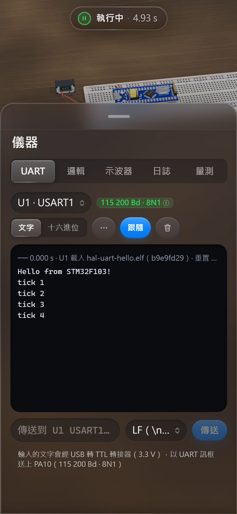 | 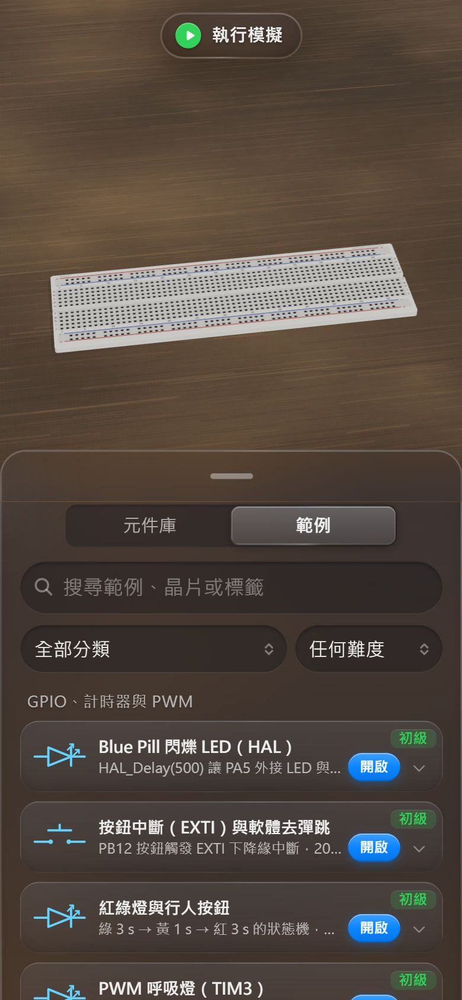 |

狀態提示列在觸控裝置上寫得比較短，例如「電路已就緒」加〔執行模擬〕按鈕；刪除後的提示寫「點 ↶ 可復原」。模擬暫停時，窄螢幕上那一行可能顯示不完；點一下就會完整顯示「模擬已暫停——改動接線或元件就會自動繼續」。手機上的提示訊息會浮在打開的面板上方，不會蓋住面板裡的文字。

放置元件時，把元件面板往下滑掉（或點底部的「元件」關閉）就結束放置，不會在下一次點麵包板時又開始放一顆。放好一顆後面板縮在下方時，點一下「元件」會把面板拉回來，直接挑下一個元件。

手機上沒有電路說明卡（[§6.1](#61-電路說明)）：電路沒有問題、提示列也沒有其他話要說時，提示列會寫出電路說明的第一行（例如「LED1 亮著：亮度 49 %（9.70 mA）」），
點一下就以提示訊息顯示完整的兩行；使用螢幕閱讀器時，說明的對象或狀態改變也會念出來。

觸控手勢：單指拖曳旋轉、雙指捏合縮放、雙指拖移平移、點一下放置或選取、點兩下空白處重新取景、**長按孔位或腳位約半秒再拖曳**接一條導線（[§4](#4-接線)），
**長按導線的一端再拖曳**改接那一端（長按時小標籤寫出放開與拖曳各會做什麼）。
**長按元件**打開動作選單（屬性、旋轉、複製、加入選取、刪除；「複製」會立刻在旁邊放一份連同參數的複本；燒毀的元件另有「換新」）——長按在元件本體上（例如電阻的色環、LED 的燈罩）就算，即使本體下面剛好是空的孔位；
**長按孔位、腳位或導線端點後直接放開**打開探測選單。
連結到儀器的按鈕（例如問題面板的「在模擬日誌中檢視」、課程的「把 PA5 加到邏輯分析儀」）會直接打開「儀器」面板的對應分段。
