# ohmlet embedded lab：使用者體驗審查與改善計畫

> 審查日期：2026-10-12　·　審查版本：`embedded-platform` 分支 @ `45c6561`
> 審查標準：產品負責人的要求：**「介面要非常直覺、易用、好懂、好分析」**
> 必須遵守：沿用 ohmlet 原有的視覺語言（Liquid Glass、3D 質感），介面全中文（zh-TW），不做假模擬，legacy 視覺回歸場景維持 0 差異，不增加每一影格的 React 運算

---

## 0. 一頁結論

這個 App 的「骨架」已經很強：模擬是真的（真實韌體、真實量測）、錯誤訊息大多寫得清楚、課程能用實測值驗收，Liquid Glass 的風格也一致。問題出在**把使用者帶到這些能力的路徑上**。五位測試者在同樣幾個地方卡住：

1. **核心路徑有兩個斷點。** 中級課程要求「載入內建韌體」，但介面只能從電腦選檔，8 / 17 堂課在瀏覽器裡無法誠實完成。示波器在預設時基下會給出錯 34 % 的頻率。
2. **找不到「執行」，狀態也會誤導人。** 唯一一直看得到的執行控制，看起來像狀態標籤。MCU 只是還沒執行就顯示「未供電」。沒載韌體時，介面卻顯示綠燈「執行中」。
3. **問題資訊分散在三個地方。** 電氣規則檢查（ERC）在檢視面板最底部（Blue Pill 選取時要捲 7000 px），執行時的問題放在「更多」裡，紅色徽章卻指到一個看不到問題的面板。新手最常犯的錯（LED 一腳沒接、沒接地）ERC 完全沒抓到。
4. **3D 電路不在視覺焦點。** 電路會被引導卡和面板蓋住，畫面上又太小，看不出 LED 在閃。手機上甚至完全看不到麵包板。
5. **儀器的預設值會藏住訊號。** 邏輯分析儀預設 10 ms 視窗，1 Hz 閃爍只看得到平線，單位還顯示成「998.0 mHz」。範例承諾的解碼器沒有載入。要在儀器之間對照時間，只能自己抄數字。

**改善策略：** 先修好核心路徑（P0），再補強「好懂、好分析」（P1）。總共 5 條檔案互不重疊的工作流（第 6 節），全部沿用既有的 Liquid Glass 元件，不新增任何玻璃濾鏡層。

| 要求 | 現況評分（1–5） | 主要扣分原因 | P0＋P1 完成後的目標 |
|---|---|---|---|
| 直覺 | 2 | 執行鍵看起來像狀態；課程寫「拖」但只能用點的；第一次打開看不出這是 STM32 平台 | 4.5 |
| 易用 | 2 | 內建韌體載不進來；量測一支腳要 3–6 步；問題資訊要到處找 | 4.5 |
| 好懂 | 3 | 狀態說謊（未供電／執行中）；英文識別碼和術語沒有解釋 | 4.5 |
| 好分析 | 2.5 | 邏輯分析儀預設看不到訊號；示波器讀數錯誤；儀器之間沒有共用時間軸 | 4 |

---

## 1. 方法

| 項目 | 內容 |
|---|---|
| 人物誌 | ① 大一學生（零基礎、沒耐心）② 嵌入式工程師（5 年 STM32CubeIDE 經驗）③ 高職／大學教師（備 40 人、2 小時的實驗課）④ 量測與分析專家（Saleae、Rigol、Wokwi 重度使用者）⑤ 資深互動設計師（Nielsen 啟發式評估＋行動裝置 HIG） |
| 操作方式 | 每位測試者都用 Playwright（msedge、無頭模式）操作**真實介面**，連到自己的無 HMR Vite 伺服器（port 5301–5305），並用持久化的瀏覽器設定檔延續狀態。每一步都截圖並逐張檢視。審查期間沒有修改任何 repo 檔案 |
| 視窗尺寸 | 1440×900（主要）、1366×768、1920×1080、手機 390×844（觸控、DPR 2）、瀏覽器縮放 150 %、列印模擬 |
| 規模 | 66 項任務、約 538 次點擊、476 張截圖、105 則發現（6 則阻斷、約 45 則嚴重） |
| 嚴重度 | **阻斷**：核心任務無法完成；**嚴重**：核心路徑上明顯卡住或被誤導；**輕微**：多花時間或理解成本；**潤飾**：細節 |
| 交叉驗證 | 不同人物誌重複發現的問題排在前面（例如「找不到執行」有 4 位、「內建韌體」有 3 位）。主要問題都對照過原始碼，確認根因（見第 4 節「根因」欄） |

本文件所附截圖存放在 `docs/ux/img/`。原始截圖與完整的人物誌報告保留在審查工作目錄，沒有放進 repo。

---

## 2. 做得好、必須保留的地方

這些是產品的資產，改版時**不可以弄壞**。

| # | 優點 | 證據 |
|---|---|---|
| 1 | **課程用「目標＋實測值」驗收**：「量測值 0.998 Hz（預期 0.95 Hz – 1.05 Hz）· 3 秒內有 3 個上升緣」。步驟會在接線後自動重新檢查，驗收也可以中途取消 | 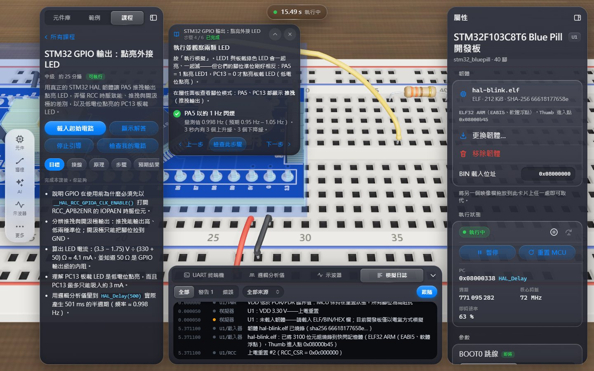 |
| 2 | **ERC 訊息寫出原因和修法**，中文自然，並附「選取元件」：「請串聯約 150 Ω 的電阻（≈ (3.3 V − 1.8 V) / 10 mA）」 | 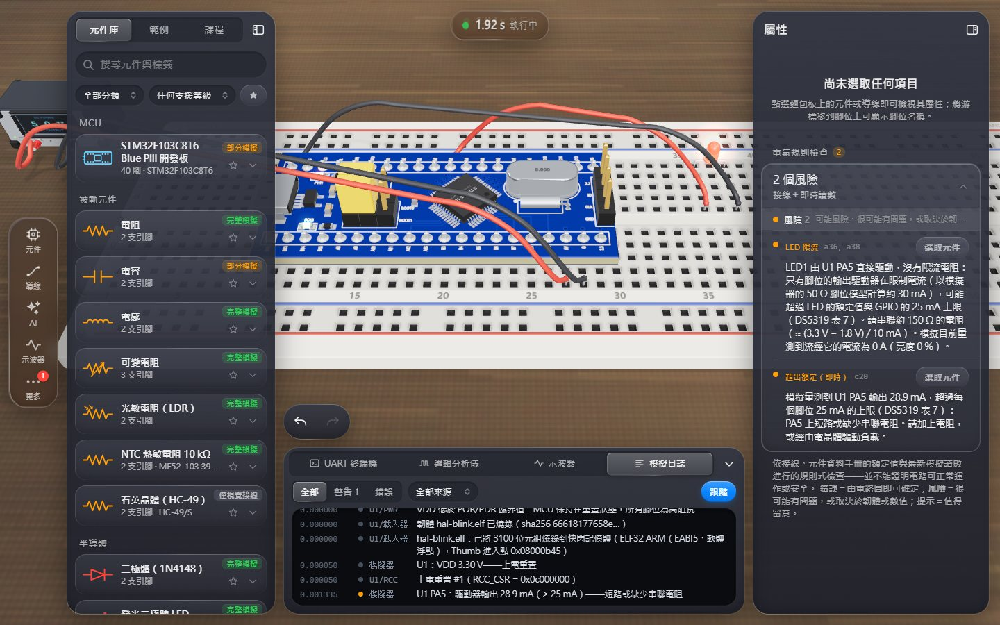 |
| 3 | **放置回饋很好**：卡片顯示「放置中」、全息預覽、定位孔發光，提示會寫出定位腳（PB12、h 列） | 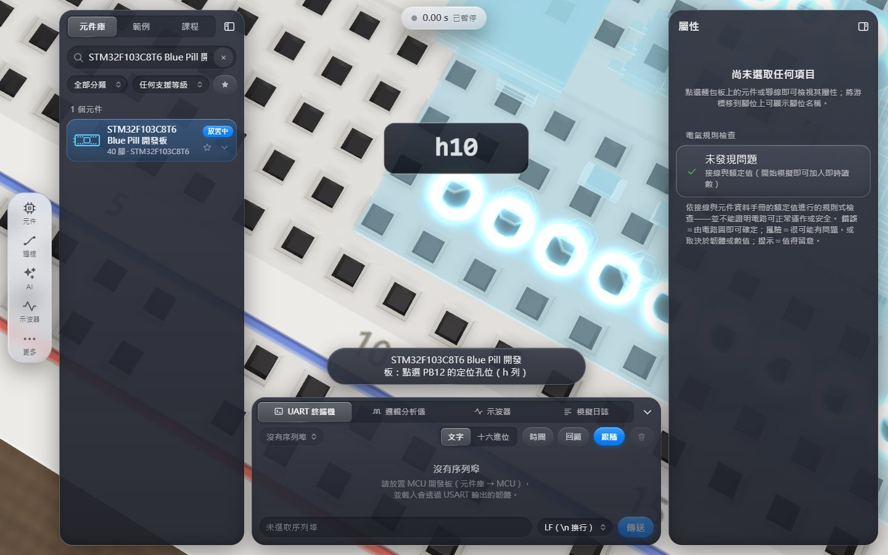 |
| 4 | **真實韌體的回饋可以信任**：ELF／SHA-256／進入點；錯誤格式時直接拒絕並保留原本的韌體；支援拖放與熱抽換 | — |
| 5 | UART 會從 BRR 自動判讀出「115200 8N1」。邏輯分析儀的 A/B 標記、Δt、佔空比都精確；類比閾值的讀數標「≈」，尚未模擬的區段畫斜線，不造假 | （標記功能本身） |
| 6 | 支援程度標示誠實（已模擬／部分／未模擬，並附驗證測試名稱），模擬日誌中文、有標來源、引用 RM0008 | — |
| 7 | 範例說明寫得好（接線／試試看），開範例前會確認，也可以復原；專案檔可以完整還原電路、韌體和儀器設定 | — |
| 8 | Liquid Glass 語言一致：Tier-S 深色面板、膠囊、chip、焦點環、減少動態效果設定、空白鍵執行 | — |
| 9 | 懸停孔位會出現大字孔名，放大後懸停在 Blue Pill 腳上會顯示「U1 · A5 · c20」。執行中懸停 3D 腳位時，腳位圖會同步標出對應的列 | — |

---

## 3. 核心路徑走查（新手從零到分析）

| 步驟 | 現在發生什麼事 | 摩擦程度 | 主要發現 |
|---|---|---|---|
| ① 第一次打開 | 導覽在筆電上教觸控手勢，完全沒提到 STM32、韌體、課程。空白卡片只有「瀏覽元件」和「問 AI」（後者要 API 金鑰） | 高 | STU-06、D-06、T19 |
| ② 開始課程 | 「課程」只是左側面板的第 3 個分頁，沒有任何地方推薦；手機上要到「更多」底下才找得到 | 中 | STU-23、D-11 |
| ③ 放元件 | 課程寫「拖一顆電阻」，但拖曳沒有任何作用。Blue Pill 放在無效的列時沒有反應 | 高 | STU-07、T13、STU-12 |
| ④ 接線 | 有步驟提示，但沒說怎麼結束；接地線預設是紅色 | 低 | D-13、STU-21 |
| ⑤ 載入韌體 | 課程要求「內建韌體 hal-blink」，介面只能從電腦選檔 → **卡死**，只能按「顯示解答」 | **阻斷** | STU-01、T1、D-01 |
| ⑥ 執行 | 沒有看得出來的「執行」鍵；文案說「點時鐘」，但畫面上沒有時鐘 | **阻斷／嚴重** | STU-02、T2、D-04 |
| ⑦ 觀察 | LED 太小或被面板蓋住。邏輯分析儀只看到平線，要按 7 次「−」。示波器頻率錯誤 | 高 | STU-09、STU-08、AN-01 |
| ⑧ 修錯 | 沒韌體時顯示綠燈「執行中」。LED 開路時 ERC 顯示「未發現問題」。紅色徽章指到「更多」，裡面看不到問題 | 高 | STU-04、STU-05、D-10 |
| ⑨ 分析 | 量一支腳要 3–6 步。I²C 開機時的流量要約 25 個操作才找得到。UART、日誌、波形無法對時 | 高 | AN-03、ENG-05、AN-05 |

---

## 4. 問題清單（依嚴重度與影響排序）

每個問題都合併了不同人物誌的相同發現；括號內是原始發現的編號（附錄 A 有完整對照）。

### P-01【阻斷】課程要「內建韌體」，但介面只能從電腦選檔（STU-01、T1、D-01）

- **現象**：i1 步驟 3「在屬性面板的『韌體』區載入內建韌體 hal-blink」。U1 的韌體卡只有「將韌體拖放到這裡／選擇檔案…」。中級 i1–i8 的起始電路都不含韌體（初級 b3、進階 a1–a2 有），所以這 8 堂課和所有「錯誤示範韌體」（lesson-i1-noclk 等）都卡在這裡。唯一能繼續的方法是「顯示解答」，但它會換掉學生自己接好的線，之後還照樣算「課程完成」。
- **根因**：`src/firmware-assets.ts` 已經有 `bundledFirmwareNames()` 和 `loadBundledFirmware()`，但只有課程的「載入起始電路」用到，檢視面板沒有呼叫它們。
- **影響**：17 堂課中有 8 堂無法誠實完成，全班會在同一步停下來。

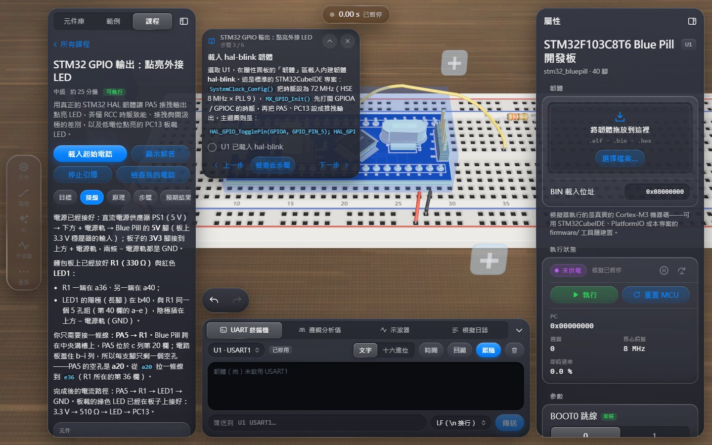

### P-02【阻斷】示波器在預設時基下給出錯誤的頻率（AN-01）

- **現象**：PWM 1 kHz，在預設 500 ms/格時，量測列顯示「頻率 ≈657.4 Hz、週期 ≈1.521 ms」，要放大到 ≤10 ms/格才正確。畫面上沒有「自動設定」。
- **根因**：在抽樣（min/max 抽取）後的擷取資料上仍然計算頻率，沒有檢查「每個週期至少要有幾個樣本」。
- **影響**：直接違反「讀數必須可信」。「≈」符號不足以提醒使用者這個數字是錯的。

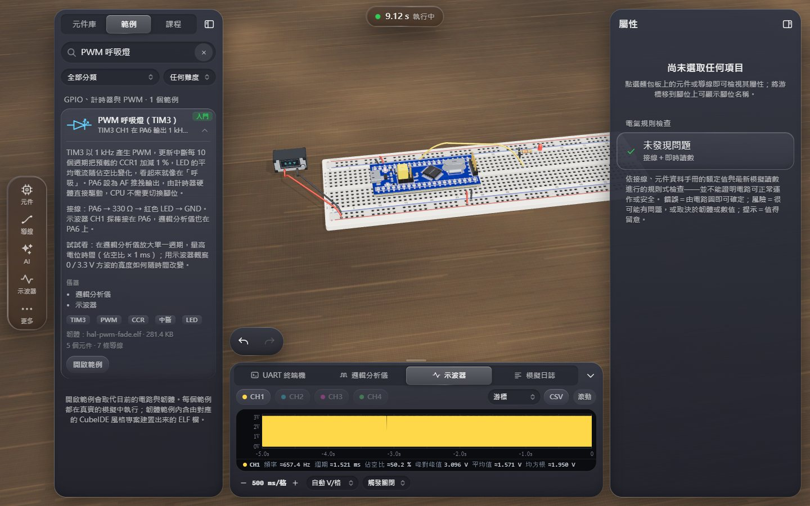

### P-03【嚴重】找不到「執行」（STU-02、T2、D-04、ENG-17）

- **現象**：唯一一直看得到的執行控制是膠囊「● 0.00 s 已暫停」：沒有播放圖示、沒有動詞，也沒有提示文字（`title` 是 null）。課程寫「按『執行模擬』」，空白狀態寫「點上方的時鐘」，畫面上兩者都不存在。有文字標籤的「▶ 執行」按鈕只在選取 MCU 時才出現在檢視面板裡，而且它其實是全域的執行鍵。
- **影響**：每一堂課、每一個電路都要經過這一步；40 人的課堂上，老師會一直被問同一個問題。


### P-04【嚴重】狀態顯示會誤導人（STU-03、D-02、ENG-02、T17、ENG-01）

- 電源接得好好的，只是還沒按執行，MCU 卻顯示紫色「**未供電**」。學生會去拆正確的電源線。
- 真的沒電時，週期數仍然一秒跳 900 萬，核心時脈顯示 8 MHz、即時速率 100 %。
- BOOT0 = 1 時徽章是綠色「執行中」；鎖死幾秒後，膠囊又變回綠點。
- 偵錯器停住核心後，大的「執行」鍵和空白鍵都**沒有任何反應**，唯一的出口是一顆 32 px、沒有文字的圖示。

| 沒電時週期仍在增加 | 核心停住時「執行」鍵沒有反應 |
|---|---|
| 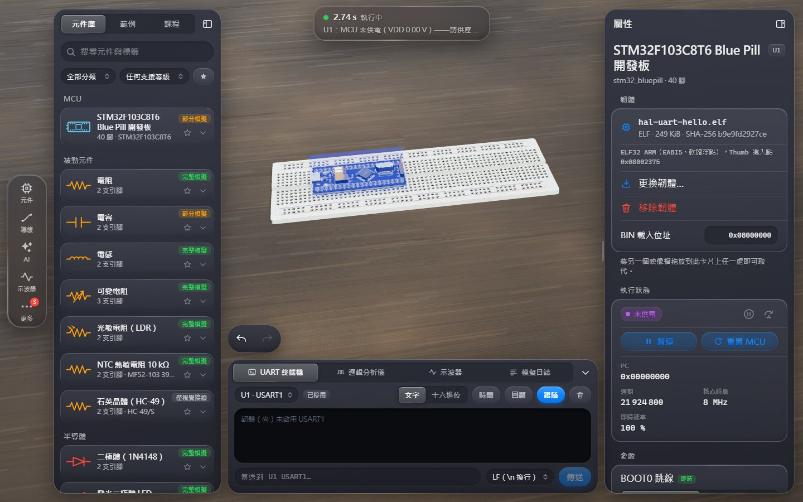 | 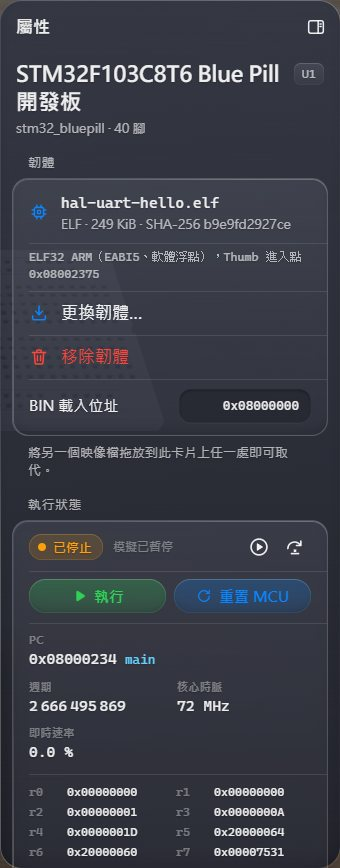 |

### P-05【嚴重】問題分散在三個地方，徽章指錯面板（STU-04、D-10、T17、ENG-03、AN-10、AN-18）

- 沒載韌體就執行：膠囊綠燈「執行中」，ERC 顯示「未發現問題」。唯一的訊息藏在沒打開的「模擬日誌」分頁裡，膠囊只展開 3 秒，而且字被截斷成「請供應 …」。
- 「更多」上的紅色徽章 1，點進去只看到速度、麵包板、圖形設定，問題清單在最底部、約 40 個範例之後。
- 選取 Blue Pill 時，ERC 在 7046 px 長的檢視面板最底部（第 9 屏）。
- 手機上完全沒有 ERC。

| 沒韌體卻一切正常的樣子 | 徽章帶到不相關的面板 | ERC 在面板第 9 屏 |
|---|---|---|
| 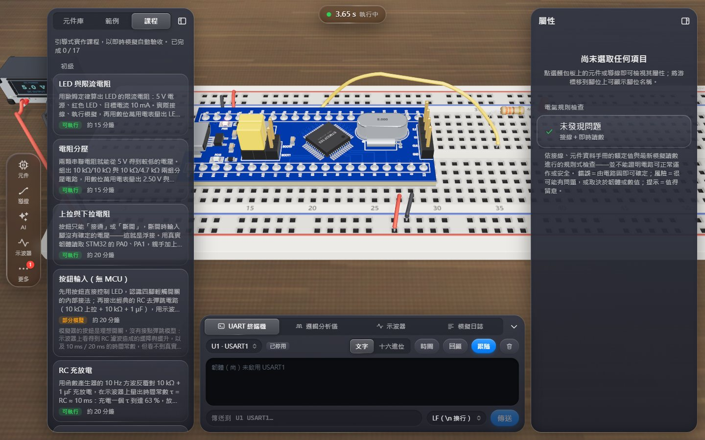 | 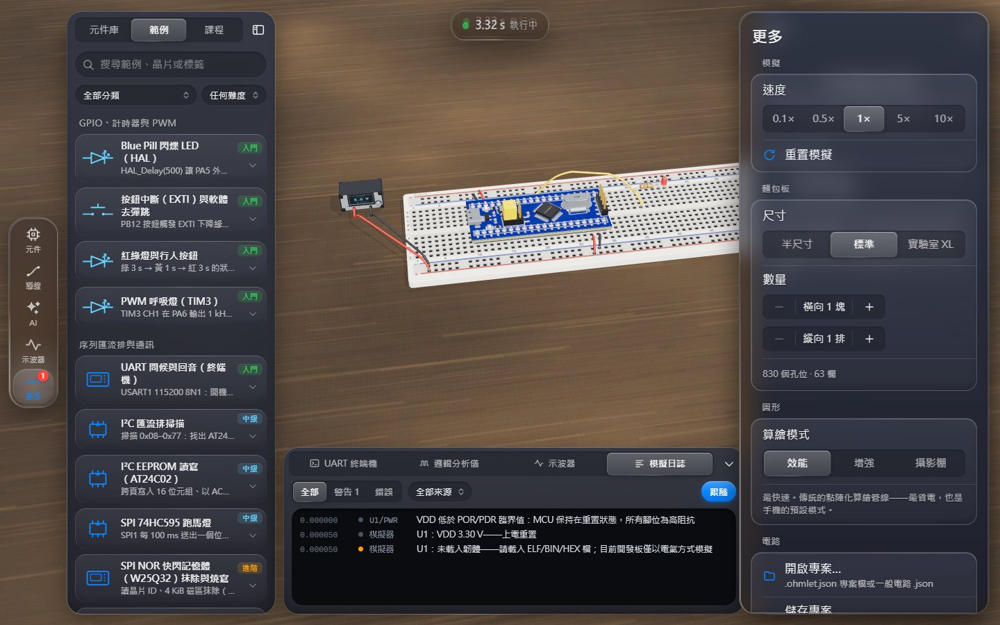 | 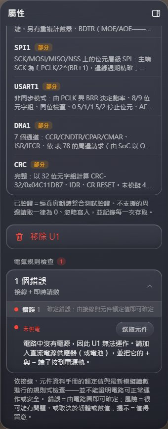 |

### P-06【嚴重】ERC 漏抓新手最常見的錯（STU-05、ENG-07、STU-10、AN-07）

| 情境 | 現在 | 應該 |
|---|---|---|
| LED 陰極什麼都沒接（忘了接地） | 「未發現問題」，LED 2.29 nA、0 % | 指出 a38 開路，並說明怎麼接 |
| I²C 腳設成開汲極，但沒有上拉電阻 | 「未發現問題」（只有韌體自己印出「pull-ups?」） | 風險：請加 4.7 kΩ 上拉 |
| 韌體沒有驅動接 LED 的那支腳（載錯韌體） | 只有日誌一行「PA5：浮接輸入」 | 說明「LED1 接在 PA5，但這個韌體沒有把 PA5 設成輸出」 |
| 7805 的輸出短路到 GND | 執行前「未發現問題」，選取時選到的是電池 | 錯誤：指出是哪條導線造成穩壓輸出短路 |

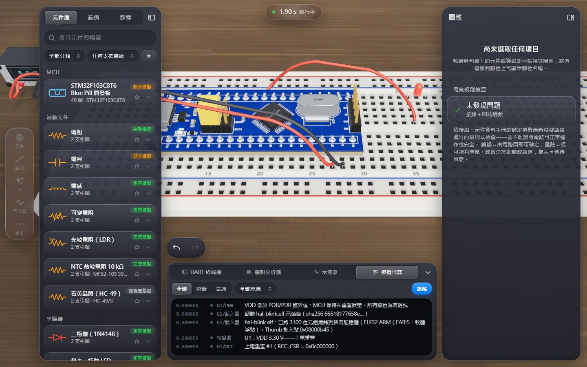

### P-07【嚴重】第一次打開看不出這是什麼、也不知道從哪裡開始（STU-06、ENG-16、T19、AN-17、D-06、D-11）

導覽三張卡分別是「四處看看（雙指捏合…）／放置元件／問 AI」。空白卡片的兩顆按鈕中，一顆是多餘的（元件庫本來就開著），另一顆沒有 API 金鑰就無法使用。最有價值的 17 堂課和 34 個範例完全沒有被推薦。

| 筆電上卻教觸控手勢 | 空白狀態：瀏覽元件／問 AI |
|---|---|
| 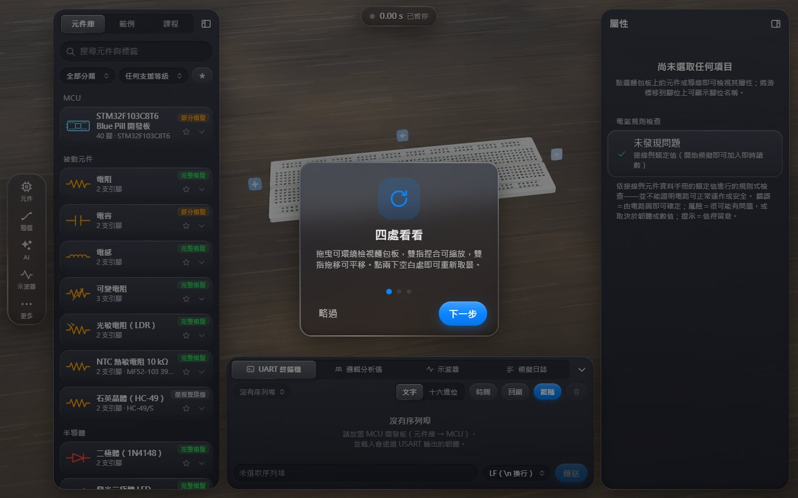 | 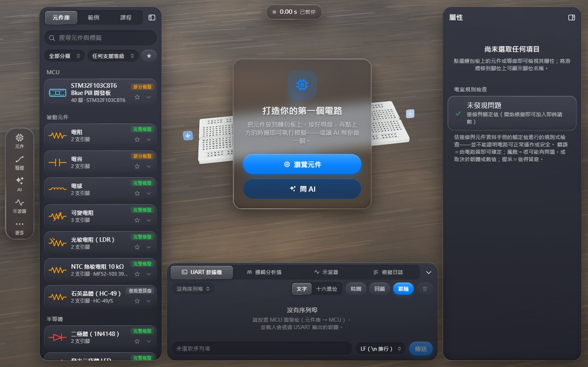 |

### P-08【嚴重】3D 電路不在視覺焦點（STU-09、T3、D-05、AN-09、T9、D-21、ENG-20）

- 引導卡（約 320×320）蓋住它正在講的 Blue Pill。按「在場景中標示」時，鏡頭不會移動。
- 自動取景用的是電路的外接球，細長的電路會變得很小：LED 在 1440 寬的畫面上只有幾個像素，看不出有沒有在閃。
- 1366×768 下，三個面板只留下約 430×130 px 給電路。
- 手機：屬性 sheet 會把選取的板子完全蓋住。

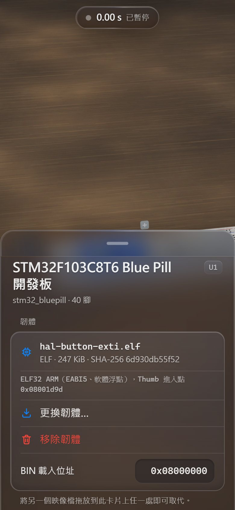

### P-09【嚴重】邏輯分析儀的預設值會藏住訊號（STU-08、D-07、ENG-05、AN-02、AN-06、ENG-06、AN-04）

- 預設 10 ms 視窗下，1 Hz 閃爍只看到平線（「頻率 — 邊緣數 0」），要按 7 次「−」。
- 「998.0 mHz」很容易被看成 MHz。
- 範例檔設定好的 I²C、UART 解碼器**沒有出現**。根因：`LogicAnalyzer.tsx` 讀寫的是舊的 `bb.logicDecoders`，`lab.importProject` 寫入的卻是 `logicView`。
- 打開解碼設定後，240 px 的儀器匣只剩約 25 px 的波形。開機時的單次 I²C 流量要約 25 個操作才找得到；沒有解碼結果表，也沒有「下一個訊框」。

| 預設只看到平線 | 「998.0 mHz」單位容易誤讀 | 解碼設定把波形擠掉 |
|---|---|---|
| 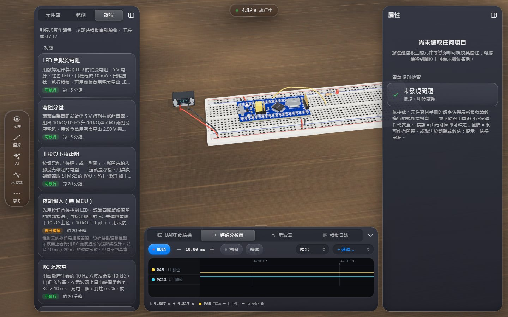 |  | 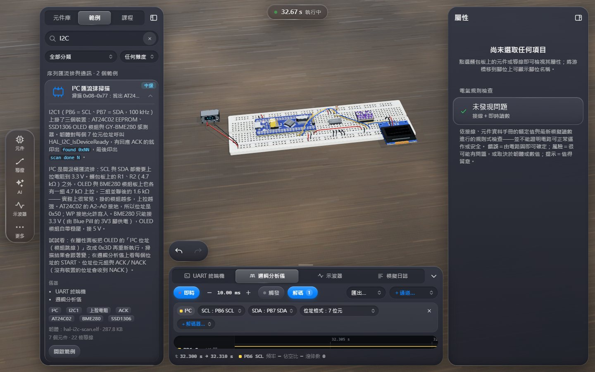 |

### P-10【嚴重】萬用電表的讀數讀不到（STU-16、T4、AN-08）

b1 最後一步要「讀電表」，但課程的標示效果把電表變成青色的全息外殼，LCD 被蓋住。檢視面板只列 IN／COM 兩腳的電壓，沒有主讀數，儀器匣也沒有電表分頁。

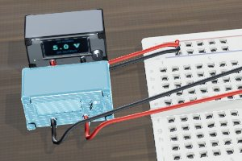

### P-11【嚴重】量測「這支腳／這個網路」要繞路（AN-03、D-09、ENG-08、ENG-11、D-14、ENG-13、AN-11、AN-13）

- 「＋通道…」是 32 個沒有註記的「U1 · Pxx」，而且不能選任意網路（API 其實支援 `kind: 'net'`）。
- 腳位圖的列不能點，懸停提示沒有電壓或模式，導線只顯示「起點 j27／終點 bot+20」。
- 示波器只能接放好的探棒元件，新放的探棒預設 CH1，會跟原本的撞在一起，而且沒有任何提示。
- 同一支腳在各處名稱不一致：A6／PA6／「PA6 PWM」／孔位 c19。

### P-12【嚴重】檢視面板資訊太長、術語沒有解釋（ENG-03、D-08、STU-11、STU-14、ENG-18、D-16）

選取 Blue Pill 後的順序是：韌體 → 執行 → BOOT0 → 40 列腳位圖（約 3000 px）→ 板載元件 → 30 列周邊 → 移除 → ERC。介面上直接露出 `stm32_bluepill`、`anode`、`p1 → p2`、`top+10`、「DS5319 表 7」、「50 Ω 腳位模型」，以及沒有解釋的 PC、週期、即時速率、FT。同一個面板裡的數值還互相矛盾（0 A 對 28.9 mA）。

### P-13【嚴重】課程引導和實際操作對不上（STU-07、T13、T3、D-12、T5、T15、T16、STU-13、STU-15、STU-19、T14、T6）

- 文案寫「拖」「按『執行模擬』」「把滑鼠移到」，但實際操作是點擊、按膠囊、手機沒有滑鼠。
- 檢查結果只列出症狀：LED 接反時有 4 個紅叉，但沒有一項寫「LED 接反了」；真正的原因在右側 ERC，等級還是最低的「提示」。
- 還沒開始做就先出現紅叉；重新整理後引導卡消失；完成後沒有「下一課」；7 個分頁有一半被擠出畫面。

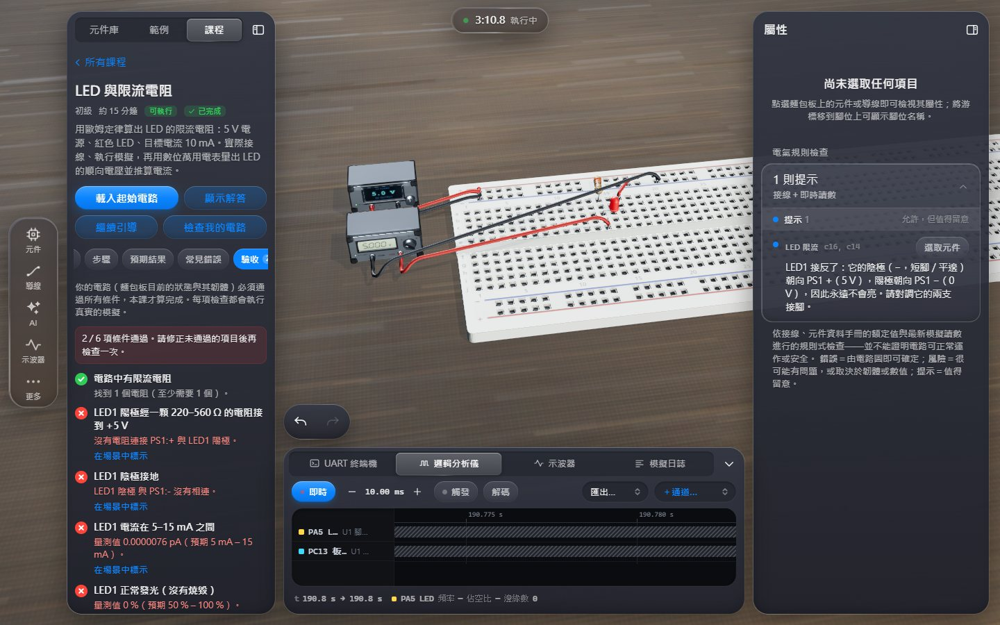

### P-14【中】儀器之間沒有共用時間軸（AN-05、ENG-12、AN-16、T10）

邏輯分析儀用絕對時間，示波器用相對於觸發點的時間，UART 和日誌顯示「2.586000」卻沒有單位。點 UART 的某一行無法跳到對應的波形。換韌體時終端機沒有分隔線。上一個電路的邏輯通道會殘留在新電路上。

### P-15【中】操作模式進出不明（D-13、STU-18、STU-12、D-03、D-22）

接線和放置模式都沒有說怎麼結束。放錯位置時沒有說明原因。範例寫「在 3D 畫面點按鈕」，但 3D 按鈕按不下去，只有檢視面板的「按住」有作用，而且短按也沒有反應。

### P-16【中】專家效率（ENG-04、ENG-17、D-19、ENG-09、ENG-14、ENG-15、ENG-10、ENG-21）

重新載入韌體要 3–4 步，偵錯器沒有快捷鍵和中斷點，時脈只顯示 HCLK，周邊表 30 列中有 24 列是「部分」。載入時的「沒有向量表」警告只寫在日誌裡；模擬速度掉到 0.3× 時，只有檢視面板看得到。

### P-17【輕微】可讀性與投影（D-17、ENG-19、AN-15、STU-22、T9）

面板中有 97 個 11 px 的中文字節點，讀數標籤的不透明度只有 0.38（對比約 3.3:1），清除按鈕只有 18×18 px。在投影機上看不清楚電路和孔名。

### P-18【輕微】教學管理（T6、T7、T8、T18、T11）

按「顯示解答」後仍算完成；沒有列印講義或匯出驗收結果的功能；專案檔沒有任務說明；課程沒有編號；按鈕自動命名為「PB1」，跟 GPIO 腳名撞在一起。

### P-19【潤飾】3D 雜訊（STU-20、D-20、STU-21、T20）

擴充麵包板的「+」方塊會蓋住膠囊和電路；接地線預設是紅色。

---

## 5. 設計原則（這次改版的「北極星」）

1. **一直看得到「現在怎樣、下一步做什麼」**：膠囊負責「執行控制」，膠囊下方新增的**狀態提示列**負責「問題或下一步」，兩者分工清楚。狀態寧可顯示「—」，也不要說錯。
2. **每一個問題都附三樣東西**：白話的原因、可以直接按的修正動作，以及在 3D 中標出位置。所有問題集中在一個「問題」面板（ERC 加上執行時的問題）。
3. **在哪裡看到，就在哪裡量**：腳位、孔位、導線上都能一鍵「加入邏輯分析儀／放示波器探棒」。
4. **預設值就要看得到訊號**：邏輯分析儀自動縮放，示波器提供「自動設定」，量不準時就不顯示讀數。
5. **3D 是主角**：取景只用面板之間空出來的區域，引導卡不壓在場景上，每一步都把鏡頭帶到要操作的地方。
6. **不破壞 ohmlet**：全部採用 Tier-S（不加 backdrop-filter）的元件，玻璃濾鏡預算維持 ≤4／≤3。英文加經典外觀（legacy）時，畫面與現在完全相同。

### 新的全域狀態（示意）

```
            ┌──────────────────────────────┐
            │  ▶  執行模擬                  │   ← 膠囊：動作＋狀態（點一下執行／暫停、空白鍵）
            └──────────────────────────────┘
        ┌──────────────────────────────────────────┐
        │ ● U1 還沒有韌體              [載入韌體…] ›│   ← 狀態提示列：最重要的問題或下一步（Tier-S）
        └──────────────────────────────────────────┘
```

| 情境 | 膠囊 | 狀態提示列 |
|---|---|---|
| 剛載入電路，還沒執行 | ▶ 執行模擬 | 「電路已就緒——按 ▶ 執行模擬（空白鍵）」〔執行〕 |
| 有 MCU 但沒有韌體 | ▶ 執行模擬 | 琥珀色「U1 還沒有韌體」〔載入韌體…〕 |
| 執行中，一切正常 | ❚❚ 執行中 · 3.11 s（綠色脈動） | 隱藏 |
| 執行中，沒有電源 | ❚❚ 執行中 · 2.74 s | 紅色「電路中沒有電源」〔在電路板上標示〕 |
| 偵錯器停住核心 | ▶ 核心已停住 · 繼續 | 琥珀色「U1 核心已停住（偵錯器）」〔繼續執行〕 |
| 鎖死 | ⚠ U1 故障 · 5.20 s（紅色） | 紅色「U1 故障（鎖死）」〔查看原因〕 |

---

## 6. 改善計畫

### 6.1 優先序定義

- **P0**：修正核心路徑（第一次打開 → 放元件 → 接線 → 韌體 → 執行 → 觀察 → 修錯 → 分析）上的阻斷與嚴重問題。下一個版本必須完成。
- **P1**：明顯提升「好懂、好分析」的改善。
- **P2**：潤飾與進階功能。

### 6.2 五條工作流（檔案互不重疊，可以平行實作）

| 工作流 | 負責範圍（只有這條工作流可以修改） |
|---|---|
| **WS1 殼層：起步、執行控制、全域狀態** | `src/App.tsx`、`src/app.css`、`src/ui/chrome/**`、`src/ui/kit/**`、`src/ui/sheets/{MoreSheet,AiSheet,ApiKeyRow}.tsx`、`src/ui/sheets/{ai-text.ts,asm-sheets.css}`、`src/ui/styles.css`、`src/ui/format.ts`、`src/ui/wire-colors.ts`、`src/i18n/zh-TW/{chrome,core,settings}.ts`、新檔 `src/i18n/zh-TW/ux-shell.ts` |
| **WS2 3D 取景、場景互動、元件庫** | `src/three/scene.ts`、`src/three/scene-api.ts`（只能做相容的新增）、`src/three/internal/{hole-fx,hologram}.ts`（只新增標示效果，不改元件模型）、`src/ui/workspace/{Workspace.tsx,state.ts,workspace.css,hole-labels.ts,LibraryPanel.tsx,examples.ts,ResizeHandle.tsx}`、新檔 `src/ui/workspace/{scene-bridge.ts,hole-chip.ts,ProbeMenu.tsx}`、`src/ui/sheets/PartsSheet.{tsx,css}`、`src/i18n/zh-TW/{workspace,examples}.ts`、新檔 `ux-scene.ts` |
| **WS3 課程引導與驗收** | `src/ui/lessons/**`、`src/lessons/**`（含課程內容、`engine/**`、`progress.ts`、`types.ts` 相容新增）、`src/i18n/zh-TW/lessons-ui.ts`、新檔 `ux-lessons.ts` |
| **WS4 檢視面板、MCU 狀態、韌體、問題診斷（含 ERC）** | `src/ui/embedded/{McuPanel,PartInfo,ErcPanel}.tsx`、`ErcPanel.css`、`src/ui/embedded/{format,text}.ts`、`controls.tsx`、新檔 `src/ui/embedded/{problems.ts,glossary.ts,inspector.css,BundledFirmwarePicker.tsx}`、`src/ui/sheets/PropertiesSheet.{tsx,css}`、`src/ui/workspace/Inspector.tsx`、`src/sim/erc/**`、`src/i18n/parts.ts`、`src/i18n/zh-TW/{embedded,sheets,messages-erc,messages-mcu,messages-core}.ts`、新檔 `ux-inspector.ts` |
| **WS5 儀器與分析** | `src/ui/embedded/{LogicAnalyzer,UartTerminal,SimLog}.tsx`、`logic-decoders.ts`、`embedded.css`、`src/ui/embedded/lab.ts`、`src/ui/embedded/instruments/**`、新檔 `src/ui/embedded/probe-actions.ts`、`src/ui/sheets/ScopeSheet.tsx`、`src/ui/workspace/Tray.tsx`、`src/instruments/**`、`src/state/{lab.ts,lab-types.ts,store.ts}`、`examples/embedded/**`、`src/i18n/zh-TW/{instruments,acceptance}.ts`、新檔 `ux-instruments.ts` |

新增的翻譯一律放在各工作流自己的新字典檔（`src/i18n/zh-TW/ux-*.ts`，`import.meta.glob` 會自動合併），避免多條工作流同時修改同一個字典。各工作流新增的測試檔也加上工作流前綴（例如 `tests/ux-inspector-*.test.ts`）。

### 6.3 項目總表

> 完整規格（行為、版面、zh-TW 文案、驗收條件）與實作計畫一起交付。下表是摘要。

#### WS1 殼層

| ID | 優先 | 內容 | 驗收重點 |
|---|---|---|---|
| SH-1 | P0 | **膠囊變成真正的執行鍵**：▶／❚❚ 圖示加上動詞（「▶ 執行模擬」「❚❚ 執行中 · 3.11 s」「▶ 核心已停住 · 繼續」「⚠ U1 故障」），提示文字寫出「（空白鍵）· 長按重置」；空白鍵與膠囊在核心被停住時改為「繼續」。新增 `isLegacyChrome()` 開關，英文加經典外觀時畫面不變 | 新手 0 次誤點就找到執行；核心停住時按空白鍵可以繼續；legacy 場景 0 差異 |
| SH-2 | P0 | **狀態提示列**（膠囊下方，Tier-S）：顯示最重要的問題或下一步，附一顆動作按鈕，點本體打開「問題」面板。工作區模式下，問題徽章從「更多」移除 | 沒韌體、沒電源、沒接地、LED 開路、核心停住這 5 種情況，1 秒內就會出現在狀態提示列，而且附可直接按的修正 |
| SH-3 | P0 | **第一次使用**：導覽改成「這是 STM32 電子實驗室／看看四周（依滑鼠或觸控切換文案）／從第一課開始」；空白狀態改成「從第一課開始（推薦）／開啟範例／自己放元件」，AI 只在有金鑰時才出現 | 第一次打開到 b1 起始電路只要 2 次點擊；到閃爍的 LED（範例）≤ 4 次點擊 |
| SH-4 | P0 | **App 掛鉤接線**：場景橋接、問題監看、引導卡的取景內縮、懸停提示、3D 按鈕、探測選單 | 各契約（6.4）都已接上，並有失效保護 |
| SH-5 | P1 | 模式提示寫出「Esc 結束」，接線色條加上「完成」，放置失敗時說明原因 | 不會再卡在任何模式裡 |
| SH-6 | P1 | dock／rail 改成「元件、導線、課程、儀器、更多」，AI 移到「更多」；手機的「更多」把問題放在最上面；開啟範例後自動關閉 sheet | 手機上 1 次點擊就能找到課程 |
| SH-7 | P1 | 快捷鍵：F5（停住／繼續核心）、F10（單步）、Shift+F5（重置 MCU）、F（對準電路）、Ctrl+S、?（快捷鍵清單）；undo 膠囊旁加「對準電路」按鈕 | 快捷鍵都寫在提示文字中 |
| SH-8 | P2 | 依慣例自動選導線顏色（GND／− 黑、+ 紅）、模擬速度 < 90 % 時顯示「0.3×」小標、手機 sheet 打開時的取景內縮 | — |

#### WS2 3D 取景、場景互動、元件庫

| ID | 優先 | 內容 | 驗收重點 |
|---|---|---|---|
| SC-1 | P0 | **以電路為主的取景**：在面板空出的區域內，用外接盒（而不是外接球）取景；新增 `frameTargets()`；選取被遮住的物件時自動帶入視野；新增場景橋接 `focusInScene()`，問題標示使用獨立的紅／琥珀色層 | 開啟 blink、b1、i1、pwm-fade 後，電路全部在可見區內，且寬或高至少占可見區的 55 %；legacy 場景不變 |
| SC-2 | P0 | **工作區契約**：左側面板頂端的引導卡插槽、`openExampleById()`、開範例時把儀器匣切到範例使用的儀器 | 引導卡不再壓在 3D 上 |
| SC-3 | P0 | 課程標示遇到有顯示器的儀器（電表、電源）時，改用光圈和外框，不再用全息外殼 | b1 第 6 步時看得到 LCD |
| SC-4 | P1 | 懸停提示加上即時資訊：「PA5（板上 A5）· 推挽輸出 · 3.30 V · c20」；空孔顯示「a20 → 同一排：U1 PA5」 | 懸停就能知道電位和接到誰 |
| SC-5 | P1 | 3D 右鍵**探測選單**：加入邏輯分析儀、放示波器探棒（CH2）、選取接在這裡的元件 | 量一支腳 ≤ 2 次點擊 |
| SC-6 | P1 | 模擬中可以在 3D 按住按鈕 | button-exti 範例在 3D 按下按鈕後，UART 印出「press 1」 |
| SC-7 | P1 | 範例卡加上「開啟」小膠囊、放置中的卡片寫出「點麵包板孔位 · Esc 結束」 | 開範例 1 次點擊 |
| SC-8 | P2 | 放置位置無效時顯示紅色預覽、可放的列會發光；「+」擴充鈕只在需要時出現；從卡片拖曳放置；1366 寬時預設收合元件庫 | — |

#### WS3 課程引導與驗收

| ID | 優先 | 內容 | 驗收重點 |
|---|---|---|---|
| LS-1 | P0 | **步驟一鍵動作**：「載入 hal-blink 到 U1」「▶ 執行模擬」「拿一顆電阻」「載入錯誤示範韌體」；接線分頁的韌體名稱可以直接點來載入；`startFirstLesson()` | i1 可以不開檔案選擇器、不按「顯示解答」就完成 |
| LS-2 | P0 | **文案全面校對**：「拖」改成「點」；「執行模擬」改成「按上方的「▶ 執行模擬」（或空白鍵）」；「滑鼠移到」改成不分裝置的寫法 | 所有課程的文字都符合實際操作 |
| LS-3 | P0 | **引導卡搬家**：工作區時放進左側面板頂端，手機與經典外觀時執行中自動收合；換步驟和「在場景中標示」時把鏡頭帶到目標 | 1440 與 1366 寬下，引導卡都不遮 3D |
| LS-4 | P1 | 重新整理後恢復引導、完成後出現「下一課」、還沒做的步驟顯示灰色「尚未完成」 | — |
| LS-5 | P1 | 檢查結果最上方加「最可能的原因」（對照 ERC 與常見錯誤）、合併連帶失敗的項目、缺少起始電路時直接提示、數值改成人看得懂的格式 | LED 接反時，第一行就寫「LED1 接反了」 |
| LS-6 | P1 | 7 個分頁換行，全部都看得到 | — |
| LS-7 | P2 | 「以解答完成」標示、列印講義與匯出驗收結果、課程編號（B1、I1…）、孔名 chip 可以點 | — |

#### WS4 檢視面板、MCU 狀態、韌體、問題診斷

| ID | 優先 | 內容 | 驗收重點 |
|---|---|---|---|
| IN-1 | P0 | **內建韌體選擇器**：「選擇內建韌體」（可搜尋，「本課使用」排在最前面，錯誤示範有標示）＋「從電腦選擇檔案…」 | 2 次點擊載入 hal-blink |
| IN-2 | P0 | **MCU 狀態說實話**：新增「尚未執行」狀態；沒電、重置、沒韌體時，讀數一律顯示「—」並寫出原因與修法；新增「系統記憶體開機（未模擬）」狀態；核心停住時主按鈕變成「▶ 繼續執行」 | 不會再出現「沒電但週期在跑」或「執行中 · 模擬已暫停」 |
| IN-3 | P0 | **問題資料來源與「問題」面板**：ERC 加上執行時問題加上 MCU 狀態，每一則都附動作與「在電路板上標示」；沒有選取時放在檢視面板最上面，選取元件時在標題下方列出該元件的問題；手機也看得到 | 「更多」不再是問題的入口；ERC 不在第 9 屏 |
| IN-4 | P0 | **ERC 新規則：腳位沒接**（執行中為風險，否則為提示） | LED 陰極開路時，會指出 a38 並說明修法 |
| IN-5 | P0 | 萬用電表、電源的**大字讀數** | b1 第 6 步可以直接讀到「1.798 V」 |
| IN-6 | P1 | MCU 面板分頁：「概況｜腳位｜韌體｜周邊」 | 未供電的原因在第一屏就看得到 |
| IN-7 | P1 | 腳位列的動作（加入邏輯分析儀／放探棒／在 3D 標示）、使用中的替代功能以實心標示、「只看有接線的腳」 | — |
| IN-8 | P1 | ERC 新規則：I²C 沒有上拉、韌體沒有驅動接 LED 的腳、穩壓輸出短路；訊息整理（資料手冊引用收進「詳細」、閃爍負載改用峰值、離譜的數值設上限） | — |
| IN-9 | P1 | 白話與術語說明：型號 ID 換成分類，「陽極（長腳）」「第 1 腳」「PA5（板上 A5）」，PC／週期／即時比／BOOT0／FT／開汲極加上 ⓘ 說明 | 介面上沒有英文識別碼 |
| IN-10 | P1 | 選取導線時顯示網路、端點、電壓、電流，並附探測按鈕 | — |
| IN-11 | P1 | 韌體卡顯示載入警告（例如沒有向量表）、BIN 位址只在 .bin 時出現、CFSR／HFSR 拆成位元說明 | — |
| IN-12 | P2 | 「⟳ 重新載入」與監看檔案變更、時脈樹、「按住」短按也會觸發 | — |

#### WS5 儀器與分析

| ID | 優先 | 內容 | 驗收重點 |
|---|---|---|---|
| IS-1 | P0 | **邏輯分析儀預設就看得到訊號**：「自動」縮放（加入通道或第一次出現邊緣時自動套用）；頻率格式化（不再顯示 mHz）；空白時寫出下一步 | blink 範例執行 3 秒內，不用手動縮放就看到方波，頻率顯示「0.998 Hz」 |
| IS-2 | P0 | **示波器量不準就不顯示讀數**，數位網路改用邊緣資料精確計算；新增「自動設定」 | 預設時基下不會出現 657 Hz |
| IS-3 | P0 | **解碼器設定改從 `lab.logicView` 讀寫**（附一次性搬移） | 開啟 i2c-scan 就看到 I²C 解碼列 |
| IS-4 | P1 | `probe-actions.ts`：任何腳位、孔位都能一鍵加入邏輯分析儀或放示波器探棒，自動選沒用過的通道 | — |
| IS-5 | P1 | 儀器匣預設收合，直到電路中有 MCU 或儀器才打開；解碼和觸發設定改成摘要 chip 與 popover，不再擠壓波形；標籤欄 ≥ 104 px | — |
| IS-6 | P1 | 找訊號：「⤢ 全部」、上一個／下一個訊框、可搜尋的解碼結果表、切換分頁後保留視窗 | I²C 開機流量 ≤ 3 個操作就能找到 |
| IS-7 | P1 | 通道選單分成「使用中的腳位／網路／全部」，並有「＋匯流排…」：一鍵加入 I2C1 或 USART1 的通道與解碼器（鮑率直接帶入） | — |
| IS-8 | P1 | 共用時間游標；點 UART 或日誌的一行就跳到波形；換韌體時插入分隔線；來源已不存在的通道會標示 | — |
| IS-9 | P2 | 分析版面、標記吸附與鍵盤操作、量測欄、對比與點擊範圍、手機版排版 | — |

### 6.4 跨工作流契約（介面先定好，各自實作）

| 契約 | 提供者 | 使用者 | 簽章 |
|---|---|---|---|
| K1 經典外觀開關 | WS1 `src/ui/chrome/legacy.ts` | WS1 | `isLegacyChrome()`／`useLegacyChrome()` = 英文且工作區未啟用 |
| K2 執行控制 | WS1 `src/ui/chrome/run-control.ts` | WS4 | `toggleRun()`、`runOrResume()`、`useSimPhase()` |
| K3 問題資料來源 | WS4 `src/ui/embedded/problems.ts` | WS1 | `useProblems`、`startProblemsWatcher()`、`openFirmwareFor(id)`、`<ProblemsList/>`，錨點 `#ws-problems` |
| K4 場景橋接 | WS2 `src/ui/workspace/scene-bridge.ts`＋`scene-api.ts` 新增 | WS1、WS3、WS4 | `registerScene()`、`focusInScene(spec,{kind})`、`frameCircuit()`；scene 新增 `frameTargets?`、`setProblemHighlights?`、`onObjectPress?`、`onProbeRequest?` |
| K5 懸停提示 | WS2 `hole-chip.ts` | WS1 | `holeChipText(hole)` |
| K6 探測選單 | WS2 `ProbeMenu.tsx` | WS1 | `openProbeMenu(target, {x,y})` |
| K7 探測動作 | WS5 `src/ui/embedded/probe-actions.ts` | WS2、WS4 | `addLogicChannelFor(target)`、`addScopeProbeFor(target)`、`revealInLogic(t)` |
| K8 引導卡 | WS2 提供插槽 `#ws-coach-slot`；WS3 提供 `useLessonUi.coachRect` | WS3、WS1 | — |
| K9 課程入口 | WS3 `src/ui/lessons/actions.ts` | WS1 | `startFirstLesson()` |
| K10 範例入口 | WS2 `src/ui/workspace/examples.ts` | WS1 | `openExampleById(id)` |
| K11 腳位顯示名稱 | WS4 `src/i18n/parts.ts` | WS2 | `pinDisplayName(entry, pin)` |

順序建議：各工作流先完成契約模組（簽章固定），再實作功能；WS1 的 SH-4（接線）最後合併。

### 6.5 視覺回歸與相容性（明確標示）

- **legacy 場景（英文加經典外觀：`desktop-*`、`closeup-*`、`phone-*`、`extra-*` 中 `workspace` 不為 true 的）必須維持 0 差異。**
  - SH-1、SH-2、SH-3、SH-6 對經典外觀的所有改動，都必須透過 `isLegacyChrome()` 關閉。
  - SC-1 的外接盒取景與 SC-8 的「+」鈕調整，只在 view insets 不為 0（工作區）時生效。legacy 場景 `desktop-blinky-555` 等沒有指定 camera，開機時會走 `frameContent()`，所以零 insets 時的取景演算法**不可以改**。
- **需要刻意重新拍基準的場景**（不是 legacy，但畫面會因為這次改版改變）：`i18n-chrome-desktop-empty`、`i18n-chrome-phone-empty`、`i18n-chrome-desktop-running`、`i18n-ws-*`（4 張）、`comm-ws-zh`、`displays-workspace-zh`、`sensors-ws-zh`，以及英文但啟用工作區的 `extra-bp-workspace`、`extra-workspace-empty`（IS-5 預設收合儀器匣、SH-6 rail 項目）。重新拍基準由整合者在人工檢視後統一進行。
- **英文使用者**：因為 K1 開關的設計，英文加經典外觀不會看到新的膠囊、狀態提示列和 dock。這是刻意的取捨：zh-TW 是產品語言，英文是相容模式。如果之後要讓英文也套用新外觀，改為由視覺回歸工具設定 `bb.legacyChrome` 即可。
- **玻璃預算**：所有新的介面（狀態提示列、探測選單、韌體選擇器、ⓘ 說明）都採用 Tier-S（UndoPill 的做法，不加 backdrop-filter）。`scripts/glass-chrome.mjs` 必須通過（≤4 個 backdrop-filter、≤3 個透鏡）。
- **效能**：狀態提示列與問題資料最多每秒更新 1 次（跟目前 ERC 一樣）；懸停提示在場景的回呼中計算；邏輯分析儀的自動縮放只在事件發生時計算。不新增任何每影格的 React 工作。

### 6.6 怎麼知道改好了（成功指標）

| 指標 | 現在 | 目標 |
|---|---|---|
| 第一次打開到 LED 閃爍（範例路徑） | 找不到路徑；學生自行摸索超過 40 次點擊 | ≤ 4 次點擊 |
| i1 不按「顯示解答」完成 | 不可能 | 可以，韌體步驟 1 次點擊 |
| 找到「執行」 | 4 / 5 位測試者卡住 | 0 次誤點 |
| 5 種常見錯誤（沒電源、沒接地、LED 開路、沒韌體、韌體腳位不符）被指出並附修法 | 2 / 5 | 5 / 5，1 秒內出現在狀態提示列 |
| 邏輯分析儀看到 1 Hz 方波 | 7 次點擊 | 0 次 |
| 示波器在任何時基下給出錯誤頻率 | 會 | 不會（量不準時不顯示讀數） |
| 找到 I²C 開機流量 | 約 25 個操作 | ≤ 3 個操作 |
| 量測任一支腳 | 3–6 步 | ≤ 2 次點擊 |
| 選取 Blue Pill 時看到「為什麼不動」 | 第 9 屏 | 第 1 屏 |

建議每個 P0 項目都有一個 Playwright 驗收腳本，重跑本次的人物誌任務，並沿用 `npm run test:e2e` 的格式。

---

## 7. 這次不做（Backlog）

- 中斷點與反組譯（ENG-09）：需要擴充協調器 API（`setBreakpoints`、`disassembleAtPc` 已經存在，但還沒接上），規模 L，等 P1 完成後再評估。
- 按鈕元件代號從「PB1」改成「SW1」（T11）：會同時動到 store、所有課程和範例，而且需要寫 ID 遷移。
- 專案任務卡與老師版設定（T8、T6 的隱藏解答）：需要擴充專案檔格式。
- 投影模式（T9）：先觀察 SC-1 取景加上「對準電路」的效果，再決定要不要做。
- 分割版面、同時顯示兩種儀器（AN-04、AN-18 的完整工作流程）。

---

## 附錄 A：原始發現與本文件的對照

| 原始發現 | 本文件問題 | 計畫項目 |
|---|---|---|
| STU-01、T1、D-01 | P-01 | IN-1、LS-1 |
| AN-01 | P-02 | IS-2 |
| STU-02、T2、D-04、ENG-17 | P-03 | SH-1、LS-2、SH-7 |
| STU-03、D-02、ENG-02、T17、ENG-01、D-18 | P-04 | IN-2、SH-1 |
| STU-04、D-10、ENG-03、AN-10、AN-18、D-23 | P-05 | SH-2、IN-3、SH-6 |
| STU-05、ENG-07、STU-10、AN-07 | P-06 | IN-4、IN-8 |
| STU-06、ENG-16、T19、AN-17、D-06、STU-17、STU-23、D-11 | P-07 | SH-3、SH-6 |
| STU-09、T3、D-05、AN-09、D-21、ENG-20 | P-08 | SC-1、SC-2、LS-3、SH-8、SC-8 |
| STU-08、D-07、ENG-05、AN-02、AN-06、ENG-06、AN-04、AN-14 | P-09 | IS-1、IS-3、IS-5、IS-6、IS-7、SC-2 |
| STU-16、T4、AN-08 | P-10 | IN-5、SC-3 |
| AN-03、D-09、ENG-08、ENG-11、D-14、ENG-13、AN-11、AN-13 | P-11 | IS-4、SC-4、SC-5、IN-7、IN-10 |
| ENG-03、D-08、STU-11、STU-14、ENG-18、D-16、ENG-15 | P-12 | IN-6、IN-9、IN-8 |
| STU-07、T13、T5、T15、T16、STU-13、STU-15、STU-19、T14、T12、D-12 | P-13 | LS-1～LS-7、SC-7 |
| AN-05、ENG-12、AN-16、T10 | P-14 | IS-8 |
| D-13、STU-18、STU-12、D-03、D-22 | P-15 | SH-5、SC-6、SC-8 |
| ENG-04、ENG-09、ENG-10、ENG-14、ENG-21 | P-16 | IN-11、IN-12、SH-7、SH-8、Backlog |
| D-17、ENG-19、AN-12、AN-15、STU-22、T9 | P-17 | IN-9、IS-9、Backlog |
| T6、T7、T8、T18、T11 | P-18 | LS-7、Backlog |
| STU-20、D-20、STU-21、T20 | P-19 | SC-8、SH-8 |
| STU-11（術語） | P-12 | IN-9、SC-4 |
| STU-14（數值矛盾） | P-12 | IN-8 |
| D-15 | P-13 | SC-7 |
