# ohmlet embedded lab：改版後使用者體驗複查（UX_VERIFY）

> 複查日期：2026-10-14　·　複查版本：`embedded-platform` @ `b7be397`（UX 改版），對照 `6d01968` 的 [UX_REVIEW.md](UX_REVIEW.md)
> 審查標準（產品負責人，具約束力）：**「介面要非常直覺、易用、好懂、好分析」**，以及**「記得操作、接線、顯示資訊的連貫性、易用性、直覺性是這個二次開發的大重點」**
> 本次只新增本文件與 `docs/ux/verify-img/`（16 張截圖），沒有修改任何程式碼。

---

## 0. 一頁結論

這次改版把 UX_REVIEW 的計畫（SH-1～8、SC-1～8、LS-1～7、IN-1～12、IS-1～9）幾乎全部做完。核心路徑明顯變順：

- **9 項成功指標：6 項達成、2 項部分達成、1 項未達成**（第 3 節）。第一次打開到 LED 閃爍只要 4 次點擊；找「執行」0 次誤點；邏輯分析儀不用縮放就看到 0.998 Hz；I²C 開機流量 0 個操作就看到；桌面上量一支腳 2 次點擊；選取 Blue Pill 時，第一屏就看得到「為什麼不動」。
- 執行狀態在膠囊、狀態提示列、MCU 面板和 toast 上用同一套詞和顏色。問題集中在一個面板，每則都附修法。課程每一步都有一鍵動作。

但產品負責人最在意的**連貫性**，還有 4 個斷點：

1. **接線點不到（阻斷）。** 導線模式下，懸停晶片寫著「a20 → 同一排：U1 PA5」，點下去卻被元件本體吃掉，畫面沒有任何反應。每一條 MCU 導線都會遇到這個問題：b1、i1、i4 都得先手動把鏡頭轉成俯視才接得上。學生與教師兩位測試者一共失敗超過 15 次。
2. **兩個畫面互相矛盾。**
   - 課程寫「U1 正在執行 hal-blink」，同時 MCU 面板寫「尚未執行」。
   - 暫停後按「重置 MCU」，狀態提示列反過來怪韌體「沒有把 PA5 設成輸出」。BOOT0 = 1 時，ERC 也怪韌體。
   - 「沒有韌體」這一件事，問題清單列 2 列，介面上一共有 5 種說法。
3. **出現可能錯誤的數值。**
   - 沒接 GND 時，問題清單列出 33 則「−1261957.64 V」。
   - 示波器把 UART 資料線量成「38.40 kHz（數位精確）· 佔空比 99.9 %」。
   - LED 反插時顯示「未發現問題」，電流寫「−0 pA」。
   - 量到 2 Hz，卻寫成「≈ 0 Hz」。
4. **同一個東西有不同的名字和格式。** PA5 有 7 種寫法，0.5 V 有 4 種格式。另外還有「工作週期／佔空比」「0.2 倍速／0.17×」「在電路板上標示／在場景中標示」這類兩套說法並存。

另外有兩個問題，影響範圍跨越整個 App：

- **鍵盤會被面板吞掉。** 點過面板裡的按鈕之後，空白鍵會重按那顆按鈕，F5／F10 則完全沒有反應。
- **經典英文外觀被改動了。** 導覽、MCU 檢視面板與 F5 鍵的行為都和以前不同，違反「legacy 0 差異」的約束。

**修正策略：** 先處理 **15 個 P0**，目標是三件事：點得到、說實話、不互相矛盾。P0 由 5 條工作流各自負責，修改的檔案不重疊。接著用 **11 個共用 helper**，把「同名、同色、同格式」一次收斂，包括：腳位名稱、端點名稱、單位格式、網路即時摘要、狀態色、問題「事實」去重，以及課程用詞表（第 7 節）。

| 要求 | 改版前 | 目標 | 現在 | 主要扣分 |
|---|---|---|---|---|
| 直覺 | 2 | 4.5 | 3.5 | 接線點不到；點過面板按鈕後空白鍵失效 |
| 易用 | 2 | 4.5 | 4 | 韌體、執行、量測都只要 1–2 次點擊；手機上沒有量測入口 |
| 好懂 | 3 | 4.5 | 3.5 | 兩個畫面互相矛盾、出現假數字、同一件事多種說法 |
| 好分析 | 2.5 | 4 | 3.5 | 自動縮放與解碼表做得很好；UART 量出假頻率、從通道回不到 3D |
| **連貫性**（新增） | — | 4.5 | **3** | 操作 3.5、接線 2.5、資訊顯示 3（第 5 節） |

---

## 1. 複查方法

| 項目 | 內容 |
|---|---|
| 稽核者 | 原本的 5 位人物誌（大一學生、嵌入式工程師、教師、量測分析專家、資深互動設計師），加上 **連貫性稽核**（系統性檢查命名、狀態、格式、動作、連結、接線）與 **程式碼審查**（diff `6d01968..b7be397`） |
| 操作方式 | Playwright 驅動 msedge 無頭瀏覽器，操作**真實介面**。每位稽核者各自架一個無 HMR 的 Vite 伺服器（port 5301–5307），而且從清空 localStorage 的真正首次使用開始。稽核期間沒有修改 repo |
| 視窗 | 1440×900（主要）、1366×768、1920×1080、手機 390×844（觸控、DPR 2）、列印 |
| 規模 | 84 項任務、約 770 次點擊、738 張截圖、137 則新發現（2 則阻斷、53 則嚴重、60 則輕微、22 則潤飾） |
| 交叉驗證 | 不同稽核者重複發現的問題排在前面。例如「接線點不到」有 2 位；「課程說正在執行」有 3 位；「同一個問題列兩次」有 4 位。列入修正計畫的每一項都**對照過原始碼**（第 6 節附根因的檔案與行號），無法成立或需要調整的列在附錄 B |
| 環境限制 | 機器同時跑 7 個稽核，CPU 滿載，模擬速度只有 0.01–0.7 倍速，所以所有時間結論都以模擬時間判讀。膠囊上誠實顯示了「0.2 倍速」。另外，本機 `node_modules` 缺 `@anthropic-ai/sdk`（`package.json` 有宣告，重新安裝即可）：稽核者用 scratch stub 繞過，因此 AI 功能沒有測試 |

本文件的截圖放在 `docs/ux/verify-img/`。原始截圖、逐步紀錄與各稽核者的完整報告，保留在複查工作目錄，沒有放進 repo。

---

## 2. 這次改了什麼

| 工作流 | 完成狀況 | 使用者看得到的變化 |
|---|---|---|
| **WS1 殼層** | SH-1～SH-8 全部完成 | 膠囊變成執行鍵：「▶ 執行模擬」「❚❚ 執行中 · t」「核心已停住 · 繼續」「U1 故障」。膠囊下方新增**狀態提示列**，顯示最重要的問題並附一顆動作按鈕。導覽改成 3 張卡，最後一張是「開始第一課／先看範例」。dock 改成「元件·導線·課程·儀器·更多」。新增快捷鍵 F5／F10／Shift+F5／F／?／Ctrl+S，導線依慣例自動配色，速度慢時顯示「0.2 倍速」 |
| **WS2 3D 取景與場景** | SC-1～SC-8 全部完成 | 取景改用外接盒，只看面板之間的空白區。課程標示遇到儀器時改成光圈加外框，看得到 LCD。懸停晶片顯示即時模式與電壓。右鍵叫出探測選單。可以在 3D 按住按鈕。範例卡加了「開啟」。放置位置無效時顯示紅色預覽，可放的列會發光 |
| **WS3 課程** | LS-1～LS-7 全部完成 | 步驟一鍵動作：「拿一顆電阻」「載入 hal-blink 到 U1」「▶ 執行模擬」「錯誤示範／換回」。引導卡嵌在左側面板，和 3D 的重疊是 0 px²。檢查結果第一行列出「最可能的原因」。重新整理後會回到原本的步驟。通過後出現「下一課」。另外新增講義、驗收收據與課程編號 |
| **WS4 檢視面板與問題** | IN-1～IN-5、IN-8～IN-10 完成；IN-6、IN-7、IN-11、IN-12 部分完成 | 內建韌體選擇器。MCU 狀態說實話：尚未執行／未供電時讀數一律顯示「—」並寫出原因。統一的「問題」面板。ERC 新規則：腳位沒接、I²C 沒有上拉、韌體沒驅動接 LED 的腳、穩壓輸出短路。萬用電表大字讀數。選取導線時顯示網路資訊 |
| **WS5 儀器** | IS-1、IS-3～IS-9 完成；IS-2 部分完成 | 邏輯分析儀自動縮放，頻率不再顯示 mHz。示波器量不準時不給讀數，並新增「自動設定」。範例的解碼器會正確載入。解碼結果表可以搜尋。可以從 UART 的某一行跳到對應波形。換韌體時插入分隔線。新增分析版面（Shift+A） |

未完成的部分（全部有記錄）有 5 項：腳位列懸停時在 3D 標示、LR 顯示函式名稱、時脈樹、「只看韌體用到的」周邊篩選，以及 pwm-fade 的示波器預設。

---

## 3. 成功指標：改版前 → 現在（實測）

| # | 指標（UX_REVIEW §6.6） | 改版前 | 目標 | 現在 | 結果 |
|---|---|---|---|---|---|
| 1 | 第一次打開到 LED 閃爍（範例路徑） | 找不到路徑，> 40 次點擊 | ≤ 4 次 | **4 次**：下一步 → 下一步 → 先看範例 → ▶ 執行模擬。4 位測試者結果一致；手機 3 次 | ✅ |
| 2 | i1 不按「顯示解答」完成 | 不可能 | 可以，韌體步驟 1 次點擊 | 韌體步驟 **1 次**。但步驟 2 的 a20 在課程給的鏡頭下點不到，學生和教師都要手動轉成俯視才完成。學生全程 33 次點擊，其中約 5 次浪費 | ⚠️ 部分 |
| 3 | 找到「執行」 | 4/5 卡住 | 0 次誤點 | 用滑鼠 **0 次誤點**（5/5）。但照課程文字按空白鍵時誤觸 1 次，觸發的是「下一步」（V-09） | ✅ |
| 4 | 5 種常見錯誤出現在狀態提示列並附修法 | 2/5 | 5/5，1 秒內 | **5/5** 都有白話原因與動作。LED 開路在執行前只算「提示」，執行後才出現在狀態列。高負載下約 1–1.5 秒出現，無法精確量測 1 秒。這次另外測的兩種經典錯誤（LED 反插、接到沒供電的電源軌）是 **0/2** | ✅（附條件） |
| 5 | 邏輯分析儀看到 1 Hz 方波 | 7 次點擊 | 0 次 | **0 次**：自動選 5 s（500 ms/格），顯示 0.998 Hz、50.0 %、501 ms | ✅ |
| 6 | 示波器在任何時基下都不給錯誤頻率 | 會（657 Hz） | 不會 | 穩態 PWM 在 19 種時基下都正確。但同一支 UART TX 腳顯示「**38.40 kHz（數位精確）· 佔空比 99.9 %**」。按「自動設定」後，也曾短暫出現沒有「≈」的 1.010 kHz | ❌ |
| 7 | 找到 I²C 開機流量 | 約 25 個操作 | ≤ 3 | **0 個操作**就看到最新訊框；找特定位址要 3 個操作 | ✅ |
| 8 | 量測任一支腳 | 3–6 步 | ≤ 2 次點擊 | 桌面：右鍵加入 **2 次**，腳位列 **1 次**。手機：長按沒有探測選單，至少要 4 次點按 | ⚠️ 桌面 ✅、手機 ❌ |
| 9 | 選取 Blue Pill 時看到「為什麼不動」 | 第 9 屏 | 第 1 屏 | **第 1 屏**（y≈370–395） | ✅ |

**新增的連貫性指標**（建議以後每次改版都量）：

| 指標 | 目標 | 現在 | 結果 |
|---|---|---|---|
| 用課程自動取景的鏡頭，接出第一條 MCU 導線（a16／a20／a25） | 1 次點擊 | 學生 0/7。教師在 b1、i1、i4 三堂課都失敗，只有轉成俯視才接得上 | ❌ |
| 「沒有韌體」這件事在問題清單的列數 | 1 列、1 種說法 | 2 列、5 種說法（同一個面板最多同時出現 4 種） | ❌ |
| PA5 在各介面的寫法 | 1 種完整寫法加 1 種簡寫 | 7 種 | ❌ |
| 同一個 0.5 V 節點的格式 | 1 種 | 4 種：0.50 V／500 mV／500.0 mV／0.5 V | ❌ |
| 點過面板按鈕後，空白鍵仍然是「執行／暫停」 | 一律是 | 點過「重置 MCU」後，空白鍵會再重置一次；切過儀器分頁後無效 | ❌ |
| 接出短路導線 → 紅色狀態列 | ≤ 1 s | ≈ 1.5 s（模擬 0.02–0.6 倍速下） | ⚠️ |
| 執行中，狀態提示列與問題面板的 DOM 更新頻率 | ≤ 1 Hz | 每秒 0 次（膠囊約每秒 4 次、檢視面板約每秒 6 次） | ✅ |
| 經典英文外觀 0 差異 | 0 差異 | 7 個基礎場景 0 差異，但導覽、MCU 檢視面板、F5／? 鍵都變了（這些都不在場景範圍內） | ❌ |

---

## 4. 原始問題 P-01～P-19 的狀態

| 問題 | 狀態 | 證據（複查） | 還剩下什麼 |
|---|---|---|---|
| P-01 課程要內建韌體，介面卻只能從電腦選檔 | ✅ 已修正 | 課程步驟按鈕 1 次點擊；選擇器 2 次點擊，「本課使用」排在最前面（STU-01、T1、D-01） | 載入後課程寫「正在執行」（V-02） |
| P-02 示波器給錯誤頻率 | 🟡 改善 | 穩態 PWM 在 1 µs–2 s/格都正確；時基太慢時拒絕給讀數並附原因 | UART 這種非週期訊號被當成週期訊號量頻率；自動設定後會短暫退回類比估算（V-06） |
| P-03 找不到「執行」 | ✅ 已修正 | 膠囊「▶ 執行模擬」，0 次誤點 | 點過面板按鈕後空白鍵失效（V-09） |
| P-04 狀態會誤導人 | ✅ 已修正 | 未供電／尚未執行顯示「—」；BOOT0、鎖死、偵錯停住，各介面一致；核心停住時可以繼續 | 「未供電」是紫色，其他地方是紅色；暫停時 F10 的提示是錯的；重置後誤報（V-03） |
| P-05 問題分散在三個地方 | ✅ 已修正（結構） | 狀態提示列加統一的問題面板；手機的「更多」把問題放在最上面 | 同一件事列兩次；三種計數互相對不上（V-04） |
| P-06 ERC 漏抓新手錯誤 | 🟡 改善 | 已抓到腳位沒接、I²C 沒有上拉、韌體腳位不符、7805 短路 | LED 接在 GPIO 上反插、接到沒供電的電源軌、TIM1 MOE 陷阱（V-08、V-03） |
| P-07 第一次打開看不出是什麼 | ✅ 已修正 | 導覽是 STM32 定位；空白狀態有「從第一課開始／開啟範例／自己放元件」 | 手機首次打開時麵包板偏下 |
| P-08 3D 不在視覺焦點 | 🟡 改善 | 桌面取景在可見區內占 68–89 % | LED 被全像外殼罩淡；手機取景偏下、LED 約 5 px（V-14、V-20） |
| P-09 邏輯分析儀預設藏住訊號 | ✅ 已修正 | 0 次縮放；解碼器正確載入；解碼結果表可搜尋 | 標記被自動模式帶走；解碼表與底部列重疊（V-24） |
| P-10 電表讀數讀不到 | ✅ 已修正 | 大字「1.798 V」在第一屏；課程標示改成外框 | 要選取電表才看得到讀數；沒有和預期值比對（V-15、P2） |
| P-11 量一支腳要繞路 | 🟡 改善 | 右鍵 2 次點擊；腳位列 ⎍／∿；導線面板有探測鈕 | 手機沒有入口；從通道回不到 3D；名稱對不起來（V-17、V-20） |
| P-12 檢視面板太長、術語沒解釋 | ✅ 已修正 | 有分頁、第一屏就有狀態；有 ⓘ 說明；「微控制器 · 40 腳」 | 腳位列仍寫「top+10」；ERC 仍寫「3V3_1」「U1.REG」；參考資料是英文（V-18） |
| P-13 課程引導和操作對不上 | 🟡 改善 | 有一鍵動作；文案正確；重新整理後恢復；有「下一課」 | 接線步驟點不到；最後一步沒有路通往驗收；拿一顆電阻後沒有自動選取（V-01、V-15） |
| P-14 儀器之間沒有共用時間軸 | ✅ 已修正 | 點 UART 的一行就跳到波形；有分隔線；舊通道會清除 | 時間有 4 種格式；終端機寫行尾時間、解碼表寫起始時間 |
| P-15 操作模式進出不明 | ✅ 已修正 | 提示都寫出 Esc 或畫面上的出口；有「完成」；可在 3D 按住按鈕 | 放錯位置的理由寫錯；導線接好沒有確認（V-13、V-22） |
| P-16 專家效率 | 🟡 改善 | 有快捷鍵、BIN 警告、CFSR 位元說明 | 焦點在面板時快捷鍵失效；拖到 3D 沒反應；分頁不會記住；中斷點、時脈樹仍在 backlog |
| P-17 可讀性與投影 | 🟡 改善 | 11 px 的中文字節點從 97 個降到 16 個；標籤對比 5.0–6.2:1 | 空白卡內文只有 2.2:1；示波器讀數仍是 11 px；沒有投影模式 |
| P-18 教學管理 | 🟡 改善 | 有 2 頁講義、含 SHA-256 的收據、「以解答完成」標示、課程編號 | 按鈕元件代號「PB1」與「SW1」並存；收據沒有學生姓名 |
| P-19 3D 雜訊 | ✅ 已修正（桌面） | 「+」只在靠近邊緣時出現；導線依慣例配色 | 手機上「+」一直浮在電路上 |

**合計：** 已修正 10 項、改善 9 項、未處理 0 項。沒有任何原始問題變得更糟。但改版過程**新增**了幾類問題，詳見第 6 節：矛盾（V-02、V-03、V-04）、假數值（V-05、V-06），以及經典外觀的回歸（V-12）。

---

## 5. 連貫性評估

### 5.1 核心路徑逐步走查

| 步驟 | 改版前 | 現在 | 還會斷在哪裡 |
|---|---|---|---|
| ① 第一次打開 | 高摩擦 | **順暢**：3 張導覽卡 → 開始第一課／先看範例 | 手機首次打開時麵包板偏下、被裁切 |
| ② 放元件 | 高摩擦 | **順暢**：「拿一顆電阻」、紅色預覽、h 列發光、提示寫出出口 | 放錯列時理由寫錯（V-13）；放好後沒有自動選取，設電阻值要多 2 步（V-15） |
| ③ 接線 | 低 | **斷點**：MCU 導線點不到（V-01）；提示只寫孔號，接好也沒有確認（V-22）；不能改接（V-21） | 這是目前最大的斷點 |
| ④ 載入韌體 | 阻斷 | **順暢**：課程 1 次點擊，選擇器 2 次點擊 | 狀態提示列的「載入韌體…」不會直接打開選擇器；拖到 3D 沒反應 |
| ⑤ 執行 | 阻斷 | **順暢**：膠囊、空白鍵、狀態提示列都能執行 | 課程寫「正在執行」其實還沒跑（V-02）；空白鍵在面板內失效（V-09） |
| ⑥ 觀察 | 高摩擦 | **改善**：邏輯分析儀自動 0.998 Hz、電表大字讀數 | 要看的 LED 被全像外殼罩淡（V-14） |
| ⑦ 找問題 → 修 | 高摩擦 | **改善**：狀態提示列、問題面板、在電路板上標示 | 同一件事重複列出、假數字、重置後誤報、LED 反插沒提示、標示後沒選取元件（V-03～V-05、V-08、V-16） |
| ⑧ 分析 | 高摩擦 | **改善**：右鍵 2 次加入；UART → 波形 1 次；解碼表可搜尋 | UART 量出假頻率；從通道回不到 3D；通道名稱變成「b40」（V-06、V-17） |

### 5.2 操作的連貫性：3.5／5

**做到了：**

- 下一步就在使用者正在看的地方：引導卡上的一鍵動作，以及狀態提示列的動作鈕。
- 偵錯停住後，5 種繼續方式都有效：空白鍵、F5、膠囊、狀態提示列、面板按鈕。
- 開範例會自動打開它用到的儀器。
- 通過課程後，1 次點擊就到下一課。

**還會斷：**

- 點過任何面板按鈕後，空白鍵會重按那顆按鈕，F5／F10 也被吞掉（V-09）。
- 換電路之後，課程引導卡還在講舊電路（V-10）。
- 最後一步沒有路通往「驗收」，結果和「下一課」在畫面外（V-15）。

### 5.3 接線的連貫性：2.5／5

| 產品負責人的要求 | 現況 |
|---|---|
| 清楚的進入與離開模式 | ✅ 提示寫出「Esc 結束」；觸控時改寫畫面上的出口；有「完成」鈕 |
| 即時提示寫出兩端是什麼 | 🟡 懸停晶片會寫出目標孔接到誰（「a20 → 同一排：U1 PA5」）。但起點只寫孔號（「從 a25 拉線」），接好後也沒有「已接上 U1 PA0 → GND」這種確認 |
| 依慣例配色 | ✅ 接到 − 軌是黑色，接到 + 是紅色，訊號線是黃色 |
| 立即的電氣回饋 | 🟡 狀態提示列約 1.5 秒內反應，短路會變紅。但接到一半（有 5V、還沒接 GND）時，會冒出 33 則百萬伏特的假讀數 |
| 容易修正（復原、刪除、改接） | 🟡 復原、刪除都可以；**不能改接**，i4 步驟 7「把導線改接到 a19」做不到 |
| 點得到 | ❌ 晶片寫著的孔，點下去卻被元件本體吃掉（V-01） |

### 5.4 資訊顯示的連貫性：3／5

**同一個東西，同一個名字（目前不一致的地方）：**

| 東西 | 目前的寫法 | 建議的唯一寫法 |
|---|---|---|
| MCU 腳位 | 「PA5（板上 A5）」「PA5 板上 A5」「U1 · PA5」「U1 PA5」「PA5 LED / U1 腳位」「U2.PA5」「U1.PA5」 | 完整：「U1 PA5（板上 A5）」；表格內的簡寫：「U1 PA5」，滑鼠移上去顯示完整寫法 |
| 電源腳 | 「3V3_1」「GND1」「U1.REG」「3.3」「3V3」「G」 | 「U1 3V3（板上 3.3）」「U1 GND（板上 G）」「U1 板載穩壓器」 |
| 儀器端子 | 「PS1:+」「PS1:-」「PS1 正端」「PS1 · 正端」 | 「PS1 正端」「DMM1 COM 端」 |
| 沒有韌體 | 「U1 未載入韌體」「U1 還沒有韌體」「沒有韌體」「這塊板子還沒有韌體」「U1 尚未載入韌體。」 | 「U1 還沒有韌體」 |
| 工作週期 | 課程寫「工作週期」，儀器寫「佔空比」 | 「工作週期」（台灣教材用語） |
| 在 3D 標出位置 | 「在電路板上標示」「在場景中標示」 | 「在電路板上標示」／「取消標示」 |
| 難度 | 範例寫「入門」，課程寫「初級」 | 「初級／中級／進階」 |
| 腳數 | 元件庫寫「2 支引腳」，檢視面板寫「2 腳」 | 「2 腳」 |
| 示波器探棒 | 「P1 探針」「示波器探棒」 | 「探棒」 |
| 導線代號 | 「w1」（範例與課程）、「W1」（新畫的），同一個電路裡兩種都有 | 一律寫成「W1」 |
| 按鈕代號 | 新放的叫「PB1」（跟 GPIO 的 PB1 撞名），範例裡叫「SW1」 | 「SW1」 |

**同一種狀態，同一種顏色：** 執行中（綠）、核心已停住（橘）、故障（紅）、BOOT0 系統記憶體開機（橘）在 4 個介面都一致 ✅。不一致的有兩處：「未供電」在 MCU 面板是**紫色**，在狀態提示列和問題清單是**紅色**；「已暫停」在 MCU 面板是藍色徽章，膠囊上沒有對應的狀態色。

**同一個量，同一種格式：** 電壓有 4 種寫法（0.50 V／500 mV／500.0 mV／0.5 V）。頻率有 3 種（999.7 Hz／1.000 kHz／1 kHz）。百分比有 3 種（50.0 %／50 %／97%）。速度有 2 種（0.2 倍速／0.17×），而且會出現「0 倍速」。時間有 4 種（膠囊 1:06.9、邏輯分析儀 66.9 s、日誌 50.00 µs、UART ≈20 ms）。

**連結矩陣**（「A → B」代表從 A 可以一步跳到 B）：

| 從 → 到 | 狀態 |
|---|---|
| 問題 → 3D 標示 | ✅ 錯誤與風險會畫琥珀／紅色外框；❌「提示」等級只移鏡頭，不畫任何標示 |
| 問題 → 選取元件／打開檢視面板 | ❌ 只有 MCU 狀態那幾則有這個連結；其他問題標示之後，選取仍是空的 |
| 腳位列 → 邏輯分析儀／示波器 | ✅ ⎍／∿ 一鍵 |
| 3D 腳位 → 探測選單 | ✅ 桌面右鍵；❌ 手機長按沒有 |
| 邏輯分析儀通道／示波器 CH → 3D 來源 | ❌ 點了沒有任何反應 |
| 課程步驟 → 鏡頭對準目標 | ✅ |
| 開範例 → 打開它用到的儀器 | ✅（桌面）；❌ 手機的儀器 sheet 停在示波器 |
| UART 的某一行 → 波形 | ✅ 1 次點擊，並放上標記 A |
| 導線 → 網路成員與探測 | ✅ |

**說實話：** MCU 的「—」加原因、示波器在慢時基拒絕給讀數、邏輯分析儀把還沒錄到的區段畫斜線，這些都很好。但目前還有 6 種假數值或誤報：V-03、V-05、V-06、V-08、V-11、V-19。

---

## 6. 新問題（依優先序）

> **P0** 的定義：打斷「放元件 → 接線 → 載入韌體 → 執行 → 觀察 → 修錯 → 分析」這條路、兩個畫面互相矛盾、名字寫錯，或顯示可能錯誤的數值。**P1**：明顯提升連貫性或清楚程度。**P2**：潤飾。
> 每一則都標出計畫項目（第 7 節）和來源發現（附錄 A）。

### V-01【阻斷 · P0】導線模式下，晶片寫哪個孔，點下去卻不是那個孔
- **現象：** 懸停晶片寫「a20 → 同一排：U1 PA5」，點下去沒有吐司、沒有紅框，什麼都沒發生。b1 的 a16、i1 的 a20、i4 的 a25 都一樣；按 F 對準電路之後也一樣。只有手動轉成俯視才接得上。學生 0/7 成功。
- **根因：** `src/three/scene.ts` 5250–5276 行：導線或放置模式下，只要射線先碰到元件本體，就只會在孔被宣告為「遮蔽」時改判為孔位，其他情況都呼叫 `onObjectClick`。而 `src/App.tsx` 260 行的 `handleObjectClick` 在非選取模式時直接 return。懸停晶片走的是另一條路（`processHover` 用板面平面挑孔，3751 行），所以兩者的判定不一樣。
- **計畫：** SC-9；課程的接線步驟取景改由 LS-11 負責。

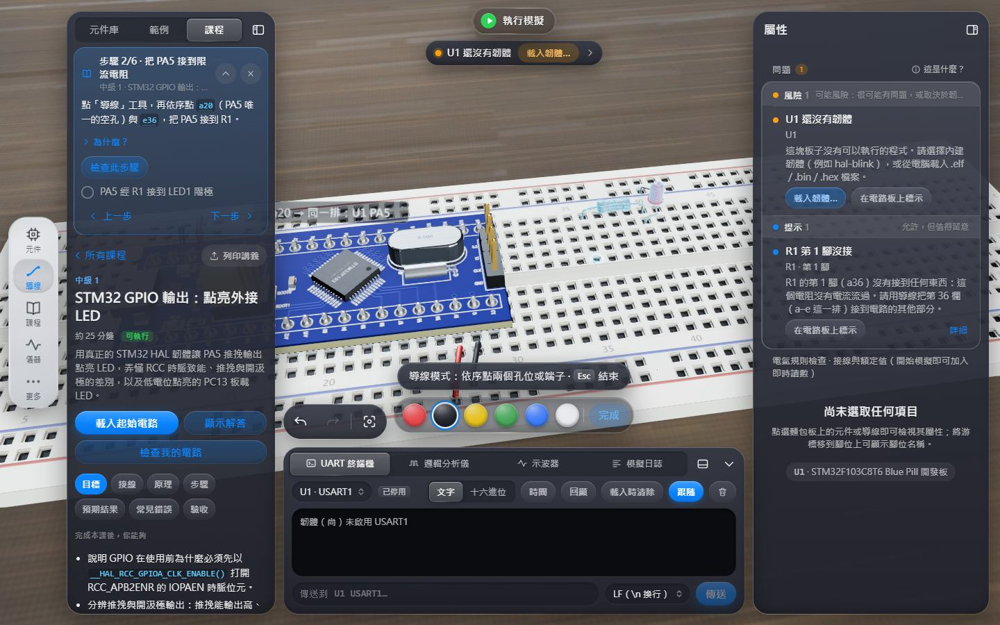

### V-02【嚴重 · P0】課程說「正在執行」，模擬其實還沒跑
- **現象：** 按「載入 hal-blink 到 U1」之後，引導卡寫「✓ U1 正在執行 hal-blink」與「U1 正在執行 hal-blink.elf。」。同一時間，膠囊寫「▶ 執行模擬」，MCU 面板寫「尚未執行」。這剛好就是「忘了按執行」這個經典錯誤的起點。3 位稽核者都發現了。
- **根因：** `src/i18n/zh-TW/lessons-ui.ts:152`、`ux-lessons.ts:14-15` 的「正在執行／執行中」用來描述「已載入」。用到的地方有 `evaluate.ts:612/620` 與 `LessonBrowser.tsx:409/481/613`。
- **計畫：** LS-8

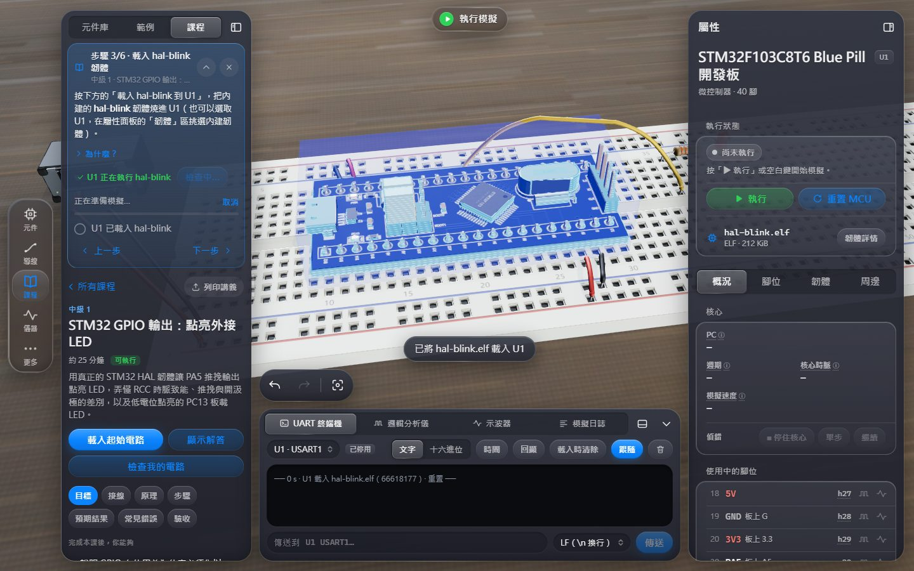

### V-03【嚴重 · P0】重置、重燒或 BOOT0 = 1 之後，ERC 誤報韌體有錯
- **現象：**
  - hal-blink 跑了 1.2 秒，暫停後按「重置 MCU」，狀態提示列變成「D1 接在 PA5，但 PA5 不是輸出——目前的韌體（hal-blink.elf）沒有把 PA5 設成輸出」。
  - 暫停時改燒 bare-blink，也會出現同樣的誤報。
  - BOOT0 = 1 時，狀態提示列寫「系統記憶體開機」，ERC 卻同時怪韌體。
  - 另外，載入 i4 的 nomoe 韌體時 LED 熄滅，問題面板卻寫「未發現問題」：TIM1 MOE = 0 的原因只寫在模擬日誌裡。noclk 的根因（GPIOA 沒有開時脈）也同樣只在日誌裡。
- **根因：** `src/sim/erc/rules-mcu.ts:766` 用的是**全域**模擬時間（`telemetry.time >= 0.5`），沒有看這塊板子自上次重置以來跑了多久。772 行的 state 'running' 也包含 PC 在系統記憶體的情況。周邊的警告（MOE、RCC）不會進入問題資料來源。
- **計畫：** IN-15

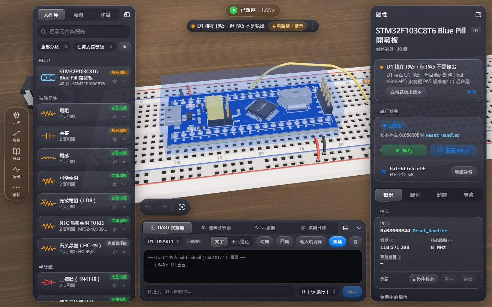

### V-04【嚴重 · P0】同一件事列兩次，而且說法不同
- **現象：**
  - 沒有韌體時，同時列出「U1 未載入韌體」（模擬器）和「U1 還沒有韌體」（MCU 狀態）。
  - U1 的檢視面板頂端偏偏只顯示**沒有動作按鈕**的那一則。
  - 手機的「更多」把沒有動作的那一則排在前面。
  - 狀態提示列算成「另 1 個」。
  - 其他重複：LED 直接接在 PA5（沒有電阻）會列出 3 列，其中一列的標題只有「U1 PA5」；燒毀、> 2 A 也有重複。
- **根因：** `src/ui/embedded/problems.ts:390-402` 只會去掉模擬器的「電源」類重複；471 行的去重是用標題的字面比對。`PropertiesSheet.tsx:347` 排除了 MCU 狀態那一列。
- **計畫：** IN-13

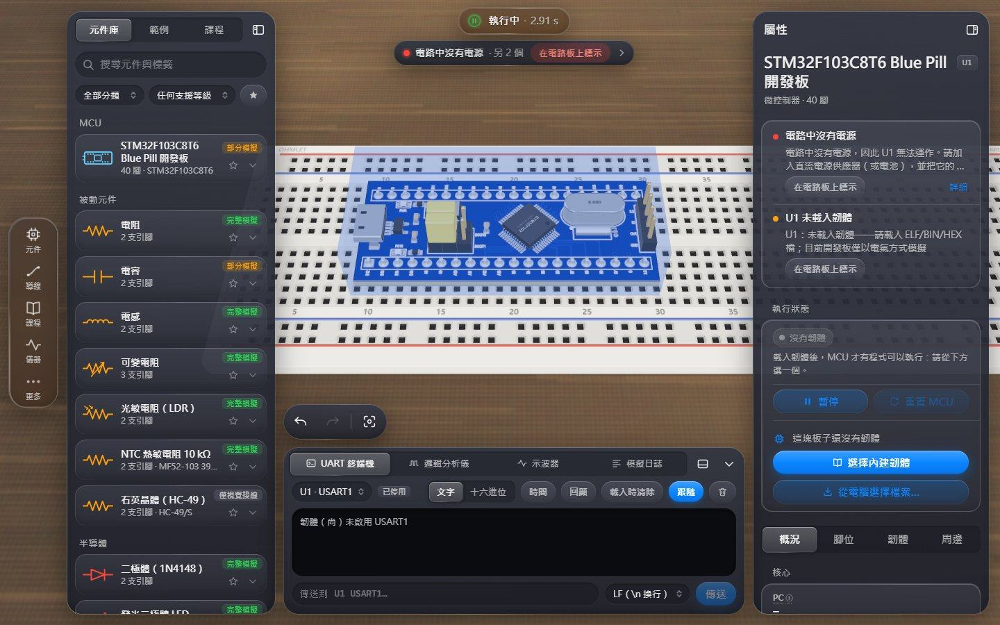

### V-05【嚴重 · P0】顯示假數字
- **現象：**
  - 只接 5V、沒接 GND 時，問題清單出現 33 則「U1 PB12：−1261957.64 V 低於 VSS − 0.3 V」，外加「求解器未收斂」，真正能動手的問題被擠到後面。
  - LED 反插時電流寫「−0 pA」。
  - 燒毀時同一個面板裡出現「267 A／622 W」，旁邊又寫「> 2 A（短路）」。
  - 電源沒接負載時，大字讀數是「5 nA」。
  - 課程把 2 Hz 寫成「≈ 0 Hz」。
- **根因：** `src/sim/coordinator/mcu-board.ts:615` 每支腳各發一則警告，`problems.ts` 沒有把它們合併；格式化函式沒有設上下限。`src/lessons/engine/format.ts:88-97` 把低於範圍下限 1 % 的值一律寫成「≈ 0」，連頻率也一樣。
- **計畫：** IN-14、LS-10

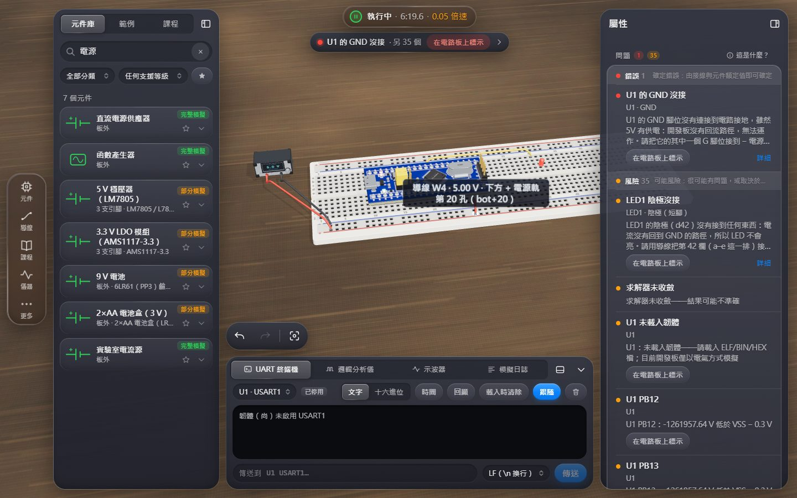

### V-06【嚴重 · P0】把非週期訊號量成頻率
- **現象：**
  - PA9（UART TX）在示波器上顯示「頻率 38.40 kHz（數位精確）· 佔空比 99.9 %」，邏輯分析儀同時寫「32.50 kHz · 47.9 %」。
  - I²C SCL 依視窗不同，分別顯示 99.25／88.53／63.10 kHz。
  - 按「自動設定」後，會短暫退回類比估算，顯示沒有「≈」的 1.010 kHz。
- **根因：** `src/instruments/measure.ts:79-83` 直接把上升緣的間隔平均成週期，沒有檢查訊號是不是週期性的。
- **計畫：** IS-11

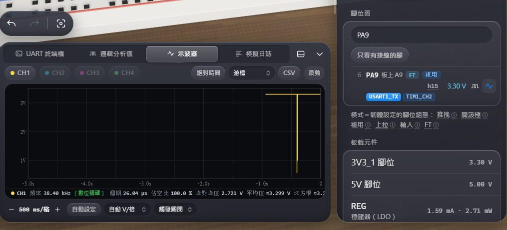

### V-07【嚴重 · P0】通道選單把 I²C 腳標成 USART1
- **現象：** 載入 hal-i2c-scan.elf 後，「使用中的腳位」列出「PB6 · USART1_TX」。範例的匯流排群組還建議「USART1（PB6 TX／PB7 RX）」。可是檢視面板和 ERC 都說 PB6 是 I²C1 SCL，三個地方說法不同。
- **根因：** `src/ui/embedded/instruments/channel-picker.ts:211-224` 先把「(remap)」去掉，所以只要 USART1 有啟用，PB6 就會被當成 USART1_TX。
- **計畫：** IS-10

### V-08【嚴重 · P0】新手最常犯的兩個錯沒有被正確指出
- **現象：**
  - LED 反插、陰極接在 PA5 那排時，問題面板寫「未發現問題」。只有兩端都接在電源軌上的反插才抓得到，而且只列為最低等級的「提示」。
  - 照建議把陰極接到上方 − 軌，可是那條軌根本沒接電源，結果建議仍然是「請接到 − 電源軌」。
- **根因：** `src/sim/erc/rules-led.ts:151` 只檢查「兩端都是電源軌」的反插，等級是 info。`rules-open.ts:100` 不管什麼情況都給同一句修法。
- **計畫：** IN-17

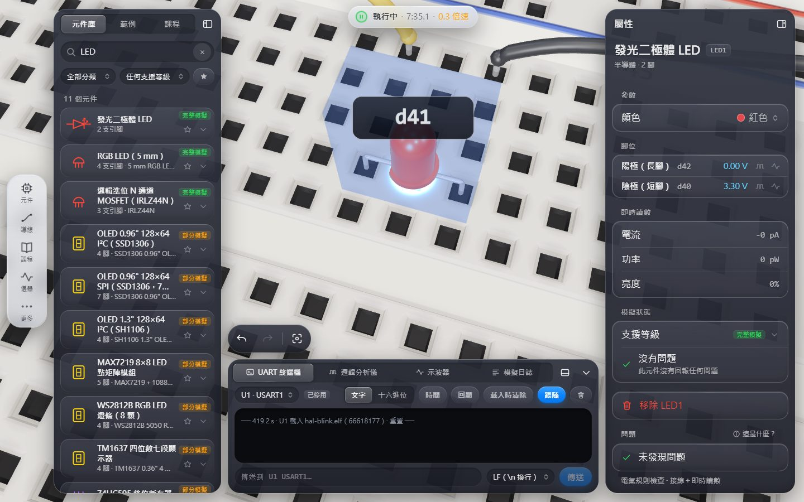

### V-09【嚴重 · P0】鍵盤：點過面板按鈕後，空白鍵和 F5 不再是「執行」
- **現象：**
  - 點過檢視面板的「單步」之後，F5、F10、Shift+F5 都完全沒有反應，空白鍵反而再單步一次。
  - 點「重置 MCU」後按空白鍵，會再重置一次，UART 出現兩條「U1 重置」分隔線。
  - 學生照課程文字按空白鍵，觸發的是引導卡的「下一步」。
  - 暫停時按 F10，提示叫你「先按 F5 停住核心」，照做按 F5，模擬卻開始跑了。
  - 快捷鍵清單寫著「焦點在 3D 畫面或面板上時都能用」，和實際行為相反。
- **根因：** `src/ui/workspace/Workspace.tsx:56` 的 `guardKeys` 擋掉面板內所有不含修飾鍵的按鍵；`App.tsx:813-820` 遇到焦點在按鈕上時，空白鍵直接交給按鈕；`App.tsx:500-505` 在暫停時的提示寫錯。
- **計畫：** SH-9

### V-10【嚴重 · P0】換了電路，課程引導還在講舊電路
- **現象：** 先開始第一課，再開啟 blink 範例。引導卡仍然顯示「步驟 1/6 · 認識電源與電源軌……LED1 插在 c14」，狀態提示列的「電路已就緒」被壓掉，重新整理後還會恢復 b1。
- **根因：** `src/ui/lessons/actions.ts` 只在 121 行和 166 行停止引導。開範例、匯入專案、新電路都不會停止。
- **計畫：** LS-9

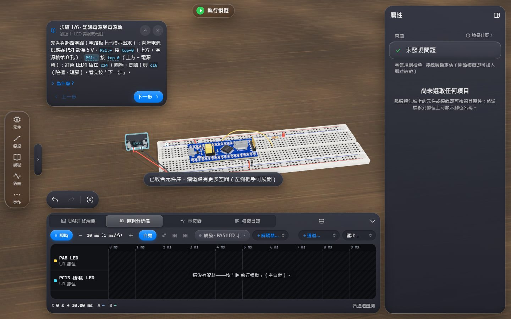

### V-11【嚴重 · P0】暫時性與「執行後才知道」的問題一直掛著
- **現象：**
  - spi-595 執行 4 秒後，狀態提示列仍然掛著 3 則「U2 74HC595 輸入浮接」，可是波形明明顯示這些腳有在動。
  - button-exti 這個正常的範例一打開，狀態提示列就是琥珀色的「U1 PB12 輸入浮接」：上拉是韌體開的，執行後才會解除。
- **根因：** `src/sim/models/serial-ics.model.ts:378` 只警告一次（floatWarned），之後從不撤回；靜態 ERC 不知道韌體會怎麼設定腳位。
- **計畫：** IN-16，狀態提示列配合修改在 SH-13

### V-12【嚴重 · P0】經典英文外觀被改動
- **現象：** 英文加經典外觀時：
  - 導覽變成新版的「This is an STM32 electronics lab / Start lesson 1」。
  - MCU 檢視面板變成新版的分頁。
  - F5 不再重新整理頁面，而是開始模擬。
  - ? 會打開快捷鍵清單，清單上還列了經典外觀裡沒有作用的 F 鍵。
- **根因：** `Onboarding.tsx` 和 `PropertiesSheet.tsx` 沒有 `useLegacyChrome()` 分支；`App.tsx:751-760` 只對 F 鍵做了 gating。7 個 legacy 視覺場景都沒有涵蓋這些畫面。
- **計畫：** SH-10、IN-18

### V-13【嚴重 · P0】放置被拒時，給了錯的修法
- **現象：** Blue Pill 點在 e10，吐司寫「封裝會超出標準麵包板（63 欄）——請改用加大 XL 麵包板或把它往左移」。真正的原因是列不對：Blue Pill 要跨在中央溝槽上，應該點 h 列。
- **根因：** `src/ui/chrome/hints.ts:127-146` 的 `placementRefusedHint` 優先採用驗證器給的理由。
- **計畫：** SH-11

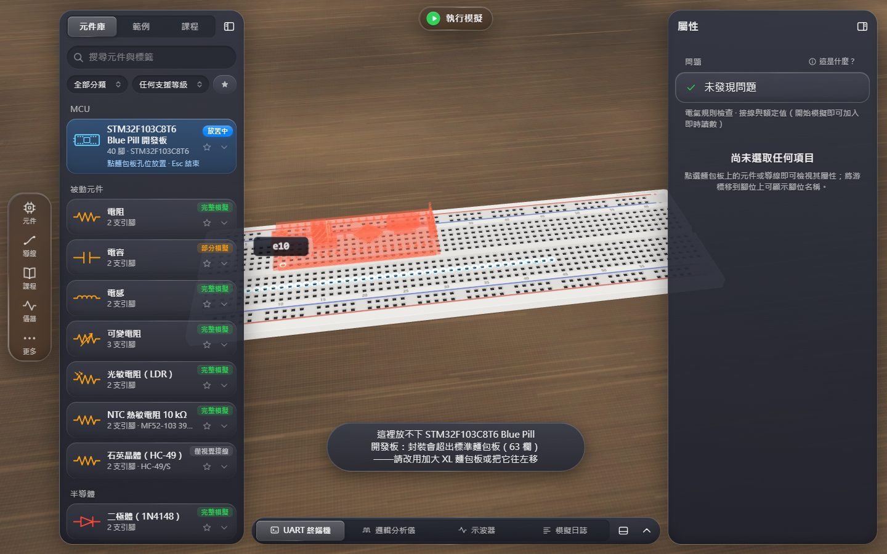

### V-14【嚴重 · P1】課程的標示把要觀察的 LED 罩住了
- **現象：** b1 步驟 5「LED1 應該亮起」：LED 被青色的全像外殼罩成淡白色，完全看不到紅光。i1、i4 的 LED 約 10 px，而且被外殼蓋住。i4 要求的「LED1 明顯比 LED2 亮」根本看不出來。
- **計畫：** SC-10；觀察步驟的取景由 LS-12 負責

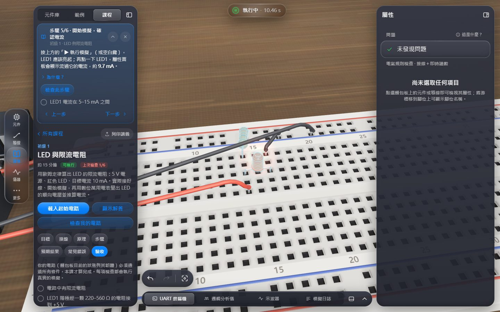

### V-15【嚴重 · P1】引導卡在幾個步驟沒有「下一步」
- **現象：**
  - 按「拿一顆電阻」放好之後，工具仍停在放置模式，也沒有選取 R1，所以「把電阻值設為 330 Ω」看不到下一個動作。
  - 「加入 PA5、PC13 兩個通道」沒有一鍵按鈕。
  - 最後一步只剩「上一步」。按「檢查我的電路」之後，最可能的原因與「下一課」都在畫面外（y = 936–986，視窗高 900）。
  - i4 步驟 5 要求用萬用電表量 PA8，可是電路裡沒有電表。
- **計畫：** LS-11、LS-12

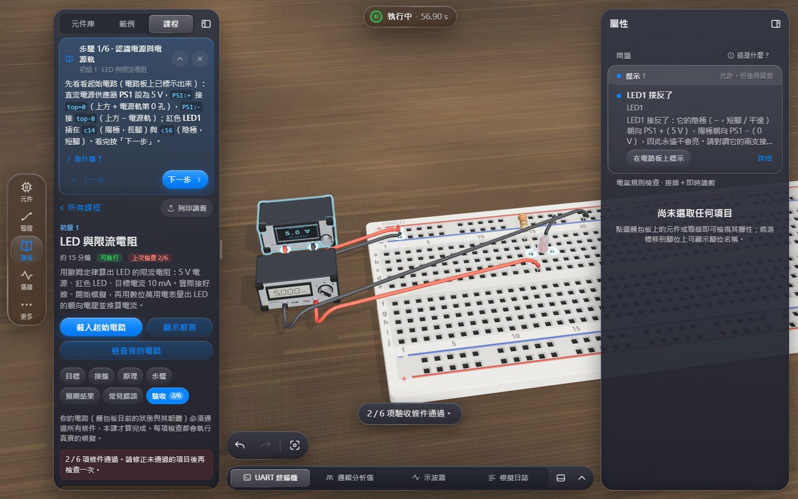

### V-16【嚴重 · P1】從問題到元件，只做了一半
- **現象：**
  - 按「在電路板上標示」，鏡頭會移過去，但不會選取那個元件，檢視面板還停在 U1。
  - 「提示」等級只移鏡頭，什麼都不標。
  - 問題列裡的「D1、U1 · PA5」是純文字，不能點。
  - I²C 上拉的問題只描出整塊板子，沒有指出 PB6／PB7。
  - 同一個 LED 面板，上方是問題卡，下方卻寫「沒有問題 · 此元件沒有回報任何問題」。
- **計畫：** IN-19；「提示」等級的標示層由 SC-11 提供

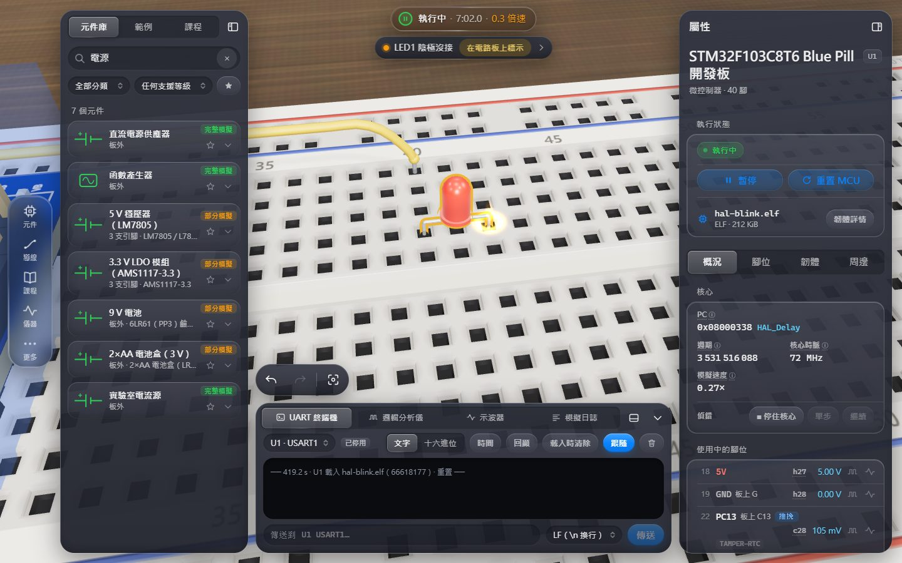

### V-17【嚴重 · P1】儀器通道和電路斷線，名稱也對不起來
- **現象：**
  - 邏輯分析儀的通道標籤、示波器的 CH chip，點了都沒有反應，無法回到 3D。
  - 從 LED 陽極加入的通道，名稱變成「b40 / 網路 b40 ≈」。
  - 重複加入時的提示寫「已在邏輯分析儀（通道 D0）」，可是畫面上沒有任何地方顯示 D0。
  - 同一個網路可以放兩支探棒，邏輯分析儀卻會拒絕重複的通道，兩邊規則不一致。
- **計畫：** IS-13；探測選單的配合修改在 SC-14

### V-18【嚴重 · P1】名稱、術語與格式不一致
- **現象：** 見 5.4 節的三張表，以及導線端點只寫「j27」、模式只寫「複用」（另一邊卻寫「複用開汲極」）、ERC 參考資料是英文（「DS5319 Table 7 (25 mA per pin)…」）。
- **計畫：** 共用 helper（第 7.1 節），以及 IN-20、IS-17、LS-13、SC-17、SH-14、SH-17

### V-19【嚴重 · P1】PWM 網路的「電壓」在四個地方有四種值
- **現象：** PA6 在跑 1 kHz PWM：懸停晶片寫「3.10 V」，腳位列有時寫「0 mV」、有時寫「3.10 V」，導線面板用大字寫「電壓 0 mV」，同一個畫面下方的示波器卻是「1.000 kHz · 平均 1.011 V」。沒有任何地方標示這是「瞬時值」。
- **計畫：** IS-12（helper）、IN-21、SC-12

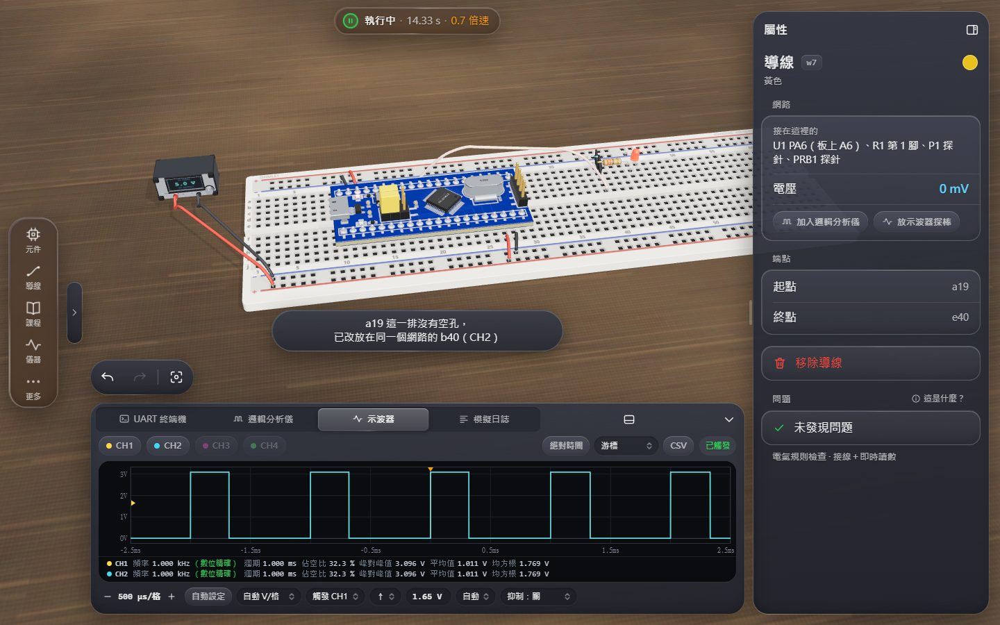

### V-20【嚴重 · P1】手機上的斷點
- **現象：**
  - 課程進行中狀態提示列整段隱藏，連「電路中沒有電源」這種錯誤也看不到。
  - 長按孔位沒有探測選單。
  - 開範例後麵包板偏下、被裁切，上方約 40 % 是空的。
  - 「儀器」開在示波器，而且寫「請放置探棒並按「執行」」，可是模擬早就在跑。
  - 照 i1 步驟 1 點 Blue Pill，屬性 sheet 一打開，引導卡就消失了。
- **計畫：** LS-14、SC-14、SH-15、IS-14

### V-21【嚴重 · P1】導線不能改接
- **現象：** 拖導線的端點沒有任何作用，store 也只有 addWire 和 removeWire。i4 步驟 7「把 R2 的導線從 a25 改接到 a19」只能先刪掉再重畫。
- **計畫：** SC-13，store 動作由 IS-18 提供

### V-22～V-26【輕微】
- **V-22 接線提示只寫孔號，接好沒有確認**：只寫「從 a25 拉線」，接好時只有一聲震動回饋，沒有任何文字確認。→ SH-12
- **V-23 儀器的空白狀態說錯原因**：
  - MCU 沒供電時，邏輯分析儀叫你「按自動縮放」。
  - 示波器在 2 µs/格整個全黑；在 1 µs/格說「沒有探棒、請按執行」。
  - SPI 解碼器出現英文「SCK idle level ≠ CPOL 0」。
  
  → IS-14
- **V-24 分析流程被介面打斷**：
  - 放好的標記被自動模式帶走。
  - 新增解碼器後，視窗跳到最新的訊框。
  - 解碼結果表和底部列重疊。
  - 標記的時間只到毫秒。
  - B 標記沒有吸附到邊緣（吸附半徑只有 6 px）。
  
  → IS-15
- **V-25 可讀性**：
  - 桌面空白卡的內文對比只有 2.2:1。
  - 示波器讀數是 11 px。
  - 快捷鍵對話框沒有焦點陷阱。
  - 沒有 F6 可以在面板之間跳轉。
  
  → SH-16、IS-20
- **V-26 專家效率**：
  - 把韌體拖到 3D 畫布沒有反應。
  - MCU 分頁不會記住上次的位置。
  - 偵錯按鈕的提示文字沒有寫出快捷鍵。
  - 「未供電」是紫色，其他地方是紅色。
  
  → SC-15、IN-21、SH-14

---

## 7. 修正計畫

5 條工作流的檔案所有權沿用 UX_REVIEW §6.2。共用 helper 由一條工作流提供，其他工作流各自在自己的項目中採用。項目編號接續上一輪。

### 7.1 先做：共用 helper（跨工作流契約）

| Helper | 提供者 | 使用者 | 內容 |
|---|---|---|---|
| H1 `pinLabel()`／`terminalLabel()`（`src/i18n/parts.ts`，擴充 K11） | WS4 | WS1、WS2、WS3、WS5 | 完整寫法：「U1 PA5（板上 A5）」「LED1 陽極（長腳）」「PS1 正端」「U1 3V3（板上 3.3）」；簡寫：「U1 PA5」 |
| H2 `endpointName()`（`hole-chip.ts`） | WS2 | WS1、WS4、WS5 | 「U1 PA0（a25）」「a25（U1 PA0 這一排）」「上方 − 電源軌 第 20 孔」「PS1 正端」 |
| H3 單位格式（`src/instruments/format.ts`） | WS5 | 全部 | 電壓、電流、功率、頻率、百分比、倍速、模擬時鐘、「≈」的唯一格式，並設下上下限（「0 A」不會出現 −0；> 2 A 顯示「> 2 A（短路）」；非有限值顯示「—」） |
| H4 `netLiveSummary()`（`src/instruments/measure.ts`） | WS5 | WS4、WS2 | 網路是直流還是 PWM（頻率、工作週期、平均值），以及最近有沒有邊緣 |
| H5 問題契約 v2（`problems.ts`） | WS4 | WS1、WS3、WS5 | `Problem.fact` 去重、`pendingRuntime`、`ProblemsState.layout`、`boardBlocker(id)`；按「在電路板上標示」時也選取元件 |
| H6 `STATE_TONE`／`withKey()`（`run-control.ts`、`ShortcutsSheet.tsx`） | WS1 | WS4、WS5 | 狀態色的唯一對照表；按鈕的提示文字自動帶出快捷鍵 |
| H7 場景標示 API（「提示」等級、懸停時的暫時標示、取景仰角） | WS2 | WS3、WS4、WS5 | 「提示」等級畫藍色光圈；`highlightSource()` 只標示、不移動鏡頭；`frameTargets()` 可指定最小仰角（接線步驟用） |
| H8 store 動作（`moveWireEnd`、`swapLeads`、ID 正規化） | WS5 | WS2、WS4、WS3 | 改接和對調兩腳各算一個復原步驟；載入時 PB→SW、w→W |
| H9 用詞表與用詞測試（`tests/ux-shell-terms.test.ts`） | WS1 | 全部 | 第 5.4 節的唯一寫法；中文字最小 12 px |
| H10 `activePinFunction()` | WS5 | WS4 | 腳位列與通道選單共用同一個判斷 |
| H11 `acceptFirmwareFile()` | WS4 | WS2 | 讓 3D 畫布可以接受拖放的韌體檔 |

沒有歸屬的檔案這次指定給：`scripts/visual-regression.mjs`、`scripts/glass-a11y-probe.mjs`、`scripts/i18n-audit.mjs` → WS1；`src/sim/coordinator/**`（只限 IS-16）、`scripts/build-examples.mjs` → WS5。

### 7.2 各工作流項目

**WS1 殼層**

| ID | 優先 | 內容 | 驗收 |
|---|---|---|---|
| SH-9 | P0 | 鍵盤路由：在 window capture 階段處理空白鍵與 F5／F10。用滑鼠點過的按鈕失去焦點；暫停時按 F10 會直接停住核心並單步；經典外觀不攔截這些鍵 | 點過任何面板按鈕後，空白鍵、F5、F10、Shift+F5 的效果 5/5 正確；用 Tab 移到按鈕再按空白鍵，仍然觸發那顆按鈕 |
| SH-10 | P0 | 經典外觀回歸：導覽恢復原本的 3 張卡；新增 2 個 legacy 視覺場景 | 新增的場景與 `6d01968` 的畫面 0 差異 |
| SH-11 | P0 | 放置被拒時給正確的理由：列不對時寫「請點 h 列」 | 點 e10 時，吐司寫 h 列 |
| SH-12 | P1 | 接線提示寫出兩端名稱；接好時顯示「已接上 U1 PA0 → 上方 − 電源軌（GND）」 | — |
| SH-13 | P1 | 狀態提示列不說謊：問題算完之前不顯示「已就緒」；加上「· 1 項執行後確認」；空白麵包板不能執行；三種計數一致 | — |
| SH-14 | P1 | 狀態色表；膠囊的時間與速度採用 H3（「187.8 s · 0.2 倍速」） | — |
| SH-15 | P1 | 手機：長按可以打開探測選單；側邊內縮改變後重新取景 | — |
| SH-16 | P1／P2 | 可讀性：空白卡對比 ≥ 4.5:1、中文字 ≥ 12 px、焦點陷阱、F6 | — |
| SH-17 | P1 | H9 用詞表與用詞測試 | — |

**WS2 3D 與場景**

| ID | 優先 | 內容 |
|---|---|---|
| SC-9 | P0 | 瞄準時一律以孔位為準：點擊和懸停晶片共用 `resolveAimTarget()`；不再有沒有回應的點擊 |
| SC-10 | P1 | 會發光的元件不用全像外殼；執行中一律改用光圈加外框；LED 旁顯示即時亮度「LED1 97 %」 |
| SC-11 | P1 | H7 標示 API |
| SC-12 | P1 | 懸停晶片：固定的螢幕字級、不超出可見區、端子也有晶片、懸停在本體上改用中性晶片、PWM 網路採用 H4；提供 H2 |
| SC-13 | P1 | 選取導線後出現端點把手，可以拖曳改接 |
| SC-14 | P1 | 手機長按探測；探測選單裡已經加入的項目改成「在邏輯分析儀中顯示」 |
| SC-15 | P1 | 把韌體拖到 3D 畫布時出現覆蓋層 |
| SC-16 | P2 | 觸控時「+」只在放置模式出現；新增 `setDockedChrome()` |
| SC-17 | P2 | 元件庫與範例用詞（腳、初級、微控制器）；搜尋排序 |

**WS3 課程**

| ID | 優先 | 內容 |
|---|---|---|
| LS-8 | P0 | 「已載入」和「執行中」分開；只有模擬真的在跑時才寫「執行中」 |
| LS-9 | P0 | 換了電路就結束引導；非同步載入加世代檢查 |
| LS-10 | P0 | 頻率和工作週期不再夾成「≈ 0」 |
| LS-11 | P1 | 步驟動作：放一顆就選取它；「把 R1 設為 330 Ω」；「開始接線」；「加到邏輯分析儀」；i4 補上電表 |
| LS-12 | P1 | 最後一步加「前往驗收」並捲到結果；觀察步驟的 LED 至少 30 px |
| LS-13 | P1 | 課程用語：H1 寫法、「在電路板上標示」、SW1 |
| LS-14 | P1 | 主要按鈕的層級；手機引導（裝置文字、sheet 打開時收合、標題列顯示問題） |
| LS-15 | P2 | 讀數和預期值比對；收據加姓名；學生版講義 |

**WS4 檢視面板與問題**

| ID | 優先 | 內容 |
|---|---|---|
| IN-13 | P0 | 用「事實」去重，用詞統一；檢視面板頂端只放 1 列加「另 n 個」 |
| IN-14 | P0 | 不顯示假數字：連帶的讀數併到根因底下；格式上下限；電源未接負載 |
| IN-15 | P0 | ERC 規則要知道 MCU 的狀態：每塊板子各自計算穩定時間；系統記憶體；把周邊警告轉成問題（MOE、RCC） |
| IN-16 | P0 | 開機瞬間的浮接警告由即時讀數撤銷；執行前依賴韌體的發現標為「執行後確認」 |
| IN-17 | P0 | LED 反插（含 GPIO）與沒供電的電源軌 |
| IN-18 | P0 | 經典外觀的屬性面板恢復原樣 |
| IN-19 | P1 | 問題 → 選取元件並捲到腳位；問題位置可以點；載入韌體直接打開選擇器；「沒有問題」不再和問題卡矛盾；新增「對調兩腳」 |
| IN-20 | P1 | 腳位、端點、ERC 用語採用 H1／H2；「複用推挽」；參考資料中文化 |
| IN-21 | P1 | MCU 面板：狀態色、按鈕的快捷鍵提示、記住分頁、PWM 讀數、BIN 版面 |

**WS5 儀器**

| ID | 優先 | 內容 |
|---|---|---|
| IS-10 | P0 | 重映射的功能只在 MAPR 已知時才採用；開汲極優先判為 I²C；提供 H10 |
| IS-11 | P0 | 非週期訊號不給頻率（UART 改顯示鮑率，突發時脈取中位數）；自動設定後不退回類比估算 |
| IS-12 | P0 | H4 `netLiveSummary()`（IN-16 需要） |
| IS-13 | P1 | 通道與電路雙向連結；顯示名稱；重複時改為顯示既有的那個 |
| IS-14 | P1 | 空白狀態依真正原因顯示；示波器的三種空白狀態；手機 sheet 開在範例用到的儀器；SPI 訊息中文化 |
| IS-15 | P1 | 標記、跟隨、視窗、時間解析度、吸附、解碼表版面 |
| IS-16 | P1 | 類比網路通道沒有越過門檻時，提示「改用示波器」 |
| IS-17 | P1 | H3 單位格式；「工作週期」 |
| IS-18 | P1 | H8 store 動作與 ID 正規化 |
| IS-19 | P2 | 「量測」分頁（電表讀數常駐） |
| IS-20 | P2 | 潤飾（示波器讀數字級、活動密度帶、UART 時間、手機工具列） |

### 7.3 建議順序

1. **第 1 週：** 各工作流先完成自己負責的 helper，以及所有 P0：IS-12、IS-10、IS-11、IN-13～IN-18、SC-9、LS-8～LS-10、SH-9～SH-11。
2. **第 2 週：** 採用 H1／H2／H3，完成 P1，收斂命名與格式。
3. **之後：** P2 與 backlog。

**每個 P0 都要有一支 Playwright 驗收腳本，重跑本次的稽核任務。** 例如：用課程自動取景的鏡頭點 a20、點過「重置 MCU」後按空白鍵、沒接 GND 時畫面上不得出現 |V| > 1 kV 的數字、i2c-scan 的 PB6 不得被標成 USART。

---

## 8. 必須保留（不可改壞）

- 執行狀態在膠囊、狀態提示列、MCU 面板、toast 上用同一套用詞與顏色（偵錯停住、故障、BOOT0）。
- 狀態提示列只講一件事，並附一顆動作按鈕；更新頻率 ≤ 1 Hz（實測每秒 0 次 DOM 變動）。
- 第一次使用的路徑：3 張導覽卡加 3 個入口；範例路徑 4 次點擊。
- 課程：一鍵動作；引導卡嵌在面板內、不遮 3D；重新整理後恢復；1 次點擊到下一課；檢查結果先講「最可能的原因」、合併連帶失敗的項目、數值用人看得懂的單位。
- 邏輯分析儀 0 次點擊自動縮放、不顯示 mHz；解碼器從 logicView 載入；解碼結果表可以搜尋並跳轉；UART 的某一行可以跳到波形並放上標記；換韌體與重置時插入分隔線。
- 示波器在慢時基下拒絕給頻率（新增非週期判斷時要保留這一層）。
- 右鍵探測選單、腳位列的 ⎍／∿、導線面板的網路成員與探測鈕。
- 懸停晶片的即時資訊（「PA5（板上 A5）· 推挽輸出 · 3.10 V · c20」）與「同一排」說明。
- 放置與接線：紅色預覽、可放的列發光、寫出出口、依慣例配色、「完成」鈕。
- MCU 說實話：「—」加原因、BIN 沒有向量表的警告、CFSR 位元說明、內建韌體選擇器。
- Liquid Glass Tier-S、玻璃預算 ≤ 4／≤ 3、遵守減少動態效果設定；不做每一影格的 React 運算；localStorage 一律包在 try/catch 裡。

---

## 9. 這次仍不做（Backlog）

- 中斷點與反組譯（ENG-09）、時脈樹（ENG-14）、「只看韌體用到的」周邊篩選：需要擴充模擬協調器的 API。
- 投影模式（TR-14）：先觀察取景改善與 H9 的 12 px 下限，再決定是否要做。
- 專案任務卡、老師版隱藏解答（T8、TR-15 的一部分）：需要擴充專案檔格式。
- 分割版面、同時顯示兩種儀器（AN-04）。
- 「量測」分頁（IS-19）列為 P2：工作量大，等 P1 完成後再做。

---

## 附錄 A：複查發現 → 問題 → 計畫

| 複查發現 | 問題 | 計畫 |
|---|---|---|
| F-01、TR-01 | V-01 | SC-9、LS-11 |
| F-03、TR-07、N1 | V-02 | LS-8 |
| RV-01、COH-02、F-14、TR-08 | V-03 | IN-15 |
| COH-01、F-07、N2、RV-06、AN2-19、E2-11 | V-04 | IN-13 |
| F-04、E2-05、F-18、E2-20、RV-04 | V-05 | IN-14、LS-10 |
| E2-04、AN2-14、AN2-07 | V-06 | IS-11 |
| E2-02 | V-07 | IS-10 |
| F-05、TR-10、F-06、N12 | V-08 | IN-17 |
| E2-01、COH-03、F-02、E2-09、RV-07 | V-09 | SH-9 |
| RV-02、RV-09 | V-10 | LS-9 |
| AN2-02、N7 | V-11 | IN-16、SH-13 |
| RV-03、RV-07 | V-12 | SH-10、IN-18 |
| F-08 | V-13 | SH-11 |
| TR-02、F-12 | V-14 | SC-10、LS-12 |
| TR-03、TR-04、F-11、TR-05、F-15、TR-17 | V-15 | LS-11、LS-12 |
| F-09、COH-07、E2-10、N3、N13、F-10、TR-09、COH-19 | V-16 | IN-19、SC-11 |
| N4、AN2-03、COH-08、AN2-10、COH-13、AN2-17 | V-17 | IS-13、SC-14 |
| COH-05、E2-03、TR-06、N10、F-17、COH-09、AN2-11、COH-10、COH-15、TR-16、N11、E2-07、E2-08、N20、COH-11、TR-13、RV-05、COH-20 | V-18 | H1–H3、H8、H9、IN-20、IS-17、IS-18、LS-13、SC-17、SH-14、SH-17 |
| AN2-01 | V-19 | IS-12、IN-21、SC-12 |
| N8、N9、AN2-13、N18、E2-21、E2-12、F-16、N21、RV-08 | V-20 | LS-14、SC-14、SH-15、IS-14、SC-16 |
| TR-12 | V-21 | SC-13、IS-18 |
| COH-06、TR-19 | V-22 | SH-12 |
| COH-12、TR-18、AN2-06、F-21、AN2-12 | V-23 | IS-14 |
| AN2-08、AN2-09、E2-06、E2-18、E2-19、F-13 | V-24 | IS-15 |
| N5、N24、N17、RV-11、RV-10、AN2-15 | V-25 | SH-16、IS-20 |
| E2-13、E2-17、COH-16、E2-15、COH-04、COH-17、E2-16、RV-12 | V-26 | SC-15、IN-21、SH-14 |
| N6、F-19 | （課程頁的按鈕層級） | LS-14 |
| COH-14、N16、F-20、E2-14 | （懸停晶片） | SC-12 |
| COH-18、N14、N15、N22 | （狀態提示列） | SH-13 |
| AN2-04 | （類比門檻） | IS-16 |
| AN2-05 | （量測分頁） | IS-19 |
| TR-11、TR-15 | （教學） | LS-15 |
| AN2-16、AN2-18、AN2-20、N19 | （儀器潤飾） | IS-20 |
| AN2-21 | （範例搜尋） | SC-17 |
| TR-14 | （投影） | Backlog |

## 附錄 B：調整或剔除的發現

- **COH-17（「已暫停」的顏色）只部分成立。** 膠囊上的綠色 ▶ 是「按這裡執行」的動作圖示，不是狀態色，不需要改。要統一的只有狀態標籤的顏色（交給 H6），所以這一項降為 P2。
- **E2-01「焦點在面板時按 F5 會重新整理頁面」** 是依照瀏覽器預設行為推論的，無頭模式下無法重現。不過程式碼確實沒有對這種情況呼叫 preventDefault（`Workspace.tsx:56` 擋掉了事件），而 SH-9 會一併處理。
- **RV-09（課程非同步載入的競態）** 只有讀程式碼，沒有重現。因為成本很低，併入 LS-9 一起加上世代檢查。
- **成功指標 4 的「1 秒內」：** 在 0.02–0.6 倍速的負載下無法精確量測，判定「附條件達成」。
- **AI 相關功能：** 環境缺少 SDK，這次全部沒有測試，不列入任何結論。
- 其他列入計畫的發現都已對照原始碼確認：根因的檔案與行號列在第 6 節。沒有任何一則因為「不成立」而被剔除。

## 附錄 C：截圖

| 檔案 | 內容 |
|---|---|
|  | 第一次使用的導覽最後一張：「開始第一課／先看範例」 |
| 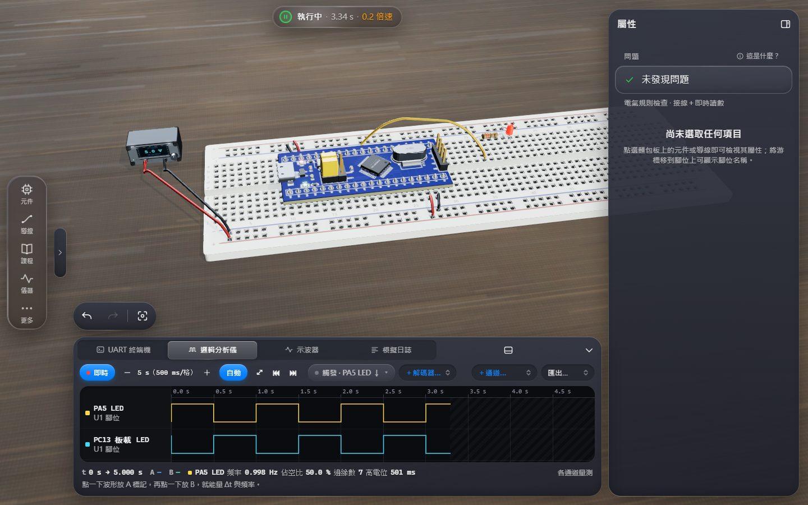 | blink：邏輯分析儀 0 次點擊，自動顯示 0.998 Hz |
| 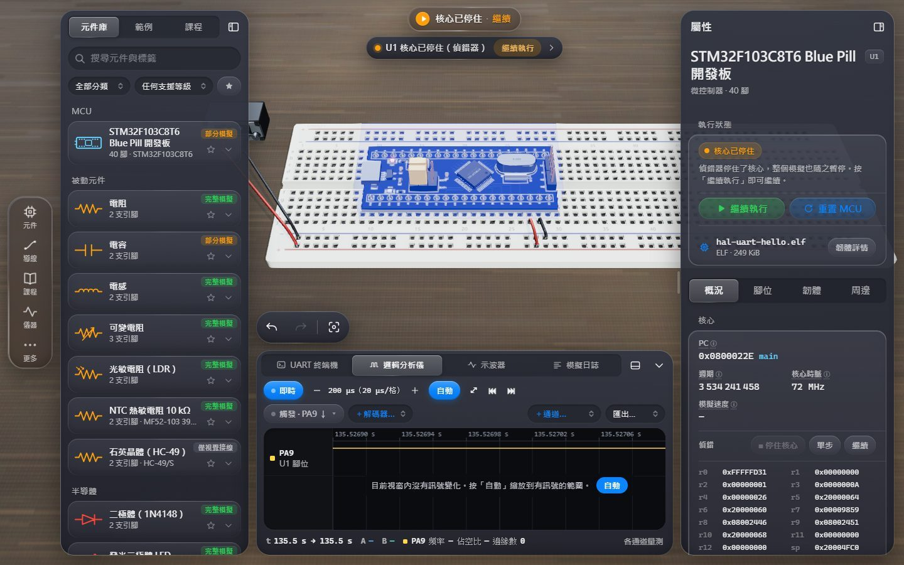 | 偵錯停住時，膠囊、狀態提示列、MCU 面板用同一套詞和顏色 |

另外 13 張截圖已穿插在第 6 節各問題之中。
